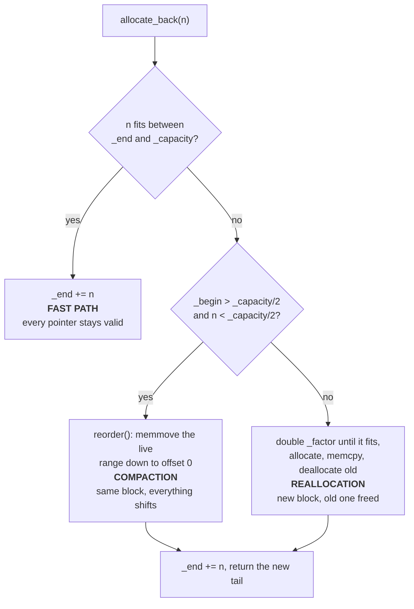

# The pipe: qb's one buffer

> **Audience:** Contributor · **Status:** stable · **Verified-against:** qb 3.2.1 (C++20 default, C++23 supported) — 0cd84ee2

`qb::allocator::pipe<T>` is a single growable allocation with three cursors on it. It backs every I/O stream in the framework, and the rules people trip over — why a `view()` dies at the next `put`, why draining a socket is O(1) per turn, why a stream's memory never comes back — are all consequences of those cursors rather than separate policies. The event pipes of a `VirtualCore` are its sibling, `qb::allocator::segmented_pipe<T>`: same cursor vocabulary, but growth links a segment instead of reallocating, so an event never moves once queued — [the Events section](#events) is that story.

**Prerequisites:** none — **See also:** [Foundations overview](./README.md) · [Inter-actor messaging](../4_qb_core/messaging.md) · [Transports](../3_qb_io/transports.md) · [Core invariants](../7_reference/core_invariants.md)

## The model

A pipe owns **one** contiguous block of `T` and three indices into it. Nothing else. There is no node, no chunk list, no free list.

```
        _data
          |
          v
          +----------------+=================+----------------+
          |    retired     |      live       |     spare      |
          +----------------+=================+----------------+
          0             _begin             _end           _capacity

          size()     == _end - _begin          the readable elements
          begin()    == _data + _begin         where a reader starts
          end()      == _data + _end           one past the last live element
          capacity() == _capacity              the whole block
```
<!-- src: qb/src/qb/system/allocator/pipe.h:64-69 -->

`_begin` and `_end` are plain `std::size_t`. Advancing one is a single integer add; nothing is moved, nothing is destroyed, no allocator is consulted. That is the entire performance story, and also the entire hazard story.

A fourth member, `_flag_front`, records *which end* the last allocation came from, so a later `free()` retracts from the right side (`qb/src/qb/system/allocator/pipe.h:66`, `:345-351`). A fifth, `_factor`, is the growth counter. A default-constructed pipe allocates `_SIZE = 4096` **elements** up front — 4 KiB for a `pipe<char>`, 256 KiB for a `pipe<EventBucket>` (`qb/src/qb/system/allocator/pipe.h:61`, `:77-83`).

### The four operations

| Operation | Does | Cost |
|---|---|---|
| `allocate_back(n)` | reserve `n` elements at `_end` | O(1) on the fast path; see below for the other two branches |
| `allocate(n)` | reserve `n` at `_begin` if there is room there, otherwise fall through to `allocate_back` | O(1) on the front branch |
| `free_front(n)` | `_begin += n` — retire consumed elements | O(1), always, unconditionally |
| `free_back(n)` | `_end -= n` — give back an unused reservation | O(1), always |

<!-- src: qb/src/qb/system/allocator/pipe.h:275-288, :361-398, :488-497 -->

`free_front` and `free_back` are `noexcept` and do not check anything. They do not destroy elements, they do not zero memory, and they do not return storage to the allocator. Two composites round the set out: `reset(pos)` sets `_begin` to `pos`, or resets both cursors to zero when `pos == _end` (`qb/src/qb/system/allocator/pipe.h:298-306`); `reset()` zeroes both cursors and clears `_flag_front` (`:313-318`). `reorder()` `memmove`s the live range down to offset 0 (`:584-592`).

## What `allocate_back` actually does

This is the function everything else reads off, and it has three branches:


<!-- src: qb/src/qb/system/allocator/pipe.h:361-398 -->

The fast path is the common case and it invalidates nothing. The other two both invalidate every pointer, reference and index into the buffer — and they are not equally dangerous.

**Reallocation is the safe failure.** The old block is handed back to `std::allocator`. A stale pointer into it points at freed memory, which ASan, Valgrind and a hardened allocator all catch on the first dereference.

**Compaction is the dangerous one.** `reorder()` `memmove`s within the *same live allocation* (`qb/src/qb/system/allocator/pipe.h:589`). A stale pointer still addresses valid, mapped, in-use memory — it now simply refers to *a different element*. No allocator debugger can see that, because nothing invalid has happened at the allocator level. Reallocation would be loud; compaction is silent, and compaction is what a busy pipe does far more often. Until 3.2 this was the mechanism behind the framework's sharpest rule — the reference `Actor::push()` returned died at the very next event queued to the same destination core — and it is the first of the two reasons the event pipes moved off this allocator ([Events](#events)).

Growth is geometric: `_factor` doubles until the request fits, and the new capacity is `_factor * 4096` elements (`qb/src/qb/system/allocator/pipe.h:375-381`). Two guards throw `std::bad_alloc` rather than wrapping — one when `_factor` would exceed `1 << (sizeof(size_t) * 4)` (`:377-378`), one when the arithmetic would still not fit (`:383-384`). Both are reachable only through a size that no legitimate caller produces, and they are the pipe's only `throw`.

### `allocate()`, the front branch, and why `send` is unordered — the mechanism, and the one that replaced it

`allocate(n)` tries the *front* first:

```cpp
inline auto
allocate(std::size_t const size) {
    if (_begin >= size + 1 && (_begin - size - 1) < _end) {
        _begin -= size;
        _flag_front = true;
        return _data + _begin;
    }
    _flag_front = false;
    return allocate_back(size);
}
```
<!-- src: qb/src/qb/system/allocator/pipe.h:488-497 -->

The retired region in front of `_begin` is memory the pipe already owns and nobody is reading. Carving an object out of it costs one subtraction, and — crucially — the resulting element is **outside** the `[_begin_old, _end)` range a reader will walk. Pair that with `free(n)`, which consults `_flag_front` and retracts from whichever end the allocation came from (`qb/src/qb/system/allocator/pipe.h:345-351`), and you have an allocation that can be made and then *unmade* without disturbing anything queued.

That pair is what `VirtualCore::send` used until 3.1: allocate at the front, attempt an immediate cross-core delivery, retract on success. Since 3.2 the event path runs on `segmented_pipe` ([Events](#events)), which has no front end — a segment is a FIFO of whole events — and `send` gets the same effect from the tail:

```cpp
auto *const raw = pipe.allocate_back(BUCKET_SIZE);
// ... construct the event in place, fill its header ...
if (dest.index() != _index && try_send(data)) {
    pipe.free_back(BUCKET_SIZE);
    // ... and count it as sent: no flush will ever see it
}
```
<!-- src: qb/src/qb/core/VirtualCore.h:1175-1197 -->

Read that as a narrative and the whole `push` / `send` contract falls out:

- `push` calls `allocate_back` (`src/qb/core/VirtualCore.h:1222`). The event joins the FIFO stream at the tail and is delivered in the next flush, **in order** with everything already queued to that core.
- `send` also calls `allocate_back`, attempts an immediate cross-core delivery, and on success **retracts the allocation** with `free_back` — exact, because nothing was queued between the two calls, so the reservation is still the tail. The event never enters the stream at all, so it can arrive *before* events queued earlier by `push` — that is the unordered contract, stated as a mechanism rather than a rule.
- If the immediate attempt fails, or the destination is this same core, the retraction does not happen and the event stays in the pipe, at the tail, to be flushed normally.
- The retraction is a cursor move, not a destructor call. Nothing runs `~T()` on that storage. That is why the same call site `static_assert`s that a `QoS < 2` event is trivially destructible (`src/qb/core/VirtualCore.h:1162-1164`): a non-trivial destructor would simply never run.

Two typed conveniences wrap the raw allocators for callers that do not need this control: `allocate_back<U>(args...)` and `allocate<U>(args...)` compute the bucket count for `U`, reserve it and placement-new in one step (`qb/src/qb/system/allocator/pipe.h:457-462`, `:507-512`); `allocate_size<U>(extra, args...)` reserves the object plus a trailing run of elements (`:473-478`). The event path deliberately does *not* use them — it allocates raw, prepares the whole bucket range to a deterministic value, and only then placement-news, because the cross-core relocation guard scans every byte of that range (`src/qb/core/VirtualCore.h:1219-1223`).

## `pipe<T>::swap` — one cache line, and why it is asserted

The derived `pipe<T>` template adds cache-line alignment and a `swap` that exchanges the two objects by byte-swapping a single `CacheLine`:

```cpp
static_assert(sizeof(pipe) <= sizeof(CacheLine),
              "pipe<T>::swap byte-swaps a single CacheLine; the pipe "
              "object must fit within one cache line");
std::swap(*reinterpret_cast<CacheLine *>(this), *reinterpret_cast<CacheLine *>(&rhs));
```
<!-- src: qb/src/qb/system/allocator/pipe.h:638-640 -->

That assertion is not decorative and the margin is not generous. Measured on this checkout: `sizeof(CacheLine)` is 64 and `sizeof(qb::allocator::pipe<EventBucket>)` is **exactly 64** — six members (`_begin`, `_end`, `_flag_front`, `_capacity`, `_factor`, `_data`) occupy 48 bytes and `alignas(64)` rounds the object up. Two more `std::size_t` members would still fit; three would not, and without the assertion the swap would exchange only the first cache line, leaving `_data` half-exchanged — a double free on one side and a leak on the other.

The consumer that explained why it existed was `VirtualCore::__receive__`, which used to swap the same-core pipe out before draining it. That pipe is a `segmented_pipe<EventBucket>` now (`VirtualPipe`, `src/qb/core/Event.h:840`), whose own `swap` exchanges six members and needs no byte trick because a segmented pipe is not one cache line (`src/qb/system/allocator/segmented_pipe.h:687-694`) — and since 3.2 the drain does not swap at all. It walks the one self pipe **in place, up to a fence** taken at the top of the pass (`segmented_pipe::mark()`, `front(fence &)`, `pop_front(fence &)`, `src/qb/system/allocator/segmented_pipe.h:604-645`):

```cpp
const bool self = !_self_pipe.empty();
if (self) {
    auto fence = _self_pipe.mark();
    for (auto run = _self_pipe.front(fence); !run.empty(); run = _self_pipe.front(fence)) {
        __receive_events__(run);
        _self_pipe.pop_front(fence);
    }
}
```
<!-- src: qb/src/qb/core/VirtualCore.cpp:434-441 -->

Handlers dispatched from that drain will themselves `push` to actors on this core. Those pushes land *behind the fence* — in the tail segment past the write cursor the fence recorded, or in a segment linked after it — so the range being iterated never grows or moves underneath the loop, and they are the next pass's events, exactly as they were when they landed in the other pipe of a swap. Each drained segment ahead of the fence goes back to the core's pool before the next is read, and a pipe drained to its fence rewinds its one resident segment, so a one-event pass reads and writes the same 64 bytes every time. The swap had cost six loads and six stores per pass, and the handler's first push then waited on the `_wcur` the swap had just written — the longest dependency chain of a one-event pass, measured with the qb-vs-others pass-cost probe: with the fence, one self-event pass went 14.5 → 12.7 ns and the marginal cost of each further event in the same pass 8.9 → 4.2 ns. The contiguous `pipe<T>::swap` keeps its assertion for the `pipe<T>` instances the rest of the tree holds.

Note the asymmetry: `swap` is on the primary `pipe<T>` template only. `pipe<char>` is an explicit specialisation that derives straight from `base_pipe<char>`, so it has no `swap` and is not cache-line aligned — measured, `sizeof(qb::allocator::pipe<char>)` is 48 with alignment 8 (`qb/src/qb/system/allocator/pipe.h:623-624`, `:708-709`).

## `pipe<char>` and the framework's serialisation extension point

`pipe<char>` is where bytes live, and it is the one place qb asks the rest of the tree to extend it. The generic `put(const U&)` falls back to `std::to_string` (`qb/src/qb/system/allocator/pipe.h:737-741`), and everything that wants a real wire form declares an explicit specialisation:

```cpp
namespace qb::allocator {
template <>
pipe<char> &pipe<char>::put<json>(const json &c);
}
```
<!-- src: qb/src/qb/json.h:286-287 -->

That single hook is how qb's own JSON — and, in the modules, every HTTP request, response, chunk, multipart body and WebSocket frame — gets written into an output buffer: each is an explicit `pipe<char>::put<T>` specialisation declared next to its own type. Declaring one is what makes `out() << my_type` work anywhere in the framework, because `operator<<` on `pipe<char>` is defined as `put` (`qb/src/qb/system/allocator/pipe.h:844-848`).

Six specialisations ship in qb itself, declared at the bottom of the header for `char`, `unsigned char`, `const char *`, `std::string`, `std::string_view` and `pipe<char>` (`qb/src/qb/system/allocator/pipe.h:897-913`). Two more overloads carry a `static_assert` that is worth reading before you use them: `put(std::vector<T>)` and `put(std::array<T, N>)` copy `size()` **bytes**, not `size() * sizeof(T)`, so they refuse to compile for a multi-byte element type rather than silently truncating (`qb/src/qb/system/allocator/pipe.h:781-784`, `:800-803`).

```cpp
#include <qb/system/allocator/pipe.h>

qb::allocator::pipe<char> p;
p.put("HEADERPAYLOAD", 13);       // raw bytes + length
p.free_front(6);                  // retire "HEADER"
p.view();                         // "PAYLOAD" — a std::string_view over the live range
p.reorder();                      // compact; view() is still "PAYLOAD", size() still 7
```
<!-- src: qb/tests/io/unit/core/pipe-allocator.cpp:162-171 -->

`view()` and `str()` are `pipe<char>`-only, returning a `std::string_view` over the live range and a copy of it respectively (`qb/src/qb/system/allocator/pipe.h:886-893`). The view borrows: any subsequent `put` that compacts or grows the buffer leaves it dangling. The one exception is the view as the *source* of that `put`: `p.put(p.view())`, `p.put(p)`, a `put`/`write` of a pointer into the pipe read their bytes where they are after the move (`allocate_back_from`, since 3.3 -- Huly QB-277).

## The two consumers

### Events

`qb::VirtualPipe` is `allocator::segmented_pipe<EventBucket>` (`src/qb/core/Event.h:840`), and every `VirtualCore` owns one per destination core plus one for itself, all drawing from the core's one `segment_pool` (`src/qb/core/VirtualCore.h:357-361`, `src/qb/core/VirtualCore.cpp:411-417`). An event is measured in cache-line-sized buckets rather than bytes — 64 B by default, and [an ABI axis](./abi_and_build_fingerprint.md) — which keeps its width in the header's 16-bit `bucket_size` field. Full narrative on [Inter-actor messaging](../4_qb_core/messaging.md).

The segmented pipe keeps the contiguous pipe's vocabulary (`allocate_back`, `free_back`, `front`, `reset`) and changes one thing: **what it holds never moves**. A segment is one 256 KB allocation (4096 buckets, the step `pipe<T>` starts from) with a header in its first bucket; the pipe is a FIFO chain of them (`src/qb/system/allocator/segmented_pipe.h:377-378`). `allocate_back(n)` is a compare and a cursor add while the tail has room (`:523-530`); when it does not, the remainder of the tail is skipped and a segment is linked behind it (`:466`) — no reallocation, no `memcpy`, no compaction, so an allocated range is always contiguous and every earlier address stays valid. A request wider than a segment gets a dedicated, exactly-sized segment that goes back to the allocator when consumed. The read side is `front()`, the head segment's live range, advanced by `consume_front(n)` (`:655`) and `pop_front()` (`:581`); a popped segment goes to the core's pool at once, so a handler pushing while the engine drains grows into the segment that was just read — still warm — rather than into fresh memory. That is what turns the memory table below from a quadratic commitment into a high-water mark: measured on the one-core counting benchmark at 1 M events, the contiguous pipe copied 64 MB it never needed to move and took 26 600 minor faults per run re-touching its doublings; the segmented one copies nothing, and — once its segments came from slabs rather than from `malloc` — faults its memory once per 2 MB rather than once per 4 KB, and not at all from the second engine of a process onward.

The pool (`segment_pool`, `src/qb/system/allocator/segmented_pipe.h:120`) is per core and not thread-safe — a core only ever touches its own pipes; the cross-core hop is the mailbox ring, which copies *out* of a segment. It retains segments at high water like the contiguous pipe did, and `shrink()` (`:324`) gives them back; one standard segment stays resident once a pipe has held anything, so a pipe that empties every pass costs no pool traffic at all.

Where the pool's segments come from is the second half of the design, and it was measured into existence rather than planned: with each 256 KB segment taken from `malloc`, the same 1 M-event burst still took 15 640 minor faults per run on a fresh engine — one per 4 KB page of every segment — and on WSL2 a minor fault is ~1 µs, so growth alone was three quarters of the cell. The contiguous pipe had only looked warm because its 32 MB and 64 MB rungs pushed glibc's `mmap` threshold high enough that the smaller rungs came back from the heap already faulted. The pool therefore does not allocate segments at all: it draws **2 MB slabs** from the process-wide `qb::allocator::slab_cache` (`src/qb/system/allocator/slab.h`, `src/qb/io/slab.cpp`) and carves eight standard segments out of each (`segment_pool::segments_per_slab`, `src/qb/system/allocator/segmented_pipe.h:131`). A slab is mapped by the platform — `mmap` trimmed to a 2 MB boundary on POSIX, `VirtualAlloc` on Windows — and on Linux it is `madvise(MADV_HUGEPAGE)`d and then populated writable in one `MADV_POPULATE_WRITE` pass (kernel 5.14+), so a slab costs one huge-page fault instead of 512 base-page traps, with the zeroing batched inside the syscall. A slab a pool gives back (`shrink()`, or the pool's destructor when its core stops) goes to the cache's free list and stays mapped, so the next engine the process starts — or the next core that grows — takes memory that is already faulted; `slab_cache::trim()` returns the cached slabs to the OS for a caller that wants its footprint back. The cache is cold-path only: a pool touches it once per eight segments of growth, never per event, and its lock is a spinlock over a few pointer writes.

Slabs are 2 MB-aligned, so a segment carved from one starts on a 4 KB boundary — and that is a defect, measured, not a nicety. A `VirtualCore` drains its read pipe while handlers push replies into its write pipe, event `k` of one and reply `k` of the other land at the same offset from their segment starts, and two addresses that agree in their low twelve bits alias in the store buffer: the reload of `bucket_size` after a handler — it is what advances the cursor — waited on the reply's store instead of the event's line, and the `big` benchmark went from 52 to 107 ms per repetition. Two things fix it, and both are in the tree. The receive loop reads an event's width **once, before its handler runs** (`src/qb/core/VirtualCore.cpp:352`), so no reload can be misdirected. And the pool **staggers** its segments (`src/qb/system/allocator/segmented_pipe.h:143`): the `i`-th segment carved starts `(i * 27) % 64` cache lines after its header (`:192-193`, `:195`, `:243`), which is what makes consecutive segments — the two pipes of one core — differ in their page offset for the life of the process, since the stagger belongs to the segment and survives every pool round trip. The stride is 27 rather than 1 because a one-line stagger was measured to move the collision rather than remove it, from reply `k` against event `k` onto reply `k` against the load of event `k+1` — 8 % slower on `big` — while 27 puts adjacent segments 27 lines apart and any two of six at least 7 apart circularly. The guaranteed `segment_capacity` is the raw capacity minus the widest stagger, so every segment still accepts it in one range whatever its slot.

### Actors

The actor object is the third consumer of the slabs. `qb::Actor` declares class-level `operator new` / `operator delete` (`src/qb/core/Actor.h:561-582`) that draw from `qb::allocator::thread_arena` (`src/qb/system/allocator/thread_arena.h:94`), a per-thread arena of 16-byte size classes up to 1 KiB (`granule`, `max_small`): a block is rounded up to its class, and a freed block is the next one its class hands out, LIFO, so a burst of one actor type recycles its own blocks while they are still in cache. When a class's free list is empty the arena bumps from a chunk — a 64 KiB first chunk from the global allocator (`first_chunk_bytes`), then 2 MB slabs from the same `slab_cache` the pipes use — so an engine that churns actors takes memory that is already faulted and hands it back warm when the thread exits. Larger or over-aligned objects go to the global allocator with the matching sized delete.

It was measured into existence the way the slabs were. On qb-vs-others' `savina/fib` (57 312 actor lifetimes per window, Huly QB-212), once the pipes and the registries had stopped allocating, the actor object's own `malloc` / `free` was the last heap traffic on an actor's lifetime — one `malloc` per actor, counted, 27.8 % of the core on WSL2 g++-14 — and the largest single piece of the gap between the 124 ns g++ lifetime and the 179 ns MSVC one, whose heap is slower. With the arena the lifetime reads 185.3 -> 127.2 ns (-31 %) on Windows/MSVC and 129.2 -> 99.1 ns (-23 %) on WSL2 g++-14 (fib 1c-spin, median of 12 interleaved launches against `develop`, same session), the other seven shapes unchanged.

Two rules make the arena lock-free and guard-free, and both are the engine's own invariants rather than new ones. A block is freed on the thread that allocated it — an actor is constructed on its core's thread and destroyed there, in the reap phase — so there is no cross-thread free path at all. And the thread-local state is a constant-initialised aggregate, so `allocate` / `deallocate` are a plain TLS load away, with the cleanup in a separate function-local thread-local that runs at thread exit (`src/qb/system/allocator/thread_arena.h:244-278`), the shape the coroutine frame pool uses. At that exit the slabs go back to the cache only if nothing is live, and the first chunk to a process-wide spare list the next thread's first refill takes, counted by `thread_arena::spare()` -- never to the global allocator, whose `free` of it at every core-thread exit let glibc trim its arena top and the next engine re-fault the pages inside its first window (Huly QB-1009); a thread that ends with a live block — a contract violation — keeps its chunks on a process-wide orphan list, reachable and counted by `thread_arena::orphaned()`, never recycled (`src/qb/system/allocator/thread_arena.h:309-352`): a bounded, visible retention is the safe failure, a use-after-free through a recycled slab is not. Under AddressSanitizer the arena poisons every block it holds -- a freed block with its link word, a chunk's unreserved tail -- and unpoisons a block as it hands it out, so a read through a dead actor's pointer is reported as `use-after-poison` with the access stack, the report `malloc` gave and a recycling arena would otherwise take away; no other build carries a byte of it.

### Streams

Every `qb-io` stream holds two `pipe<char>`s — `input_buffer_type` and `output_buffer_type` are both `qb::allocator::pipe<char>` (`src/qb/io/stream.h:58`, `:240`) — and the cursor operations map one-to-one onto what a socket does to them:

| Stream event | Pipe call |
|---|---|
| a read is about to happen | `allocate_back(read_size)` reserves the landing zone (`src/qb/io/stream.h:167`) |
| the read returned fewer bytes than reserved | `free_back(unused)` retracts the tail (`src/qb/io/stream.h:169`) |
| the protocol consumed one framed message | `free_front(size)` retires it (`src/qb/io/stream.h:184`) |
| a write drained part of the output buffer | `free_front(written)` advances past it (`src/qb/io/stream.h:326`) |
| a write drained all of it | `reset()` — both cursors to zero (`src/qb/io/stream.h:328`) |

The partial-write case is where the cursor model pays for itself, and the alternative was measured rather than reasoned about. `free_front` is O(1), and `begin()`/`size()` stay correct at the new offset, so the next `write()` resumes exactly where the socket stopped. Compacting on every partial write instead would `memmove` every byte still pending on **every** turn, making one large payload quadratic: a 64 MB body flushed 64 KiB at a time moves 32 GB and burns 728 ms of loop time — all of it stolen from the actors sharing that core (`src/qb/io/stream.h:315-323`).

What the retired prefix costs is bounded and self-correcting, which is the other half of the same comment: the next `publish()` calls `allocate_back`, which compacts once `_begin` has passed half the capacity and grows otherwise — and it only grows when the *live* bytes already fill half the block. A stream that is continuously published into while it drains settles at about 4× the bytes in flight, and settles there; it does not creep.

One more place shows the third cursor operation. On end-of-file the stream compacts explicitly rather than waiting for `allocate_back` to decide: empty buffer → `reset()`, non-empty → `reorder()` (`src/qb/io/stream.h:194-197`).

## Memory: it grows, and it does not come back

Nothing in `base_pipe` ever shrinks the block. `free_front`, `free_back`, `reset`, `clear` and `reorder` all move cursors; the only `deallocate` calls are in the destructor, the move assignment, and the growth path replacing the block with a larger one (`qb/src/qb/system/allocator/pipe.h:179-182`, `:158-159`, `:389-390`). A pipe that once held a 100 MB payload holds a 100 MB allocation until it dies.

That is a deliberate trade — a steady-state server pays no allocator traffic at all. What the engine holds before a single event exists is a separate question, and since 3.3 its answer is linear in the core count plus a page per pair of cores: every structure that exists per pair of cores is empty until that pair talks, or — a mailbox ring — the page its header was written to (on Windows, the page committed for it). Per structure (sizes are `sizeof` with the default 64-byte line; until 3.3 the rows were measured with an instrumented `operator new`):

| Structure | Count | Each | Note |
|---|---|---|---|
| `segmented_pipe<EventBucket>` | `N × (N + 1)` | 0 B at rest | one per destination core per core, plus one same-core pipe per core — by construction, none allocates before its first push (`src/qb/system/allocator/segmented_pipe.h:394`); each core's pool then holds its high water in 2 MB slabs of eight 256 KB segments, so a core that has pushed anything holds at least one slab (until 3.2 this row was `pipe<EventBucket>` at 262 144 B each, allocated eagerly, on every pipe of every core) |
| mailbox ring | `N × N` | 66 176 B | constructed without its slot array: every ring of a mailbox in `Main::start()`, by the mailbox's constructor (`mpsc::block_ringbuffer`), in its place in one `region_cache` block per mailbox, its lock and index lines written — a page, two for the one ring in eight whose 640-byte header straddles a page (`src/qb/system/lockfree/mpsc.h:910-928`). On Windows the block is reserved, those pages are what is committed, and each ring is built closed until the sender's first event to that core commits its slot pages. Its slot pages become the process's as events land, the whole ring after one lap of its 1 024 buckets — or already are, when the block is one an earlier engine left mapped. Until 3.3 all `N × N` were value-initialised at `Main::start()`, every byte written |
| per-core receive buffer | `N` | 65 536 B | one `_event_buffer` per core — a `std::array<EventBucket, 1024>` in a `region_cache` region, behind an `allocator::region_ptr` (`src/qb/core/VirtualCore.h:351`) |

| Cores | Pipes (3.1, eager) | Pipes (3.2 on, at rest) | Mailbox rings (until 3.3, eager) | Mailboxes (3.3, at rest) | Buffers | Total at rest (3.3) |
|---|---|---|---|---|---|---|
| 1 | 0.50 MiB | 0 | 0.06 MiB | 4 KiB | 0.06 MiB | ~0.07 MiB |
| 4 | 5.00 MiB | 0 | 1.01 MiB | 64 KiB | 0.25 MiB | ~0.31 MiB |
| 8 | 18.00 MiB | 0 | 4.04 MiB | 0.28 MiB | 0.50 MiB | ~0.8 MiB |
| 16 | 68.00 MiB | 0 | 16.16 MiB | 1.1 MiB | 1.00 MiB | ~2.1 MiB |
| 64 | — | 0 | 258 MiB | 18 MiB | 4.00 MiB | 22 MiB measured (Linux) |
| 128 | — | 0 | 1.01 GiB | 72 MiB | 8.00 MiB | ~80 MiB |

The mailboxes are the same pages on every platform — resident on POSIX, committed on Windows. On Windows they also reserve their blocks' address space, `N² × 66 176` bytes: 271 MB at 64 cores, 1.1 GB at 128, committed only as rings are written.

The 3.2 arithmetic was checked against the process on 2026-09-09 with qb-vs-others' `pipe-footprint` probe (one actor per core, the engine settled at `latency` 100 µs, the resident set read from the main thread; `results/<host>/qb-63-footprint/` there, TUNING §20): resident growth over the process's baseline, Windows 11 / MSVC 19.51 and WSL2 Linux 6.6 / g++ 14 within 5 % of each other —

| Cores | at rest, measured | after one event on every pipe (`N × (N − 1)` segments) | after the engine is destroyed |
|---|---|---|---|
| 8 | 4.1–5.1 MiB | 20–21 MiB | the rings freed; 17 MiB of slabs stay in the cache |
| 32 | 65–68 MiB | 324 MiB (Linux) / 325 MiB committed, 72 MiB resident (Windows) | idem, 257 MiB cached |
| 64 | 263–266 MiB | 1.26 GiB (Linux) / 1.26 GiB committed, 282 MiB resident (Windows) | idem, 1.0 GiB cached |
| 128 | 1.02 GiB | 5.02 GiB (Linux) / 5.04 GiB committed, 1.09 GiB resident (Windows) | idem, 4.0 GiB cached |

Three readings, of 3.2. The resting cost was the **rings**, `N² × 64 KiB`, resident from `Main::start()` because the mailbox value-initialised them (a 256-core engine would have sat at ~4 GiB before its first event — the arithmetic, not a measurement). Since 3.3 a ring is constructed without its slot array, whose pages are written as events land. Every ring of a mailbox is constructed in `Main::start()`, a page each, so what an engine holds at rest is the receive buffers and a page per pair of cores — 22 MiB for an idle 64-core engine, measured by `qb-core-test-system-mailbox-footprint`, ~80 MiB at 128 cores by the arithmetic above; on a kernel whose transparent huge pages are `always`, each of those pages may be backed by a 2 MiB one, and a mailbox's block is then resident nearly whole, as in 3.2. The mailbox builds every ring because a consumer that skips empty slots polls its live rings harder: with rings constructed by their first events, a chain of eight cores passing one event ran 46 to 47 loop passes per round trip against 35 to 36, and 9 % slower. On Windows those header pages are what an engine commits at rest, its blocks being reserved; a ring's slots are committed by its pair's first event and join the working set page by page, as a slab's do. Either way a ring that one event has crossed holds the page or two that event and the ring's indices touched, not its 64 KiB. The traffic cost is **256 KiB per pipe that ever carried an event**, up to `N × (N − 1)` on a fan-out topology; on Linux a slab is populated when it is mapped (the huge-page prefault above), so that memory is resident the moment the pipe grows, on Windows it is committed and becomes resident page by page as events land. And what an engine leaves behind when its cores stop is **two caches**: the slabs go to `slab_cache`'s free list, and the rings — with every other per-core buffer that grows with the engine — to `region_cache`'s, all of it mapped and warm for the next engine; `slab_cache::trim()` and `region_cache::trim()` are the calls that return it to the OS, and nothing calls them for you (the last column above predates 3.3, which keeps the rings too: [below](#what-an-engine-leaves-to-the-next-one)). The shape is what mattered: until 3.3 **doubling the core count roughly quadrupled the resting footprint**, because every mailbox kept a private inbound ring from every other core — and, until 3.2, every core kept an eagerly allocated private outbound pipe to every other core, which was the larger of the two terms. Both now cost what they carry: the pages of a ring per pair of cores that has talked, and a core's pool at the high water of the busiest burst its pipes have seen, in 2 MB slabs — 2 MB per core that has ever pushed is the floor, and a 16-core engine at rest after a light exchange is 32 MB of slabs rather than the 68 MiB of eager pipes it used to be. A full mesh is still quadratic, in rings and in segments: that is the price of a message path with no lock and no shared cursor on it, and it is worth knowing before you configure a 64-core engine on a container with a memory limit.

### What an engine leaves to the next one

The buffers an engine builds that grow with it are not `malloc`'s to keep or give back. A core builds one handler table per event type, indexed by actor id — 65 536 slots of 32 bytes once the ids pass 32 768 — plus the actor registry, the kill queues, the callback list and the broadcast snapshots, and the engine builds its mailboxes — one block of rings each; all of it dies with the engine. While it lived in `malloc`, glibc decided at every engine stop whether the next engine would fault it in again. A block above the `mmap` threshold (128 KiB to begin with) was mapped for itself and unmapped when freed, and that free raised the `mmap` threshold to the block's size and the trim threshold to twice that, for the whole process; the blocks below it were freed into the core thread's arena, whose top glibc hands back with `madvise(MADV_DONTNEED)` as soon as a free merges it past the trim threshold. Either way the next engine re-faulted its tables page by page inside its first window. Huly QB-1009 found it on qb-vs-others `savina/fork-join-create` at one core (about +25 % per actor at 40 000 live actors), where one 64 KiB chunk tipped a 4 MB top over the threshold and was kept back; QB-1012 closed the class, since a second event type or a larger population tipped it over again.

Since 3.3 those buffers are `qb::allocator::region_cache` regions (`src/qb/system/allocator/region.h`, the platform half in `src/qb/io/slab.cpp`), reached through the standard allocator `region_allocator<T>` and its aliases `region_vector<T>` and `region_ptr<T>`. A request of at least 64 KiB is a page-granular mapping — `mmap`, or `VirtualAlloc` on Windows — faulted on first touch like the block it replaces; a smaller one still goes to the global allocator. The policy has four rules:

1. **A buffer a container outgrows is unmapped at once.** The containers above grow through the cache's own growth helpers, and the buffer a growth leaves behind — a rung of the doubling ladder — goes back to the OS on the spot. A running engine holds what it uses and nothing more.
2. **A buffer a container leaves when it dies is cached**, still mapped, on a process-wide list. The final buffers of an engine that stops stay warm for the next one.
3. **A container that grows takes the largest cached region it can use** — at least what it needs, at most its own ceiling (65 536 slots for a table, one core's id space) — and reserves that region's whole capacity. The next engine's tables, registry and queues grow straight into the previous engine's final buffers in one step instead of climbing the ladder again; a fixed-size request — the receive buffer, a mailbox's block — takes the cached region of its exact size (on Windows a mailbox's block is a reserved region, cached apart from the committed ones and lent again with what was committed in it).
4. **`region_cache::trim()` gives everything cached back to the OS**, for a process that lives on after its engines; nothing calls it for you.

Measured on 2026-10-12 against the control (develop before QB-1012), one core building 40 000 actors on eight event types (the `qb1012-mempolicy` probe, WSL2 g++-14 / Windows MSVC): a running engine holds what the control holds — 23.5 against 23.7 MiB resident on WSL2, 20.8 against 20.9 on Windows, the cache holding nothing while it runs; an engine started after another one takes 90 page faults instead of 3 455 and runs in 4.4 instead of 8.0 ms (200 faults instead of 5 455, 6.6 instead of 10.1 ms on Windows); a process whose only engine stopped holds that engine's final buffers, 26.3 against 16.6 MiB (21.4 against 10.0 on Windows), until `trim()` brings it to 9.3 MiB (6.3), at or under the control's floor. The qb-vs-others cells that build one engine per repetition read, with three physical copies a side in seeded order: `fork-join-create` −4.7 % at one core and −5.0 % at two on WSL2, −20.0 % and −23.1 % on Windows; `fib` −21.8 % and −17.8 %.

Where a core's memory goes when the engine stops:

| Buffer | Kept by | Back to the OS through |
|---|---|---|
| event-pipe segments, actor-arena slabs | `slab_cache`, 2 MB slabs | `slab_cache::trim()` |
| router tables, actor registry, kill queues, callback list, broadcast snapshots, receive buffer, mailbox blocks, from 64 KiB | `region_cache`: the final buffers only (an outgrown rung is unmapped at once) | `region_cache::trim()`, or the bound below |
| the actor arena's 64 KiB first chunk | `thread_arena`'s spare list | never: one per thread that exited and was not replaced |
| the core's hash maps — registered callbacks, suspended inits and their stashes, death watches — one node per entry | `malloc`, freed when the engine stops | glibc's thresholds |
| the io loop's arrays, the coroutine frame pool, the scheduler's ring and sets, the watcher and timer free lists, the ask table | `malloc`, freed when the core's thread exits | glibc's thresholds |
| everything an actor allocates itself | `malloc` | glibc's thresholds |

The retention is bounded. What the region cache holds is the final buffers of the engines that stopped, never more than twice the most bytes the process ever had lent at once; past that bound it unmaps the regions released longest ago first. A smaller engine started after a larger one grows into the larger one's buffers — already resident — and runs at its predecessor's footprint until `trim()`. `region_cache::trim()` unmaps every cached region and resets the high water; a process that wants its footprint back between engines calls it, with `slab_cache::trim()`, and nothing calls either for it. The count that pins all this is page faults, not time: `qb-core-test-system-engine-restart-faults` (one core, 40 000 actors on eight event types, five engines in a row) and `qb-core-test-system-engine-restart-mailboxes` (a 16-core engine whose 240 rings each carry a lap of events, the second engine of a process counted on the threads that write its rings), on Linux, the first on Windows too.

The alternative was one call: `mallopt(M_TRIM_THRESHOLD, …)` or `M_MMAP_THRESHOLD` at startup keeps glibc from trimming. It is not a library's call. Those parameters are process-wide; setting any of them switches glibc's dynamic adjustment off for every allocation of the program; it overrides what the program chose itself (`mallopt`, `GLIBC_TUNABLES`); and it exists on glibc only. qb sets none of them — and since 3.3 the engine's buffers no longer move them either, as their frees of mapped blocks used to (an io buffer or a log buffer above the threshold still does, like any program's). Windows' heap has no trim threshold of this kind; there the regions stay committed, so a restarted engine finds them resident as well. The per-thread tier of the table — the io loop's and the coroutines' storage, which belongs to the thread rather than to the engine — still goes back to `malloc` when a core's thread exits, and an engine that is heavy on it re-allocates it on new threads.

## Pitfalls

- **A pointer into a `pipe<T>` is valid until the next allocation on that pipe, and not one instruction longer.** Compaction (`reorder`) is the case no tool catches, because the memory stays live and merely means something else (`qb/src/qb/system/allocator/pipe.h:584-592`). A pointer into a `segmented_pipe<T>` is the opposite: valid until the segment holding it is consumed, whatever is allocated meanwhile — which is why [`Actor::push`'s returned reference](../7_reference/core_invariants.md#sending-push-vs-send) now lives for the whole handler.
- **`free_front` / `free_back` run no destructors.** They are cursor arithmetic (`qb/src/qb/system/allocator/pipe.h:275-288`). A pipe holding non-trivially-destructible objects leaks every one of them unless the owner destroys them itself. For events that owner is the router, which disposes each one after routing — so the rule bites only where nothing routes them: the `qos == 0` drop on backpressure, which is why an `EventQOS0` payload must be trivially destructible.
- **`reserve(n)` is not `std::vector::reserve`.** It calls `allocate_back(n)` and then `free_back(n)`, so it can trigger a growth *or a compaction* — and therefore invalidate outstanding pointers — before handing the space back (`qb/src/qb/system/allocator/pipe.h:607-611`).
- **`resize(n)` shrinking does not destroy anything either.** It moves `_end` down (`qb/src/qb/system/allocator/pipe.h:262-268`).
- **`str()` copies, `view()` borrows.** A `std::string_view` from `view()` is invalidated by the next `put` exactly like any other pointer into the buffer (`qb/src/qb/system/allocator/pipe.h:886-893`).
- **`put(std::vector<T>)` and `put(std::array<T, N>)` are byte-counted.** They will not compile for a multi-byte `T`; the `static_assert` tells you to cast and pass `size() * sizeof(T)` yourself (`qb/src/qb/system/allocator/pipe.h:781-784`).
- **Don't add members to `pipe<T>` without checking the swap assertion.** It has 16 bytes of slack on a 64-byte cache line, and a build with `-DKNOWN_L1_CACHE_LINE_SIZE=128` moves the ceiling — see [ABI and the build fingerprint](./abi_and_build_fingerprint.md).
- **The buffer is a data structure, not a thread-safety boundary.** A pipe carries no atomic and no lock. Its safety comes entirely from being touched by exactly one thread; the one cross-thread hop in the framework is the [mailbox ring](./concurrency_primitives.md), which is a different type.

## See also

- [Foundations overview](./README.md) — the rest of the layer below the event loop.
- [Inter-actor messaging](../4_qb_core/messaging.md) — `push` versus `send` as an API contract; this page is the mechanism underneath it.
- [Transports](../3_qb_io/transports.md) — the streams that own the two `pipe<char>` buffers.
- [Concurrency primitives](./concurrency_primitives.md) — the mailbox ring the flush drains into.
- [Core invariants](../7_reference/core_invariants.md) — the reference-lifetime and relocation contracts stated as invariants.
- [ABI and the build fingerprint](./abi_and_build_fingerprint.md) — where the 64-byte bucket comes from.
