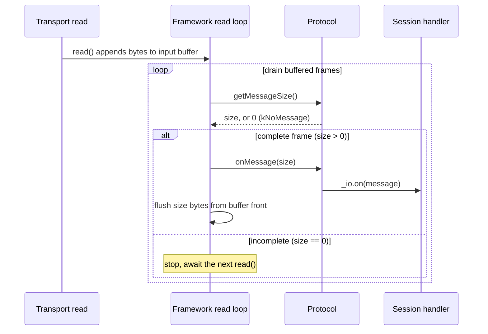

# Framing messages with protocols

> **Audience:** Adopter · **Status:** stable · **Verified-against:** qb 3.3.0 (C++20 default, C++23 supported) — 90fa721f

A protocol is the pluggable framing strategy that turns a continuous byte stream into discrete application messages: it decides where one message ends and hands each complete message to the I/O component's handler.

**Prerequisites:** [qb-io overview](./README.md) · [Transports](./transports.md) — **See also:** [The async runtime](./async_system.md) · [Secure (SSL/TLS) transport](./ssl_transport.md) · [The pipe](../0_foundations/buffers.md)

## Summary

TCP, TLS, and most pipe transports deliver a continuous stream of bytes with no inherent message boundaries — a single `read()` may return half a message, one message, or three and a half. Reconstructing logical messages from that stream is *message framing*, and in `qb-io` it is the job of a **protocol**.

A protocol is a small state machine attached to an I/O component. On every read it answers two questions:

1. Is a complete message available in the input buffer? (`getMessageSize()`)
2. If so, parse it and dispatch it to the component. (`onMessage()`)

The framework owns the buffer, the read loop, and message size limits; the protocol owns only the framing rule and the parse. `qb-io` ships protocols for the three common framing strategies (delimiter byte, delimiter sequence, length-prefix header) plus JSON and MessagePack, and lets you define your own by subclassing one interface.

## Concepts

### The protocol contract: `IProtocol` and `AProtocol<IO_>`

Every protocol implements `qb::io::async::IProtocol` (in `qb/io/async/protocol.h`). Custom protocols derive from the CRTP helper `qb::io::async::AProtocol<IO_>`, which stores a typed reference to the owning I/O component as the protected member `_io` and forwards the three pure-virtual hooks:

```cpp
// src: qb/src/qb/io/async/protocol.h
namespace qb::io::async {

class IProtocol {
public:
    static constexpr std::size_t kNoMessage = 0; // "no complete message yet"

    virtual std::size_t getMessageSize() noexcept = 0;
    virtual void        onMessage(std::size_t size) noexcept = 0;
    virtual void        reset() noexcept = 0;

    [[nodiscard]] bool ok() const noexcept;          // valid operational state?
    void not_ok() noexcept;                          // mark unrecoverable error
    void set_should_flush(bool) noexcept;            // control post-message flush
    bool should_flush() const noexcept;
};

template <typename _IO_>
class AProtocol : public IProtocol {
protected:
    _IO_ &_io;                                       // the owning I/O component
    AProtocol(_IO_ &io) noexcept;
};

} // namespace qb::io::async
```

The `_IO_` type is the I/O component that will use the protocol (typically your TCP session class). The protocol reads from the component's input buffer through `this->_io.in()` and dispatches parsed messages through `this->_io.on(...)`.

### The three hooks

**`std::size_t getMessageSize() noexcept`** inspects the input buffer and reports the size of the next complete message.

- Return the **number of bytes to consume from the front of the buffer** for the next complete message — the framework flushes exactly that many after `onMessage()` returns. For the delimiter protocols this includes the trailing delimiter; for `size_as_header` it is the payload length only, because that protocol removes the fixed header itself before reporting.
- Return `IProtocol::kNoMessage` (which is `0`) when the buffer does not yet hold a complete message; the framework will call again after more bytes arrive.
- The reported size must satisfy `size <= _io.pendingRead()` — the framework trusts the report and consumes exactly that many bytes on the matching `onMessage()` call.
- For a *custom* protocol, keep it **inspection-only and side-effect-free**: do not consume bytes, do not call back into the I/O component, and do not drive transport state machines from here. Two built-in protocols deviate by design — the internal `handshake` protocol drives the TLS state machine, and `size_as_header` consumes its fixed header here (see [Length-prefixed messages](#length-prefixed-messages)) — but the inspection-only rule is the one to follow when you write your own.
- A size greater than the component's `max_message_size()` is treated as a protocol error: the framework disconnects with `disconnect_reason::message_too_large`.

**`void onMessage(std::size_t size) noexcept`** is called once per non-zero `getMessageSize()` result. It parses the `size`-byte message at the front of the input buffer and dispatches it, conventionally by constructing the protocol's `message` type and calling `this->_io.on(...)`. You do **not** remove the bytes yourself — after `onMessage()` returns, the framework flushes `size` bytes from the front of the buffer (subject to `should_flush()`).

**`void reset() noexcept`** clears partial parsing state so the protocol is ready for the next message from a clean slate. The delimiter protocols clear their resumable scan offset here; `size_as_header` clears its pending header value. Note: `reset()` does not restore `ok()` — a protocol that called `not_ok()` stays not-ok and must be replaced.

### The `message` type alias

Concrete protocols expose a nested type named `message` (e.g. `using message = MyParsed;`). This is the type the I/O component receives in `void on(Protocol::message&&)`. The built-in protocols define their own `message` struct; a custom protocol declares the alias to whatever struct it parses into.

### Signaling errors: `not_ok()`

When a protocol detects unrecoverable corruption (bad magic, invalid length field, undecodable payload), it calls `this->not_ok()`. The framework observes `ok() == false`, closes the connection, and dispatches `qb::io::async::event::disconnected` with `reason == disconnect_reason::protocol_error` (`-1`). A protocol cannot recover after `not_ok()`: the connection is torn down. Continuing the conversation requires a new connection with a fresh protocol instance; `not_ok()` is for framing errors, not for the mid-session protocol upgrades described under [Using a protocol in an I/O component](#using-a-protocol-in-an-io-component), which switch protocols on a healthy connection.

### Buffer access

The input buffer returned by `this->_io.in()` is a `qb::allocator::pipe<char>`. Protocols read it with:

- `buffer.size()` — bytes currently buffered (same value as `_io.pendingRead()`).
- `buffer.begin()` / `buffer.end()` — iterators for scanning.
- `buffer.cbegin()` — pointer to the first buffered byte, used to build `std::string_view`s and to `memcpy` out fixed headers.

These views point into the live input buffer and are valid only until the buffer is flushed or refilled — copy out anything you need to retain past `onMessage()`.

### The framing cycle

On each read the framework drives the protocol until the buffer holds no further complete message:



### What "the framework then closes the connection" actually means

`not_ok()` sets a flag, and the connection closes **on the event that carried the bytes**, whichever hook set it:

- **From `onMessage()`.** The framing loop re-reads `_protocol->ok()` right after the call returns and stops there (`src/qb/io/async/io.h:3669`). With no output pending it sets `reason = -1` and disposes on this same event; with output pending it flushes first, arms `EV_WRITE`, and the write path emits `event::eos` and then disposes once the buffer drains -- a session a server accepted only after its peer has closed, below (`src/qb/io/async/io.h:3672-3680`, `:3768-3796`). That `eos` is what tells a handler its last bytes actually reached the transport — it fires for this graceful path only, and deliberately **not** for an aborting `disconnect()`, which delivered nothing.
- **From `getMessageSize()`.** Returning `0` after calling `not_ok()` ends the `while` loop like "need more bytes" would; the loop then reads `ok()` once more on its way out and gives the same verdict (`src/qb/io/async/io.h:3624-3626`, `:3691-3699`): `reason = -1` on this event, or the reply already queued delivered first. Before 3.3 nothing re-checked it, and the close waited for a next readiness event — which a silent peer never sends (Huly QB-293).

**`close_after_deliver()`** (`src/qb/io/async/io.h:3430`) is the same flag set from your own code: the session disposes *after* its pending response has gone out. Reads stop meanwhile — a read readiness that arrives while the output still waits for room switches the watcher to `EV_WRITE` alone and finishes the delivery (`src/qb/io/async/io.h:3961-3964`); before 3.3 it fell to the error label and disposed at once, losing what was not yet written (Huly QB-294). If you want an immediate close instead, call `disconnect(reason)`, which sets `_reason` and feeds the watcher an event (`src/qb/io/async/io.h:3563`).

**A session a server accepted closes after its peer.** Once its output is delivered and `event::eos` reported, it shuts its sending side down -- the peer reads everything delivered, then EOF -- and reads and drops what the peer still sends until the peer closes, the socket fails, or `linger()` elapses (2 s by default, `set_linger()`); only then does it dispose (`begin_linger()`, `src/qb/io/async/io.h:2499-2523`, called at `:3795`; `linger_read()`, `:2536-2546`, called at `:3950-3954`). Closing at once closed a socket whose input was unread, which TCP turns into a reset: on Windows the reset dropped the answer the peer had received and not yet read -- 9 runs in 10 for a peer still uploading 4 MiB -- and the peer's send failed (Huly QB-1089). `set_linger(qb::duration::zero())` restores the immediate close; `lingering()` says a session is in this state -- closing, never open work; `disconnect()` still aborts at once, and `extractSession()` takes a lingering session out of it (`cancel_linger()`, `src/qb/io/async/io_handler.h:288-289`). The linger is bounded in time alone: it is the path that lets a peer that is STILL SENDING -- an upload answered early, a request refused -- read the answer, and a bound in octets would reset exactly that peer on a fast link.

**A session that ends its own connection -- `disconnect()`, a framing error -- is released at once, and its descriptor is closed after the peer all the same.** `disconnect()` stays the abort: the session is disposed at the next dispatch and its server releases it. When everything it had queued was written, its descriptor goes to the thread's loop, which sends the FIN, reads and drops what the peer still sends, and closes on the peer's EOF, a socket error, `linger()` or 16 MiB dropped (`src/qb/io/async/io.h:4072-4091`) -- so a peer that was still sending reads the session's last bytes instead of a reset, which on Windows destroys what it has received and not read yet (Huly QB-1270). What the session still had QUEUED is dropped with it and the socket closed at once: an error reply behind output the peer has not taken is not delivered -- there the bound on resources wins over delivery, and `close_after_deliver()` is the path that waits. A session its size guard ended, one that already lingered, and one whose `linger()` is zero close with the session too. The hand-over comes before the server is told: a `disconnected(id)` override that looks the session up finds its transport closed and no peer -- read the peer in the session's `on(event::disconnected&&)`. A standalone object's `dispose()` takes the same path (see [Transports](./transports.md)).

One more property of the same loop, easy to miss and occasionally load-bearing: the framework **snapshots** `should_flush()` before calling `onMessage()`, and uses that snapshot to decide whether to flush this message's bytes (`src/qb/io/async/io.h:3653`). An `onMessage()` that switches protocols — a handshake upgrading to HTTP/2, say — therefore flushes according to the *old* protocol's rule, which is the one that framed the bytes being consumed. It also means `set_should_flush()` called from inside `onMessage()` has no effect on the message being processed.

### Pausing the read loop: `pause_reading()` and `resume_reading()`

A component that must stop taking input for a while -- its consumer cannot keep up, what it holds has reached a bound -- pauses its reads: `pause_reading()` on `async::input` and `async::io` (`src/qb/io/async/io.h:1102`, `:3064`). The transport is read no more, and no message is dispatched, of what the input buffer already holds either: the framing loop tests the pause before each message (`src/qb/io/async/io.h:1433`, `:3620`), so a pause made from `onMessage()` makes that message the dispatch's last. What the peer sends meanwhile waits in the system's receive buffer: over TCP, its flow control then holds the peer back; a datagram socket drops what its buffer cannot hold. The rest of a datagram the pause interrupted is kept -- its frames are framed once reading resumes, even from that dispatch's own `pending_read` hook, and only its incomplete tail is dropped then (`:1533`, `:3729`). Output is not paused: an `io` component goes on writing.

Every path that arms readability honours the pause. `ready_to_read()` has no effect while paused (`src/qb/io/async/io.h:1053`, `:2993`); a `start()` arms no read (`:1040`, `:2600`) -- a `stop()` and a `start()` keep the pause --, nor do the drain of an `io`'s output -- but for a handshake under way's reads -- (`:3797`), a TLS write pass that leaves output queued (`:2587`) or what a transport holds below its descriptor (`held_input()`, `:4194`). The pause also takes back a read readiness the loop has already collected (`hold_readability()`, `:1569`, `:2715`): libev's `set()` changes the watched events in place and leaves what is pending. So the read pass itself tests nothing: no read readiness reaches it while paused. `is_reading()` answers false meanwhile, but for the reads OpenSSL needs, below.

`resume_reading()` (`src/qb/io/async/io.h:1119`, `:3080`) arms readability again. Called from a handler of the dispatch under way, that dispatch frames on. Otherwise, when the pause stopped the framing, it feeds a dispatch of its own (`:1132`, `:3097`). That dispatch reads first, and its framing takes the old input before the new. A read that finds nothing -- it would block, meets the peer's close or a socket error, or finds the input at its cap -- frames what the pause left all the same, in its own exits (`frame_held_input_first()`, `:1598`, `:2744`): a dispatch fed for that input alone used to end at that read, and a peer that has sent everything raises no other event. A full input is met again on the next pass, and so is an end of stream: once what the pause left is framed and its answers written, a dispatch fed for it reads the end again (`read_end_again()`, `:1644`, `:2808`) -- over TLS a peer that ends with its close_notify alone, its TCP connection kept open, leaves the socket nothing more to say once that alert is read, and OpenSSL answers the read made again at once --, and a handler that paused again, or stopped the component, leaves that read to the resume or to its next `start()`: the component ends once. A socket error ends the component with that error once the held input is framed -- a reset is met once only. While paused, a read that fails or meets the peer's end -- a TLS handshake's, the one read a pause makes -- ends the component as it would unpaused. A datagram component frames before it reads (`:3861`). A pause that stopped no framing feeds nothing, so a pause and a resume made from a hook cost nothing. A component stopped before that dispatch ran is framed from its next `start()` made with its protocol in place (`:1546`, `:2689`). `input`'s resume gives a running watcher its readability back in place -- a `disconnect()` made meanwhile still lands -- and does not start a disposed component again. `reading_paused()` says whether reads are paused.

The pause belongs to the component, not to its transport: a `stop()` and a `start()`, and `switch_protocol()`, keep it; `reset_io_state()` ends it (`src/qb/io/async/io.h:1875-1881`, `:4126-4135`), and so does `io`'s `reset_for_reconnect()` (`:4164-4169`). A transport another component takes over -- `extractSession()`, a WebSocket upgrade -- starts reading there unpaused. `extractSession()` hands the transport over, not the input buffer: what the pause left there goes with the extracted session, unframed.

While paused, a component learns of its peer's close or reset at its next write -- which meets the reset -- or once reading resumes. On macOS this is measured under kqueue, which keeps no read filter for it, and under poll and select, which leave the descriptor out. Under epoll it is reasoned from the loop's code -- the descriptor stays registered with its last events until its next one, which libev answers by deleting it, a watcher that watches nothing told nothing -- and the same witnesses check it on Linux, where the resume registers the descriptor again. Its own timeout (`async::with_timeout`) still runs, and bounds the wait.

On a TLS component, the reads a handshake under way needs are made all the same (`tls_read_needed()`, `src/qb/io/async/io.h:2701`): the first handshake's and a later one's (`rehandshaking()`), a read that must write first (`read_wants_write()`) and a write that waits for the peer's handshake message (`write_wants_read()`) among them. The pause holds application data, never what OpenSSL needs: what such a read brings waits in the input buffer, unframed -- the framing loop dispatches nothing while paused --, under the read cap as any input, a read the cap refuses ending the connection (`-3`), paused or not; readability goes off once OpenSSL needs no more (`:2725`). The read a held record's departure makes, for a renegotiation the peer may have asked for meanwhile (`tls_held_flushed()`), waits for the resume, which feeds a dispatch for it (`:2647`). When `resume_reading()` finds writability alone on a TLS `io` -- output queued, an empty arm, which the pause left --, readability goes back beside it (`:3086`); writability alone is kept only for a read that waits to write. A `close_after_deliver()` drain and its linger read as before: a pause made before or during them leaves their reads alone, so the peer's end still ends the linger.

The two calls exist on `async::input` -- an acceptor is one -- and `async::io`, over TCP, Unix-domain sockets, TLS and UDP. A QUIC or HTTP/3 stream (`async::buffered_io`) has neither: a call does not compile.

```cpp
void on(Protocol::message &&msg) {
    _queue.push_back(std::move(msg));
    if (_queue.size() == kHighWater)
        this->pause_reading(); // this message is the dispatch's last
}

void on_consumed() { // the consumer caught up
    if (_queue.size() < kLowWater)
        this->resume_reading(); // frames what the input held, whether the peer sends more or not
}
```

## Built-in protocols

`qb-io` provides protocols for the common framing strategies. Including `qb/io/async.h` pulls them all in; the individual headers are noted below.

### Delimiter-framed messages

A message ends at a known byte or byte sequence. Defined in `qb/io/protocol/base.h` and aliased for text in `qb/io/protocol/text.h`.

| Type | Framing | `message` payload |
|---|---|---|
| `base::byte_terminated<IO_, EndByte>` | single byte, default `'\0'` | base only (framing) |
| `base::bytes_terminated<IO_, Trait>` | sequence from `Trait::_EndBytes` | base only (framing) |
| `text::string<IO_>` | `'\0'`-terminated | `std::string text` |
| `text::command<IO_>` | `'\n'`-terminated | `std::string text` |
| `text::string_view<IO_>` | `'\0'`-terminated | `std::string_view text` (zero-copy) |
| `text::command_view<IO_>` | `'\n'`-terminated | `std::string_view text` (zero-copy) |

`byte_terminated` exposes `static constexpr char end` (the delimiter) and `static constexpr std::size_t delimiter_size = 1`. `bytes_terminated` takes a trait such as `struct CRLF { static constexpr char _EndBytes[] = "\r\n"; };` and rejects an empty delimiter at compile time. Both keep a resumable scan offset, so re-invocation after a partial read does not rescan from the start of the buffer.

The `text::*` aliases build a `message` whose fields are the payload **without** the delimiter:

```cpp
// src: qb/src/qb/io/protocol/text.h
struct message {
    const std::size_t size; // payload length, delimiter excluded
    const char       *data; // pointer into the input buffer
    _StringTrait      text; // std::string or std::string_view over [data, data+size)
};
```

For `string_view` and `command_view`, `text` is a view into the input buffer and is only valid for the duration of the `on(...)` call; copy it out if you need it later.

### Length-prefixed messages

Each payload is preceded by an unsigned integer header giving its byte length. Defined in `qb/io/protocol/base.h`, aliased for binary in `qb/io/protocol/text.h`.

| Type | Header | Max payload |
|---|---|---|
| `base::size_as_header<IO_, Size>` | `Size` (default `uint16_t`) | `Size`'s max |
| `text::binary8<IO_>` | `uint8_t` | 255 bytes |
| `text::binary16<IO_>` | `uint16_t` | 65 535 bytes |
| `text::binary32<IO_>` | `uint32_t` | 4 294 967 295 bytes |

`size_as_header` reads the header, converts from network byte order for 2- and 4-byte headers (`ntohs` / `ntohl`), consumes the header bytes from the buffer, then waits for the full payload. A received header of zero is rejected with `not_ok()`. The matching `text::binary*` protocols dispatch a payload-only message:

```cpp
// src: qb/src/qb/io/protocol/text.h
struct message {
    const std::size_t size; // payload length
    const char       *data; // pointer to the payload in the input buffer
};
```

To **build** the outgoing header, call the static `Header(std::size_t)`:

```cpp
// src: qb/src/qb/io/protocol/base.h
static _Size Header(std::size_t size); // throws std::runtime_error if size exceeds the header's range
```

It requires an unsigned `Size` and returns the length in network byte order, ready to write before the payload.

### Varint-prefixed and netstring messages

Two more length-prefixed framings, with a variable-width length (Huly QB-80). Defined in `qb/io/protocol/varint.h` and `qb/io/protocol/netstring.h`; neither is pulled in by `qb/io/async.h`, include the header you use.

| Type | Framing | `message` payload |
|---|---|---|
| `qb::protocol::varint_prefixed<IO_, Policy, LeadBytes, MaxPayload>` | `[LeadBytes fixed bytes][base-128 varint length][payload]` | base only (framing) |
| `qb::protocol::varint_binary<IO_, Policy, LeadBytes, MaxPayload>` | the same | `{ size, data, frame, header_size }` |
| `qb::protocol::netstring<IO_, StringTrait, MaxDigits, MaxPayload>` | `[decimal length]:[payload],` | `{ size, data, StringTrait text }` (`std::string`) |
| `qb::protocol::netstring_view<IO_, MaxDigits, MaxPayload>` | the same | `std::string_view text` (zero-copy) |

**The varint** is the base-128 integer protobuf and MQTT share: seven bits a byte, least significant group first, the high bit of a byte announcing another. The two wire formats bound it differently, and the `Policy` says which: `varint::protobuf_policy` (the default) reads up to ten bytes, any 64-bit value, and accepts an over-long encoding such as `80 00` for zero, as protobuf's parsers do; `varint::mqtt_policy` reads at most four bytes, at most 268 435 455, and refuses an encoding that is not the minimal one (MQTT 5.0 §1.5.5; MQTT 3.1.1 states no such rule normatively, so a 3.1.1 peer that pads its length is refused too -- a policy `{4, 268'435'455, false}`, i.e. `max_bytes`, `max_value`, `canonical`, is the lenient form). `LeadBytes` fixed bytes before the varint belong to the frame -- `1` for an MQTT control packet, whose first byte is its type and flags -- and reach the handler as `message::frame[0]`. The codec itself is public: `varint::decode<Policy>(begin, end)` returns `{status, value, consumed}` with five statuses (`complete`, `incomplete`, `overlong`, `overflow`, `non_canonical`), `varint::encode(value, out)` writes the minimal encoding, `varint::encode_header<Policy>(value)` returns it ready to write.

Both framers are **inspection only**, the rule of the three hooks above: `getMessageSize()` consumes nothing and reports the whole frame -- header and payload -- once the input holds it, caching the decoded header while the payload arrives; the framework flushes the frame after `onMessage()`. An empty payload is therefore a frame of its header alone and is delivered -- an empty protobuf message (one byte), MQTT's `PINGREQ` (`C0 00`, two), the empty netstring `0:,` (three) -- where `size_as_header` refuses a zero. The protocol is marked `not_ok()` on a prefix that is not one of its policy's (over-long, overflowing, non-minimal under MQTT), and for a netstring on a byte other than a digit before the colon, a leading zero (`0` alone is written with one), more than `MaxDigits` digits (9 by default, Bernstein's 999 999 999), a colon with no length, or a byte other than the comma where the comma belongs -- the length's refusals at the digit that shows them, the colon not waited for. Two bounds are enforced **at the prefix, before a byte of the payload is waited for**: the payload bound, `max_payload`, and the I/O component's `max_message_size()` -- the cap it runs with, `QB_MAX_MESSAGE_SIZE` or what `set_max_message_size()` set -- for the whole frame; the component itself would refuse an oversized frame only once all of it is buffered. The default payload bound leaves the header room under `QB_MAX_MESSAGE_SIZE` (`varint::default_max_payload<Policy, LeadBytes>()`, and for a netstring the cap minus `MaxDigits` and the colon and the comma), so a frame the framer accepts is one the component accepts; a netstring's bound is also capped by what `MaxDigits` digits write (`max_payload` is the smaller of the two), and `Header()` shares it.

```cpp
// src: qb/src/qb/io/protocol/varint.h, qb/src/qb/io/protocol/netstring.h
class Session : public qb::io::use<Session>::tcp::client<MyServer> {
public:
    using Protocol = qb::protocol::varint_binary<Session>;
    void on(Protocol::message &&msg) { // msg.data / msg.size: the payload; msg.frame[0]: a lead byte
        *this << Protocol::Header(msg.size).view() << std::string_view(msg.data, msg.size); // echo, framed
    }
};

class NetSession : public qb::io::use<NetSession>::tcp::client<MyServer> {
public:
    using Protocol = qb::protocol::netstring_view<NetSession>; // or netstring<NetSession>: msg.text a std::string
    void on(Protocol::message &&msg) {                         // msg.text: the payload, a view into the input
        *this << Protocol::Header(msg.size).view() << msg.text << Protocol::end; // the prefix, the payload, the comma
    }
};
```

To **send**, write the prefix `Protocol::Header(payload.size()).view()` before the payload (and, for a netstring, `Protocol::end` -- the comma -- after it, or `Protocol::put(out, payload)` for the whole thing into a pipe). `Header` throws `std::length_error` past `max_payload` or the policy's maximum -- the precise type, as qbm-http's serializer throws, where `size_as_header::Header` throws a `std::runtime_error` past its width: a `catch (const std::runtime_error &)` written for `binary16` does not catch it.

An MQTT control packet is framed as `varint_binary<IO_, varint::mqtt_policy, 1>`: one lead byte, MQTT's Remaining Length, and the default payload bound, which leaves the header room under `QB_MAX_MESSAGE_SIZE`. A broker that announces a Maximum Packet Size (MQTT 5.0 §3.2.2.3.6) passes a bound derived from it, minus the five header bytes. Do not pass `varint::mqtt_policy::max_value`: frames of up to 268 435 460 bytes are past the default cap, so a peer announcing 150 MiB would be buffered in full before the component refused it, where the default bound refuses it at the prefix. What this framer does NOT give an MQTT module yet: a refusal is `not_ok()`, which closes the connection, with no hook to queue the `DISCONNECT` that MQTT 5.0 asks a server to send first (Reason Code 0x95, Packet too large, §3.2.2.3.6; 0x81, Malformed Packet) and no way for the session to learn which verdict closed it. That mechanism -- a reply queued before a protocol-error close -- belongs to the I/O component and is a requirement of the MQTT module, to be designed with it.

### JSON and MessagePack

Defined in `qb/io/protocol/json.h`; each message is followed by a `'\0'` byte. `json` derives from `base::byte_terminated<IO_, '\0'>`: JSON text cannot hold a raw NUL, so the first one ends the message. `json_packed` cannot frame that way -- MessagePack writes zero bytes inside its values (the integer `0` is the byte `0x00`; so is a byte of most lengths, floats and binaries) -- so it derives from `AProtocol` and frames the value by its own lengths: every MessagePack header states the length of what follows, the protocol steps over each payload without reading it, and the byte right after the value must be the `'\0'`, any other byte being a protocol error. A sender writes `qb::json::to_msgpack(value)` then `'\0'` either way.

| Type | Encoding | `message` payload |
|---|---|---|
| `qb::protocol::json<IO_>` | UTF-8 JSON text | `{ size, data, nlohmann::json json }` |
| `qb::protocol::json_packed<IO_>` | MessagePack | `{ size, data, nlohmann::json json }` |

Before handing a payload to `nlohmann`'s recursive parser, both protocols bound container nesting to `qb::protocol::detail::kJsonMaxNestingDepth` (`512`) -- `json` with a linear pre-scan of the text, `json_packed` while it frames the value, in the same pass. A document nested deeper than that, or a payload that fails to parse, is rejected with `not_ok()` rather than risking a stack overflow that a `try`/`catch` cannot recover from. The `json` field is owned by the message and survives the `on(...)` call; the `data` pointer is a buffer view and does not.

### Acceptor and handshake protocols

Two protocols under `qb::io::protocol` (in `qb/io/protocol/accept.h` and `qb/io/protocol/handshake.h`) are used internally by the framework rather than declared by application sessions:

- `accept` is the stateless protocol an acceptor uses to detect an accepted socket and hand it to the I/O component.
- `handshake` drives a transport (SSL/TLS) handshake to completion and emits `async::event::handshake`. It is a deliberate exception to the "`getMessageSize()` is a pure query" rule — it calls into the transport's `do_handshake()` and caches the result — and it disables input-buffer flushing (`set_should_flush(false)`) so handshake bytes are not consumed as messages.

You normally never name these directly; the secure transports wire them in for you. See [Secure (SSL/TLS) transport](./ssl_transport.md).

The `accept` protocol is worth two minutes anyway, because it is the clearest proof that **`getMessageSize()` does not have to count bytes.** Its whole implementation is three lines:

```cpp
// src: qb/src/qb/io/protocol/accept.h:77-95
std::size_t getMessageSize() noexcept final {
    return static_cast<size_t>(this->_io.getAccepted().is_open());
}
void onMessage(std::size_t /*size*/) noexcept final {
    this->_io.on(std::move(this->_io.getAccepted()));
}
```

`getMessageSize()` answers "is there one?" with `1` or `0`. `onMessage()` moves the accepted socket out to the acceptor's handler. And `flush(1)` — which the framework calls because `should_flush()` defaults to true — is `_accepted_io.release_handle()` on the acceptance transport (`src/qb/io/transport/accept.h:116-118`), i.e. the step that stops the transport's own socket object from closing the descriptor it just handed away. Three hooks, no bytes, and the "message" is a file descriptor.

It also shows why the `size <= pendingRead()` guard cannot be unconditional: `transport::accept` has no `in()` and no `pendingRead()` at all, so the check is compiled out for it by a `requires` test (`src/qb/io/async/io.h:3631-3637`) rather than failing every accept.

## Using a protocol in an I/O component

Three steps connect a protocol to a session: declare it, install it, and handle its messages.

```cpp
// src: qb/tests/io/system/session/text-session-loopback.cpp (adapted)
#include <qb/io/async.h>
#include <qb/io/protocol/text.h>   // required: async.h does not pull the text protocols in

class CommandClient : public qb::io::use<CommandClient>::tcp::client<> {
public:
    // 1. Declare the protocol this session uses.
    using Protocol = qb::protocol::text::command<CommandClient>;

    CommandClient() {
        // 2. Install it. switch_protocol<P>(args...) constructs P{args...},
        //    checks ok(), takes ownership, and makes it the active protocol.
        this->switch_protocol<Protocol>(*this);
    }

    // 3. Handle parsed messages. command::message carries { size, data, text }.
    void on(Protocol::message &&msg) {
        qb::io::cout() << "command: " << msg.text << '\n';
        if (msg.text == "QUIT")
            this->disconnect();
    }

    void on(qb::io::async::event::disconnected const &ev) {
        qb::io::cout() << "disconnected (reason " << ev.reason << ")\n";
    }
};
```

`switch_protocol<Protocol>(*this)` constructs the protocol with the session as its `_IO_` argument, verifies `ok()`, stores it in the session's owned protocol list, and makes it active. It returns a pointer to the new protocol, or `nullptr` if the protocol reported `not_ok()` during construction (the failed instance is destroyed and the active protocol is left unchanged). The session owns the protocol; it is destroyed with the session or by `clear_protocols()`.

**`clear_protocols()` from the read loop's dispatch ends the protocols once that dispatch has returned.** Called from the protocol's `onMessage()`, from the handler it hands the message to, or from anything those call, it detaches every protocol at once -- `protocol()` is the `NoProtocol` sentinel when it returns, and a protocol switched in afterwards is the active one -- but destroys them only after the dispatch, in the read loop (`src/qb/io/async/io.h:2885-2887`, `:3909`). A protocol whose `onMessage()` the read loop is running is not freed under it, unless the handler zeroed the dispatch flag first (below). Before 3.4 the call destroyed them on the spot, and the protocols that touch their own state after their handler returns -- qbm-http's WebSocket decoder resets its frame, its HTTP/1.1 server and client reset their message, qbm-redis's protocol walks its pending replies -- then read and wrote freed memory (Huly QB-1278); qb's own framers end their `onMessage()` on the handler call. Outside that dispatch the protocols are destroyed before the call returns, as before -- which includes an `onMessage()` a protocol runs itself outside the read loop (the HTTP/1.1 protocol's end-of-stream flush, from `on(event::disconnected&&)`) and a handler that zeroed the dispatch flag with `start()` or `reset_io_state()` before it cleared. Every clear ends its protocols one at a time, front to back (the order they were switched in), each out of the list before its destructor runs, with the sentinel already active, so a destructor that calls back into its component finds it consistent: a `switch_protocol()` there installs a protocol that is kept, a `clear_protocols()` joins the clear under way; the ones a dispatch retired end with the dispatch flag set, as inside the call before (`src/qb/io/async/protocol.h:397-419`). A retired protocol's destructor that ends the active protocol ends the session the way a clear outside a dispatch does: at its next I/O event.

### Sending data that conforms to the protocol

The protocol frames inbound bytes; the sender must produce matching framing. For a delimiter protocol, append the delimiter exposed as `Protocol::end`:

```cpp
// src: qb/tests/io/system/session/text-session-loopback.cpp
*this << msg.text << Protocol::end; // command::end is '\n'
```

For a length-prefixed binary protocol, write the network-order header followed by the payload:

```cpp
// src: qb/tests/io/system/session/text-session-loopback.cpp
uint16_t len = htons(static_cast<uint16_t>(payload.size()));
*this << std::string_view(reinterpret_cast<const char *>(&len), sizeof(len))
      << std::string_view(payload.data(), payload.size());
```

`size_as_header::Header(payload.size())` produces the same network-order header value with a range check, which is preferable when the payload size is not statically known.

## Defining a custom protocol

When no built-in framing fits your wire format, subclass `AProtocol<IO_>` and implement the three hooks. The pattern below frames a fixed binary header followed by a variable payload, and is condensed from the worked example.

### 1. Define the wire structures

```cpp
// src: examples/02-io/05-custom-protocol.cpp (adapted)
#pragma pack(push, 1)
struct MessageHeader {
    uint16_t magic;   // protocol identifier
    uint8_t  version;
    uint8_t  type;
    uint32_t id;
    uint32_t length;  // payload byte count
};
#pragma pack(pop)

constexpr uint16_t MAGIC   = 0x5150;
constexpr uint8_t  VERSION = 0x01;

struct custom_message {           // what the session's on() receives
    uint8_t     type;
    uint32_t    id;
    std::string payload;
};
```

### 2. Implement the protocol

```cpp
// src: examples/02-io/05-custom-protocol.cpp (adapted)
#include <qb/io/async.h>
#include <cstring>

template <typename IO_>
class custom_protocol : public qb::io::async::AProtocol<IO_> {
    static constexpr std::size_t HEADER_SIZE = sizeof(MessageHeader);
    bool          _reading_header = true;
    MessageHeader _header{};

public:
    using message = custom_message;

    custom_protocol() = delete;
    explicit custom_protocol(IO_ &io) noexcept
        : qb::io::async::AProtocol<IO_>(io) {}

    std::size_t getMessageSize() noexcept final {
        auto &buffer = this->_io.in();

        if (_reading_header) {
            if (buffer.size() < HEADER_SIZE)
                return 0;                                  // wait for the header
            std::memcpy(&_header, buffer.cbegin(), HEADER_SIZE);
            if (_header.magic != MAGIC || _header.version != VERSION) {
                this->not_ok();                            // unrecoverable: disconnect
                return 0;
            }
            _reading_header = false;
        }

        const std::size_t total = HEADER_SIZE + _header.length;
        if (buffer.size() < total)
            return 0;                                      // wait for the payload
        return total;                                      // full message present
    }

    void onMessage(std::size_t size) noexcept final {
        const char *base = this->_io.in().cbegin();

        message msg;
        msg.type = _header.type;
        msg.id   = _header.id;
        if (_header.length > 0)
            msg.payload.assign(base + HEADER_SIZE, _header.length);

        this->_io.on(std::move(msg));                      // dispatch
        _reading_header = true;                            // ready for the next frame
        // Do not flush here: the framework removes `size` bytes after this returns.
    }

    void reset() noexcept final {
        _reading_header = true;
        _header = {};
    }
};
```

`getMessageSize()` parses the header on the first call that has it buffered, validates it, then reports the full frame size once the payload has also arrived. Storing `_reading_header` and `_header` across calls avoids re-parsing the header while waiting for a slow payload. `onMessage()` builds the `message`, dispatches it, and re-arms for the next frame; the framework flushes the `size` bytes afterward.

### 3. Serialize the outbound side

Teach the output pipe how to write your message type by specializing `qb::allocator::pipe<char>::put<T>`, which enables the `session << message` syntax:

```cpp
// src: examples/02-io/05-custom-protocol.cpp (adapted)
namespace qb::allocator {
template <>
pipe<char> &pipe<char>::put<custom_message>(const custom_message &msg) {
    MessageHeader header;
    header.magic   = MAGIC;
    header.version = VERSION;
    header.type    = msg.type;   // a scoped-enum type field needs static_cast<uint8_t>, as the example has
    header.id      = msg.id;
    header.length  = static_cast<uint32_t>(msg.payload.size());

    this->put(reinterpret_cast<const char *>(&header), sizeof(header));
    if (!msg.payload.empty())
        this->put(msg.payload.data(), msg.payload.size());
    return *this;
}
} // namespace qb::allocator
```

### 4. Use it from a session

```cpp
// src: examples/02-io/05-custom-protocol.cpp (adapted)
class EchoSession : public qb::io::use<EchoSession>::tcp::client<> {
public:
    using Protocol = custom_protocol<EchoSession>;

    EchoSession() { this->switch_protocol<Protocol>(*this); }

    void on(Protocol::message &&msg) {
        *this << custom_message{msg.type, msg.id, msg.payload}; // echo
    }
};
```

The `01-tcp-chat` and `02-pubsub-broker` examples under `examples/05-services/` apply this same structure (header + payload + `put<T>` specialization) to a full client/server application.

## Pitfalls

- **`getMessageSize()` must stay side-effect-free.** It runs in the read hot path and may be called many times before a message completes. Do not dispatch, do not write to the socket, and do not flush the buffer from it. The one framework exception is the internal `handshake` protocol, which documents the deviation.
- **Do not flush in `onMessage()`.** The framework removes exactly the `size` bytes you reported from `getMessageSize()`. Calling `flush()` yourself double-consumes and corrupts framing.
- **Report exactly the buffered frame size.** The reported size must be `<= _io.pendingRead()` and `<= max_message_size()`. The framework checks both before calling `onMessage()`: a size above `max_message_size()`, or a size larger than the bytes currently buffered (when `should_flush()` is true), marks the protocol not-ok and disconnects with `message_too_large` (reason `-2`).
- **Buffer views are transient.** `data`/`cbegin()` pointers and `string_view`/`command_view` payloads reference the live input buffer and are invalidated once `onMessage()` returns and the bytes are flushed. Copy out anything you keep.
- **`reset()` does not clear `not_ok()`.** `reset()` clears partial parsing state (the scan offset, a half-read header) but does not restore `ok()`. After a protocol marks itself not-ok, the connection closes; `reset()` cannot rescue it.
- **Handle endianness in custom headers.** Multi-byte length or type fields should be serialized and deserialized in a fixed byte order (network order is the convention; see `htons`/`htonl` and the `size_as_header` source). A raw `memcpy` of a `uint32_t` is host-endian and will mis-frame across architectures.
- **Size limits are enforced, not advisory — and the two limits are different codes.** A `getMessageSize()` result above `max_message_size()` (default `QB_MAX_MESSAGE_SIZE`) marks the protocol `not_ok()` and disconnects with `message_too_large`, reason **`-2`** (`src/qb/io/async/io.h:3639-3644`). A read that finds the input buffer already at `max_read_buffer_size()` -- a read takes at most the room left under it, so the buffer fills to the cap and never past it -- or a publish that would take the output buffer past `max_write_buffer_size()` (defaults `QB_MAX_READ_BUFFER_SIZE`, `QB_MAX_WRITE_BUFFER_SIZE`) disconnects with `buffer_overflow`, reason **`-3`**, and does *not* touch the protocol's `ok()` at all (`src/qb/io/async/io.h:3895-3903`). Raise a component's limit deliberately with `set_max_message_size()` / `set_max_read_buffer_size()` rather than assuming it is unlimited.
- **`not_ok()` delivers what is queued before it closes.** From either hook it closes on the event that carried the bad bytes, but a reply already queued for an earlier message goes out first. If you need the connection down now, without delivering, call `disconnect(reason)`. See [what "the framework then closes the connection" means](#what-the-framework-then-closes-the-connection-actually-means).
- **To stop taking input, pause the reads: `pause_reading()`, not readability taken off the watcher.** `ready_to_read()`, a `start()`, the drain of the output and a TLS write pass arm `EV_READ` again, a readiness the loop already collected is dispatched all the same, and a dispatch under way frames what the buffer holds whatever the watcher watches; `stop()` stops the writes too. `resume_reading()` frames what the pause left in the buffer, whether the peer sends more or not. A paused component sees its peer's close at its next write or once it resumes: bound the wait with a timeout. See [Pausing the read loop](#pausing-the-read-loop-pause_reading-and-resume_reading).

## See also

- [Asynchronous I/O model](./async_system.md) — the read loop, the event loop, and where `getMessageSize()` / `onMessage()` are called from.
- [Transports](./transports.md) — the stream and transport layers a protocol reads through (`in()`, `out()`, `publish()`).
- [Secure (SSL/TLS) transport](./ssl_transport.md) — how the `handshake` protocol participates in a TLS session.
- `examples/02-io/05-custom-protocol.cpp` — the complete custom binary protocol this page condenses.
- `examples/05-services/01-tcp-chat/shared/Protocol.h`, `examples/05-services/02-pubsub-broker/shared/Protocol.h` — custom protocols inside full applications.
