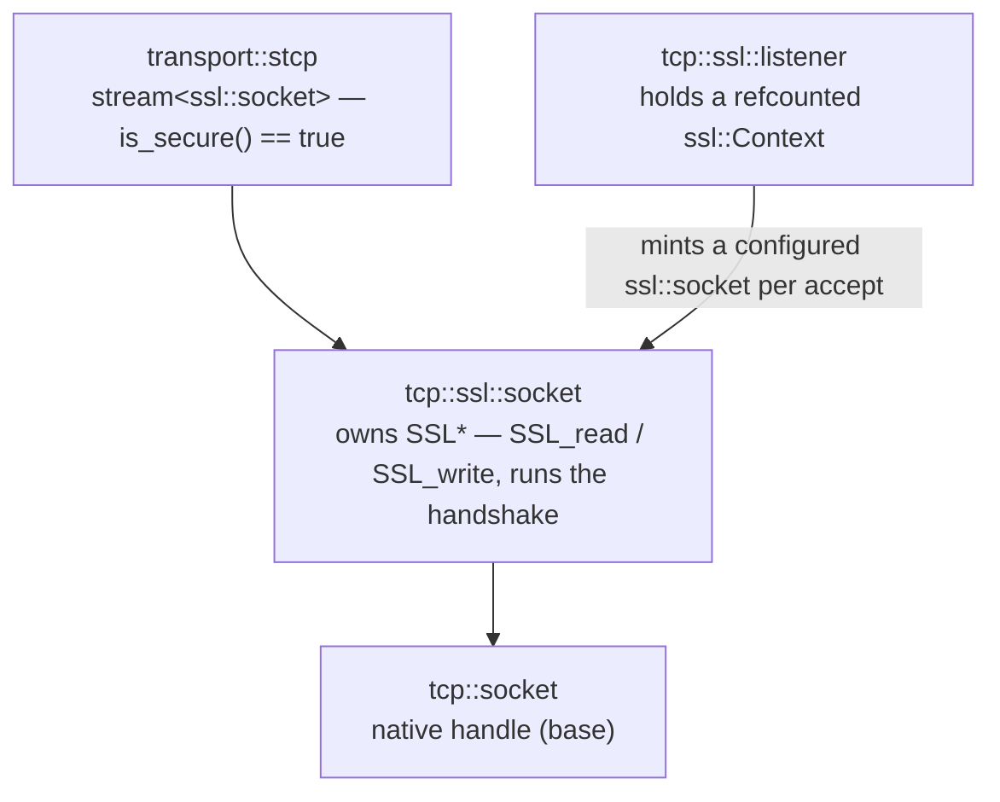

# Secure TCP with SSL/TLS

> **Audience:** Adopter · **Status:** stable · **Verified-against:** qb 3.3.0 (C++20 default, C++23 supported) — 90fa721f

`qb-io` layers OpenSSL-backed SSL/TLS over its TCP stack, with secure-by-default client verification, a context-holding listener, and a stream transport that drains OpenSSL's internal buffers.

**Prerequisites:** [Transports](./transports.md) · [The async runtime](./async_system.md) — **See also:** [Native QUIC transport](./quic_transport.md) · [qb-io utilities](./utilities.md)

## Summary

Secure TCP in `qb-io` is the plain TCP stack with an OpenSSL encryption layer spliced
underneath the same stream and async interfaces. The pieces are:

- `qb::io::ssl::Context` — **the preferred way to configure TLS.** A value-semantic,
  reference-counted, secure-by-default handle over an `SSL_CTX`: copyable (copies share one
  context, freed exactly once — no user `SSL_CTX_free`), fluent (`Context::client()` /
  `Context::server(cert, key).alpn({"h2"})`), fail-closed (a bad cert yields a falsy Context
  whose `error()` explains why). Hand it to a socket or listener; there is no raw context
  lifetime to manage. See [The `ssl::Context` type](#the-sslcontext-type).
- `qb::io::tcp::ssl::socket` — a `tcp::socket` that owns an OpenSSL `SSL*` and runs the
  handshake plus transparent `SSL_read`/`SSL_write`. Build it from a `Context`
  (`ssl::socket{ssl::Context::client()}`) or let `connect()` auto-create a secure client one.
- `qb::io::tcp::ssl::listener` — a `tcp::listener` that holds a `Context` and mints a
  configured `ssl::socket` per accepted connection.
- `qb::io::transport::stcp` — the `stream<ssl::socket>` specialization that backs every
  asynchronous secure session.
- Free functions in `qb::io::ssl` for building and configuring raw `SSL_CTX` objects — the
  advanced/escape-hatch layer, kept permanently but superseded by `ssl::Context` for most uses.

The whole slice compiles only when the build was configured with OpenSSL available; see
[Build gating](#build-gating). Throughout, the socket and listener follow `qb-io`'s
ownership conventions: they are move-only, and the listener holds a **refcounted**
`ssl::Context` rather than owning the raw `SSL_CTX` outright — `~listener()` frees nothing,
and the `SSL_CTX` dies when the last `Context` copy *and* the last `SSL` minted from it are
gone (`src/qb/io/tcp/ssl/listener.cpp:30`; `src/qb/io/tcp/ssl/context.cpp:259`).



> **Linking the SSL slice changes one process-wide setting.** `qb/io/tcp/ssl/init.cpp` runs a
> static initializer that calls `SSL_library_init()`, `SSL_load_error_strings()`,
> `OpenSSL_add_all_algorithms()` **and `signal(SIGPIPE, SIG_IGN)`**
> (`src/qb/io/tcp/ssl/init.cpp:62-71`). Ignoring `SIGPIPE` is what stops a write to a
> half-closed socket from killing the process, and it is almost always what you want — but it
> is an observable side effect of linking, not of calling anything, so a program that relied on
> the default disposition needs to reinstate it after startup.

## Build gating

The SSL transport is an optional feature. The CMake option `QB_WITH_SSL` defaults to `ON`,
but OpenSSL is found by `find_package(OpenSSL QUIET)` and is **never** fetched. If OpenSSL
is not present, `QB_WITH_SSL` is forced `OFF`, the resolved capability `QB_HAS_SSL` becomes
false, and the entire SSL/TLS slice is absent.

<!-- src: qb/cmake/qbConfig.cmake:160, qb/cmake/qbDependencies.cmake:130-161 -->

An OpenSSL whose headers, `libssl` and `libcrypto` are not one major stops the configure instead, QUIC or not, on
Linux and macOS: FindOpenSSL caches the three apart, and a cache cleared in part -- one entry removed while
`OPENSSL_ROOT_DIR` moved to another OpenSSL -- built a TLS that crashed (Huly QB-1190). The message names the three
entries and their majors; remove all three from the cache, or configure with `--fresh`. qb needs OpenSSL 3.0 or later
(`crypto.h` uses its `EVP_MAC` API), and an older one stops the configure on every platform, by the version
FindOpenSSL reports or by the one its header says -- LibreSSL, by its marker, too: the message names the version, the
paths and the remedy, another OpenSSL through `OPENSSL_ROOT_DIR` with the three entries removed (on Windows, `-U
"LIB_EAY*" -U "SSL_EAY*"` for the two libraries: FindOpenSSL caches them there under those names), or
`-DQB_WITH_SSL=OFF` (Huly QB-1213); before, one whose majors agreed configured and failed at its compile. Headers that
old whose majors disagree are refused for being too old, not as a cache cleared in part: a release that old may number
its libraries apart from itself, as RHEL 7 names 1.0.2k's `libssl.so.10`. One whose `opensslv.h` carries no version --
none of `OPENSSL_VERSION_NUMBER`, `OPENSSL_VERSION_STR` and `OPENSSL_VERSION_MAJOR` there or in what it includes with
a relative quoted `#include`, two levels deep, comments removed, FindOpenSSL reporting none either -- stops it the
same way, with the same remedy, naming the angle includes it did not follow: BoringSSL's, which keeps its version in
`base.h` and has no `EVP_MAC_fetch()` (Huly QB-1262). A version found in an included file is held to 3.0 too, and
BoringSSL's or AWS-LC's marker in a file read refuses whatever version it says. A file of that chain that cannot be
read decides nothing, and a warning names it.

<!-- src: qb/cmake/qbOpenSSL.cmake:226-382, :672-814 (_qb_openssl_carries_version, _qb_openssl_read_version) -->

| Symbol | Meaning |
| --- | --- |
| `QB_WITH_SSL` | User-facing request (CMake option, default `ON`). Forced `OFF` if OpenSSL is missing. |
| `QB_HAS_SSL` | Resolved capability after dependency probing. Gates the compile definition and the headers below. |

All SSL headers — `qb/io/tcp/ssl/socket.h`, `qb/io/tcp/ssl/context.h`,
`qb/io/tcp/ssl/listener.h`, `qb/io/transport/stcp.h` and `qb/io/transport/saccept.h` — require
an OpenSSL-enabled build. They are still installed; without `QB_HAS_SSL` they stop at an `#error` that says so,
through `qb/io/tcp/ssl/openssl_required.h`, the one place they reach `<openssl/ssl.h>` (since 3.3, Huly QB-1015 —
they used to include it regardless: "file not found" on a host without the OpenSSL headers, a silent compile against
code qb never built on a host with them).
The `use<>::tcp::ssl` async aliases in `qb/io/async.h` are themselves guarded by
`#ifdef QB_HAS_SSL`, so code that references them must also be compiled under that definition.

<!-- src: qb/src/qb/io/async.h:113-127 -->

> The crypto and JWT toolbox shares this OpenSSL dependency, but does not fail the same way.
> `qb/io/crypto_jwt.h` `#error`s at compile time unless `QB_HAS_SSL` is defined;
> `qb/io/crypto.h` compiles either way, because its gate is per **member** — the class keeps
> everything that needs no OpenSSL (the hex codec a cleartext qbm-pgsql build depends on) and
> drops the rest, so a no-SSL build fails at the call site (`no member named 'md5' in
> 'qb::crypto'`). A non-SSL build has neither secure transport nor the OpenSSL-backed crypto.
> <!-- src: qb/src/qb/io/crypto.h:33-44, qb/src/qb/io/crypto_jwt.h:36-38 -->

## Core components

### The `ssl::Context` type

Declared in `qb/io/tcp/ssl/context.h`. A `Context` is a value: copy it and both copies share the
same reference-counted `SSL_CTX`, destroyed exactly once when the last copy — and the last `SSL`
minted from it — is gone. There is no user-visible `SSL_CTX_free`, so the double-free / leak
footguns of hand-rolled OpenSSL ownership are structurally impossible.

<!-- src: qb/src/qb/io/tcp/ssl/context.h:157 -->

It is **secure by default** and **fails closed**: `Context::client()` pins TLS 1.2+, loads the
system trust store, and verifies the peer; a construction or configuration error (a missing cert, a
bad cipher list) yields a falsy Context whose `error()` explains why — it never silently degrades to
an insecure context.

```cpp
// Server: one shared, fluently-configured context.
auto ctx = qb::io::ssl::Context::server("cert.pem", "key.pem").alpn({"h2", "http/1.1"});
qb::io::tcp::ssl::listener listener{ctx};              // shared by ref-count across every accept

// Client: secure by default; per-connection SNI on top.
qb::io::tcp::ssl::socket client{qb::io::ssl::Context::client().alpn({"h2"})};
client.sni("example.com").connect(ep);
```

The factories are `Context::client()`, `Context::server(cert, key)`, and two escape hatches for
wrapping a raw `SSL_CTX*`: `Context::adopt` (transfer the caller's reference) and `Context::share`
(take a new reference; the caller keeps theirs).

<!-- src: qb/src/qb/io/tcp/ssl/context.h:168-195 -->

**A certificate file is a chain.** `Context::server(cert, key)` and `identity(cert, key)` load every
certificate the PEM file holds -- the leaf first, then the intermediates a peer needs to reach the anchor
it trusts -- and so do the raw `create_server_context` and `configure_client_certificate`. Until 3.3 all
three read the leaf only, so a certificate an intermediate issued failed every verifying peer that did
not already hold that intermediate (Huly QB-611); a file that holds only the leaf is served as before,
and the verification itself is unchanged.

<!-- src: qb/src/qb/io/tcp/ssl/context.cpp:463-464 (identity loads the chain), qb/src/qb/io/tcp/ssl/socket.cpp:203 (create_server_context), :304 (configure_client_certificate) -->

Configuration is a fluent chain (`min_version`/`max_version`, `verify`, `trust`/`trust_system`,
`identity`, `alpn`, `ciphers`/`ciphersuites`/`curves`, `dh_params`, `session_cache`/
`session_timeout`); each call is a no-op once the Context has errored, so a single `ok()` check at
the end suffices. The verification, key-log and SNI hooks are **typed** callbacks (`on_verify` /
`on_keylog` / `on_sni` take `std::function`s, not raw C pointers): the closures live on the
context's `SSL_CTX` ex-data, so they are reachable from every minted `SSL` and are destroyed with
the context. `VerifyMode` is `none` / `peer` / `peer_require` (the last adds fail-if-no-cert, i.e.
mutual TLS); `TlsVersion` is `v1_2` / `v1_3`. Since 3.3 OCSP has its pair of typed callbacks too,
`on_ocsp_staple` and `on_ocsp_response` ([below](#ocsp-stapling)), and every typed callback that
throws fails closed instead of carrying the exception through OpenSSL's C frames, which terminated
the process.

<!-- src: qb/src/qb/io/tcp/ssl/context.h:63 (TlsVersion), :73 (VerifyMode), :232-236 (typed on_keylog/on_verify/on_sni) -->

The raw `qb::io::ssl::` free functions and `socket::init(SSL*)` / `listener::init(SSL_CTX*)` remain
available as an advanced escape hatch for fully hand-built configurations.

#### OCSP stapling

A server staples the OCSP response for its certificate to the handshake, so its clients learn the
certificate is not revoked without asking the CA themselves. Both ends are typed on the `Context`
(3.3, Huly QB-83):

```cpp
// src: derived from qb/src/qb/io/tcp/ssl/context.h:237-248 (on_ocsp_staple, on_ocsp_response), :109-135 (OcspContext)
// Server: hand OpenSSL the DER response your refresher fetched from the CA (empty: staple nothing).
auto server_ctx = qb::io::ssl::Context::server("cert.pem", "key.pem")
                      .on_ocsp_staple([&cache](std::string_view /*servername*/) { return cache.current(); });

// Client: ask every server for its staple and judge it -- false fails the handshake.
auto client_ctx = qb::io::ssl::Context::client().on_ocsp_response([](qb::io::ssl::OcspContext &ocsp) {
    if (ocsp.response().empty())
        return false;   // must-staple: no response, no connection
    return my_ocsp_check(ocsp.response(), ocsp.native());   // d2i_OCSP_RESPONSE, OCSP_basic_verify, OCSP_resp_find_status
});
```

- **The client check asks for the staple itself.** Setting `on_ocsp_response` makes every connection
  of the context request one; it is then called once the server's certificate has arrived, with an
  empty response when none was stapled -- a must-staple client rejects that, a tolerant one accepts.
  Returning `false` fails the handshake.
- **What the server staples must be real.** OpenSSL 3.6 parses the response on both ends: the server
  staples it only when it parses and names the certificate being served (serial and issuer), never
  for a self-signed certificate, and a client fails a staple that does not parse before any check
  runs. Earlier versions pass the bytes through as given.
- **One slot per role pair.** OpenSSL keeps ONE status callback per `SSL_CTX` for both roles, and
  each typed callback shares its slot with the raw setter of the same job
  (`set_ocsp_stapling_client_callback`, `set_ocsp_stapling_responder_server`,
  `listener::set_ocsp_stapling_responder_callback`; likewise `on_verify`, `on_sni`, `on_keylog`): on
  one context, whichever was set last is the one OpenSSL calls.
- **A callback that throws fails closed.** It is caught where OpenSSL calls it: a verify or an OCSP
  check rejects the handshake, an SNI router aborts it, a stapler staples nothing, a keylog line is
  lost. Before 3.3 the exception crossed OpenSSL's C frames and the process terminated.
<!-- src: qb/src/qb/io/tcp/ssl/context.cpp:184-217 (one status trampoline, by role; the staple handed to OpenSSL; the check's verdict), :633-648 (on_ocsp_response asks for the staple); qb/src/qb/io/tcp/ssl/context.h:220-228 (the shared slots, failing closed) -->

### `qb::io::tcp::ssl::socket`

Declared in `qb/io/tcp/ssl/socket.h`. Inherits `qb::io::tcp::socket` and owns the OpenSSL
`SSL*` through a `std::unique_ptr<SSL, …>`, plus an optional `ssl::Context` it was built from.
It is move-only (the copy constructor is deleted, move construction is defaulted, and move
assignment is user-provided — it releases the existing `SSL` before taking over the source; the
`SSL`'s reference to its reference-counted `SSL_CTX` is dropped by `SSL_free`, never by a direct
`SSL_CTX_free`), so ownership of the native handle, the `SSL`, and the context transfers on move.

```cpp
class QB_API socket : public tcp::socket {
    // ...
public:
    constexpr static bool is_secure() noexcept { return true; }

    void init(SSL *handle = nullptr) noexcept;

    int connect(endpoint const &ep, std::string const &hostname = "") noexcept;
    int connect(std::vector<qb::io::endpoint> const &endpoints, std::string const &hostname) noexcept; // 3.3
    int connect(uri const &u) noexcept;
    int connect_v4(std::string const &host, uint16_t port) noexcept;
    int connect_v6(std::string const &host, uint16_t port) noexcept;

    int n_connect(qb::io::endpoint const &ep, std::string const &hostname = "") noexcept;
    int connected() noexcept;          // drives SSL_connect/SSL_accept after non-blocking connect

    int handshake_status() noexcept;   // 1 done, 0 needs I/O, -1 fatal
    [[nodiscard]] bool handshake_wants_write() const noexcept;   // 3.3: which I/O a pending one waits on
    [[nodiscard]] bool handshake_complete() const noexcept;

    int read(void *data, std::size_t size) noexcept;        // SSL_read
    int write(const void *data, std::size_t size) noexcept; // SSL_write
    int disconnect() noexcept;                              // close_notify, then the TCP shutdown — see below
    bool close_notify() noexcept;                           // 3.4: this side's TLS end of stream, once, never awaited
    void quiet_shutdown() noexcept;                         // 3.4: end the TLS session without it
    void mark_cut() noexcept;                               // 3.4: the stream goes on, its end says nothing

    void set_insecure() noexcept;                           // opt out of peer verification
    [[nodiscard]] bool verify_peer() const noexcept;

    [[nodiscard]] SSL *ssl_handle() const noexcept;
};
```
<!-- src: qb/src/qb/io/tcp/ssl/socket.h:361-1096 -->

Key behaviors verified in the header:

- **Initialization.** A default-constructed `ssl::socket` is uninitialized. `init(SSL*)`
  takes ownership of an `SSL` handle (created with `SSL_new` from an `SSL_CTX`). The
  blocking `connect*` family builds an `SSL_CTX` and handle for you when none is supplied,
  which is why those calls work directly on a default-constructed socket.
- **Async connector with a Context.** For full control the async connectors take a caller-built
  `ssl::Context` socket — a private CA (`trust`), a client certificate (`identity`, mutual TLS), or a
  custom verify mode: `connect(ssl::socket{Context::client()…}, uri, cb)`, and the STARTTLS sibling
  for PostgreSQL `SSLRequest` / SMTP·IMAP `STARTTLS`. The negotiator policy is **not deducible**, so
  that one must be spelled with explicit template arguments —
  `starttls_connect<Socket, Negotiator>(socket, uri, cb)`. Both async connect overloads also take a
  trailing `bool verify_peer = true`, applied as `set_insecure()` before `n_connect` — the
  asynchronous equivalent of calling `set_insecure()` yourself. The `qbm`
  PostgreSQL (`ssl_root_cert`/`ssl_cert`/`ssl_key`) and Redis (`set_ssl_root_cert` /
  `set_ssl_client_certificate`) clients drive exactly this path.
  <!-- src: qb/src/qb/io/async/tcp/connector.h:890-893 (starttls_connect, Negotiator_ not deducible), :776 (connect verify_peer), :800 (connect with existing socket), :534-537 (verify_peer applies set_insecure) -->
- **Return convention.** `connect*` and `n_connect*` return `int`: `0` on success — the
  value of `qb::io::SocketStatus::Done` — and non-zero on failure, generically
  `SocketStatus::Error` (`-1`). `n_connect*` returns the underlying non-blocking TCP
  result, so a connect still in progress is not an error.
  A **failed peer verification is not a distinct return value.** It fails the TLS
  handshake in `handCheck()`, which disconnects and returns `-1`, so `connect()` reports
  `-1` exactly as any other handshake error does. The enum's third enumerator,
  `SocketStatus::CertificateError` (`1`), is part of the public surface but is returned by
  nothing in qb; to tell a verification failure apart, read `SSL_get_verify_result()` or
  the OpenSSL error queue.
  <!-- src: qb/src/qb/io/system/sys__socket.h:1637-1641 (SocketStatus enumerators) -->
  <!-- src: qb/src/qb/io/tcp/ssl/socket.cpp:844-855 (connect return gate), :972-991 (n_connect), :746-772 (handCheck) -->
- **Handshake progress.** `handshake_status()` returns `1` when the TLS handshake is
  complete, `0` when OpenSSL needs more socket readiness (`WANT_READ`/`WANT_WRITE`), and
  `-1` on a fatal error. `handshake_complete()` reports whether it finished successfully.
  `do_handshake()` is an inline alias for the internal handshake check.
- **Which readiness, since 3.3.** After a `0`, `handshake_wants_write()` says which one:
  `true` when OpenSSL's output did not fit the socket, `false` when it waits for the peer's
  bytes (OpenSSL's own `SSL_want_write`; no I/O). Watch that one direction, never both: a
  connected socket is always writable, so a write watch on a handshake that waits to read
  wakes a level-triggered loop on every pass until the peer answers. The async connectors
  do exactly that on all three paths (a direct connect, the turn that completes an
  in-progress one, a STARTTLS upgrade); until 3.3 they watched both, and every client
  handshake spun the loop for a round trip (Huly QB-301).
  <!-- src: qb/src/qb/io/tcp/ssl/socket.cpp:1015-1018 (handshake_wants_write); qb/src/qb/io/async/tcp/connector.h:328-335 (pending_handshake_events), :431, :595, :737 (the three paths) -->
- **`read()`'s return convention is not the plain socket's.** It returns the number of
  decrypted bytes on success; **`-1` on an orderly peer shutdown** (OpenSSL's
  `SSL_ERROR_ZERO_RETURN` — the peer sent `close_notify`), so the framework's error path
  disposes the session; and **`0` when OpenSSL needs more socket readiness**
  (`WANT_READ` / `WANT_WRITE`) or the handshake is still in progress. That is the inverse of
  `tcp::socket::read`, which also reports peer close as `-1` but leaves the system error at zero — as this one does for the
  peer's `close_notify` since 3.4, whatever an earlier call left there: never a would-block. The header's `@return` block says
  so since 3.4; until then it said `0` for the peer's shutdown and a negative value for `WANT_READ`.
  <!-- src: qb/src/qb/io/tcp/ssl/socket.cpp:1146-1156 (orderly shutdown returns -1), :1161-1163 (WANT_* returns 0), :1176 (handshake in progress returns 0) -->
- **Read drains less than requested.** Because OpenSSL can hold already-decrypted
  application data internally, generic streaming code should use `transport::stcp`, which
  handles `SSL_pending()` for you (see [The stcp transport](#the-stcp-transport)).
- **`disconnect()` ends the TLS stream before it closes the socket (3.4, Huly QB-1270).** TLS has
  its own end of stream, the `close_notify` alert: a peer that reads the TCP FIN without it cannot
  tell a stream its sender ended from one something cut, and OpenSSL 3 reports it as an error
  (`SSL_R_UNEXPECTED_EOF_WHILE_READING`). `disconnect()` writes the alert, then shuts the TCP
  connection down; until 3.4 it sent none, and every connection qb ended read as cut short. It is
  OpenSSL's fast shutdown: `SSL_shutdown()` is called once, the peer's own alert is never waited
  for, and `disconnect()` makes the socket non-blocking for the write and leaves it so — one that
  cannot take the alert now is closed without it. No alert is sent before the handshake completed,
  after a fatal TLS error, after a reset `read()` or `write()` met, while OpenSSL still holds a
  record it could not write whole, on a stream marked cut (`mark_cut()`, below), on an `SSL` handle
  in OpenSSL's own quiet-shutdown mode, or after `quiet_shutdown()`, which ends the session without
  one — for a stream that is cut rather than ended. `close_notify()` sends the alert alone, for a socket you half-close yourself, and leaves
  its blocking mode as it is; after it nothing more can be written: `write()` fails. qb-io knows
  what it has queued, not what you still meant to send: an application that abandons a message
  half-way — a body the end of the connection delimits — calls `transport().quiet_shutdown()`
  before its `disconnect()`.
  <!-- src: qb/src/qb/io/tcp/ssl/socket.cpp:1068-1102 (end_session_), :1105-1109 (disconnect), :1112-1114 (close_notify), :1117-1119 (quiet_shutdown) -->
- **The peer's own `close_notify` is answered (3.4).** Each side sends its alert before it closes
  its sending direction, whoever was first (RFC 8446 6.1): a connection whose peer ended the TLS
  session with its `close_notify` gets this side's own before the close, once, never blocking — a
  peer that makes OpenSSL's two-step shutdown (its alert, then a read for this side's) reads a
  clean end where it read an unexpected EOF until 3.4; one that closed right after its alert has
  left, and the answer is one write nobody reads: no signal, no error reported, the session
  still resumable. OpenSSL's state is the judge of what the peer did: its bare EOF or a fatal
  alert leave no session to end. A reset is a socket error, after which OpenSSL forbids
  `SSL_shutdown()`: `read()` and `write()` record this side's end when they meet one, and
  nothing more is written into that connection — no alert, no SIGPIPE. And the rule above
  holds: output this side still had queued is dropped, so the stream is cut and the answer is
  withheld.
  <!-- src: qb/src/qb/io/tcp/ssl/socket.cpp:1164-1171 (a reset read) -->
- **`mark_cut()`: a stream that goes on and must not end as whole.** For a socket that leaves its
  owner while output that owner had queued is dropped — `io_handler::extractSession()` calls it:
  the octets are missing from the middle of the stream, so whoever ends it sends no
  `close_notify`. Reads and writes go on; the mark travels with the socket and ends with the
  session.
  <!-- src: qb/src/qb/io/tcp/ssl/socket.cpp:1122-1124 (mark_cut); qb/src/qb/io/async/io_handler.h:323-326 (take_transport_) -->
- **A saved session resumes after its connection was closed (3.4).** Every close tells OpenSSL that
  this side's end of the session is recorded (`SSL_SENT_SHUTDOWN`), with the alert or without it —
  and so does a socket destroyed, assigned or re-`init()`ed while still connected, which writes
  nothing (no alert: nothing said its stream was whole). OpenSSL marks as
  not resumable the session of an `SSL` object freed without that flag, which is what every qb
  close left since the `SSL_shutdown()` call was dropped: a session saved with `get_session()` no
  longer resumed once its connection's socket was destroyed or assigned. A reset is a socket
  error, not a TLS one: the session of a connection its peer reset resumes too. Unchanged, and
  OpenSSL's own rule: a session whose connection ended on a fatal TLS error does not resume — a
  peer's EOF with no `close_notify` is one for OpenSSL 3.
  <!-- src: qb/src/qb/io/tcp/ssl/socket.cpp:1068-1102 (end_session_), :611-626 (release_ssl_) -->
- **A direct `disconnect()` is still a TCP shutdown in both directions.** With input left unread
  that is a reset on Windows, which destroys what the peer has received and not read yet — the
  alert with the rest (a TLS 1.3 server sends its session tickets after the handshake: a client
  driven by hand that never read has them unread). The async objects read what arrives, and their
  own close goes through the loop (see [TCP and UDP transports](./transports.md)).

#### Secure by default

When `qb-io` builds the client `SSL_CTX` itself — the usual `connect()` / `n_connect()` /
async-connector path — it loads the system trust store, enables `SSL_VERIFY_PEER`, and
verifies the server certificate against the target hostname or IP. A connection to a host
whose certificate does not validate **fails**.

```cpp
// Verifying client (default): rejects a self-signed or untrusted certificate.
qb::io::tcp::ssl::socket c;
int rc = c.connect_v4("example.com", 443);   // 0 only if the chain + hostname verify
```

To opt out — self-signed certificates in tests, pinning handled elsewhere, or a channel
trusted by other means — call `set_insecure()` **before** `connect()` / `n_connect()`.

```cpp
// Opt out of verification for a local self-signed fixture.
qb::io::tcp::ssl::socket c;
c.set_insecure();                            // disables MITM protection — use deliberately
int rc = c.connect_v4("127.0.0.1", 64388);
```
<!-- src: qb/tests/io/system/tls/tls-peer-verification.cpp:200-205 -->

**Supplying your own `SSL` handle through `init(SSL*)` does not opt you out of that policy** — and this is the one place on the page where getting it wrong is a security bug rather than a compile error. `setup_client_ssl()` calls `apply_client_verification_()` unconditionally, and that function branches on whether an `ssl::Context` was supplied, not on whether *you* built the handle. An `init(SSL*)` socket has no `Context`, so it takes the auto-context branch: `SSL_set_verify(ssl, SSL_VERIFY_PEER, nullptr)` plus hostname checking. A `SSL_VERIFY_NONE` mode you set is therefore changed to `SSL_VERIFY_PEER`; OpenSSL keeps an already-installed verification callback when the callback argument is null. `SSL_set_connect_state` is applied to your handle too. Its quiet-shutdown mode is left as you set it: until 3.4 qb turned it on, and a handle in that mode is one whose `disconnect()` sends no `close_notify`.

To keep an `init(SSL*)` handle unverified — the shape every SSL test in the suite uses for a self-signed fixture — call `set_insecure()` before connecting. To keep *your own* verification policy, build a `qb::io::ssl::Context` and pass that instead: the `Context` path is honoured as written.

<!-- src: qb/src/qb/io/tcp/ssl/socket.cpp:959 (apply_client_verification_ is unconditional), :725-744 (the branch is keyed on _ctx.native() == nullptr), :588-589 (SSL_VERIFY_PEER + hostname on the auto path), :960 (connect state); qb/src/qb/io/tcp/ssl/socket.h:546-553 (init takes ownership of the SSL) -->

#### Pre-handshake configuration

These settings must be applied before the handshake — but only **five of the seven are
cached** on the socket and replayed once the `SSL` handle exists. The other two need a live
handle and are silent no-ops without one, which is the trap on this table:

| Method | Before `connect()`? | Purpose |
| --- | --- | --- |
| `set_sni_hostname(const std::string&)` | cached | Server Name Indication for the next handshake. |
| `set_alpn_protocols(const std::vector<std::string>&)` | cached | Offer ALPN protocols (e.g. `{"h2", "http/1.1"}`). |
| `disable_session_resumption()` | cached | Sets `SSL_OP_NO_TICKET \| SSL_OP_NO_SESSION_RESUMPTION_ON_RENEGOTIATION` and drops any pending session. |
| `request_ocsp_stapling(bool enable = true)` | cached | Request a stapled OCSP response from the server; `false` withdraws this connection's request, never the context's (`on_ocsp_response` keeps asking: a connection that asks for nothing never reaches its verdict). |
| `set_session(qb::io::ssl::Session&)` | cached | Offer a previously cached session for resumption. |
| `set_verify_callback(int(*)(int, X509_STORE_CTX*), int mode)` | **needs a handle** | Per-connection X.509 verification callback. |
| `set_verify_depth(int)` | **needs a handle** | Maximum verification chain depth. |
| `set_insecure()` | any time before the handshake | Disable peer verification on the auto-created context. |

`set_verify_callback` and `set_verify_depth` both open with `if (!_ssl_handle) return false;`. On a default-constructed or `Context`-built socket the `SSL` is minted *inside* `connect()` / `n_connect()`, so calling either beforehand does nothing and returns `false` — a return value it is easy not to check. The windows in which they work are: after `init(SSL*)`, or between `n_connect()` and `connected()`.

`disable_session_resumption()` and `set_session()` are mutually exclusive when deferred; the last call wins.

<!-- src: qb/src/qb/io/tcp/ssl/socket.cpp:1490-1496 (set_verify_callback needs a handle), :1498-1504 (set_verify_depth), :1478 (sni deferred), :1487 (alpn deferred), :1316-1317 (resumption deferred, drops the session), :1335 (ocsp deferred), :1447-1448 (session deferred), :1309 (the two SSL_OP flags); qb/src/qb/io/tcp/ssl/socket.h:920 (disable_session_resumption), :934 (request_ocsp_stapling), :968 (set_session), :991 (set_sni_hostname), :1003 (set_alpn_protocols), :1013 (set_verify_callback), :1021 (set_verify_depth), :1042 (set_insecure) -->

#### Introspection and sessions

After a successful handshake the socket exposes `get_negotiated_cipher_suite()`,
`get_negotiated_tls_version()`, `get_alpn_selected_protocol()`,
`get_peer_certificate_details()` and `get_peer_certificate_chain()` — all five gate on the
connected flag and return nothing before that. `get_last_ssl_error_string()` does **not**:
it needs only an `SSL` handle, which is what makes it the accessor to reach for after a
*failed* handshake.
<!-- src: qb/src/qb/io/tcp/ssl/socket.cpp:1230 (cipher suite gates on _connected), :1262, :1271, :1280, :1342, :1293-1295 (error string gates only on the handle) -->

`get_session()` returns a `qb::io::ssl::Session` for client-side resumption. The caller
owns it and must release it with `qb::io::ssl::free_session()`. Setting a session does not
guarantee resumption — the server must agree.

<!-- src: qb/src/qb/io/tcp/ssl/socket.h:876-901 (introspection), :943 (peer chain), :955 (get_session), :333 (free_session) -->

### `qb::io::tcp::ssl::listener`

Declared in `qb/io/tcp/ssl/listener.h`. Inherits `qb::io::tcp::listener` and holds a
value-semantic `qb::io::ssl::Context` — **not** a raw `std::unique_ptr<SSL_CTX, …>`. The context is
shared by reference count with every connection the listener accepts, so there is no `SSL_CTX_free`
bookkeeping and one context can back several listeners. It is move-only (copy construction and copy
assignment are `= delete`).

```cpp
class QB_API listener : public tcp::listener {
    qb::io::ssl::Context _ctx;   // value-semantic, refcount-shared with every accepted connection
    // _alpn_wire: unused since 3.3, kept for the class layout -- the ALPN list
    // set_supported_alpn_protocols() sets lives on the context (Huly QB-308).
    [[maybe_unused]] mutable std::unique_ptr<std::vector<unsigned char>> _alpn_wire;
public:
    constexpr static bool is_secure() noexcept { return true; }

    listener() noexcept;
    explicit listener(qb::io::ssl::Context ctx) noexcept;   // preferred
    listener(listener const &)            = delete;
    listener(listener &&)                 = default;
    listener &operator=(listener &&)      = default;

    void init(qb::io::ssl::Context ctx) noexcept;   // preferred — no raw lifetime to manage
    void init(SSL_CTX *ctx) noexcept;               // escape hatch; adopts the caller's ref
    [[nodiscard]] bool reload_context(qb::io::ssl::Context ctx) noexcept;   // 3.3: a renewal, for the next accepts

    ssl::socket accept() const noexcept;
    int         accept(ssl::socket &socket) const noexcept;

    [[nodiscard]] SSL_CTX                     *ssl_handle() const noexcept;
    [[nodiscard]] const qb::io::ssl::Context  &context() const noexcept;   // fail-closed via context().ok()
    // plus context configuration: configure_mtls, set_tls_protocol_versions,
    // set_cipher_list, set_supported_alpn_protocols, enable_session_caching, ...
};
```
<!-- src: qb/src/qb/io/tcp/ssl/listener.h:44 (class listener), :45 (the Context member), :82-93 (move-only), :105 (init), :177 (ssl_handle), :183 (context) -->
<!-- src: qb/src/qb/io/tcp/ssl/listener.h:44-380 (the whole class, `class QB_API listener` to its closing brace) -->

- **Two `init` overloads, and the `Context` one is the one to use.** `init(ssl::Context)`
  takes the value-semantic handle and has no lifetime to manage
  (`src/qb/io/tcp/ssl/listener.h:116`); it is what `async::tcp::acceptor::listen_no_start()`
  calls, and what the TLS round-trip test uses. `init(SSL_CTX*)` is the escape hatch: it
  **adopts** the caller's single reference into the refcounted holder
  (`_ctx = ssl::Context::adopt(ctx)`, `src/qb/io/tcp/ssl/listener.cpp:38-42`). Neither makes
  `~listener()` free anything — its body is empty; the `SSL_CTX` goes when the last `Context`
  copy and the last minted `SSL` are gone. Call either **before** `listen()`; to replace the context
  of a listener that is accepting, `reload_context()` ([below](#renewing-the-certificate-while-serving)).
  <!-- src: qb/src/qb/io/tcp/ssl/listener.cpp:30 (empty destructor), :38-42 (adopt), :44-47 (init(Context)); qb/src/qb/io/async/tcp/acceptor.h:163 (the acceptor's call) -->
- **`adopt` and `share` mark the context client-role.** A raw `SSL_CTX` brought in that way
  is treated as a client context, so a later `.alpn(...)` on it configures the *client offer*,
  not the server's selection list — a server that adopts a raw context and then calls `.alpn()`
  gets the wrong behaviour with no diagnostic. Build server contexts with
  `ssl::Context::server(cert, key)` instead. (`src/qb/io/tcp/ssl/context.cpp:389`, `:399`.)
- **Accept.** Both `accept()` overloads first perform a plain TCP accept, then create an
  `SSL` object from `_ctx` and associate it with the accepted descriptor. The returned
  (or filled) `ssl::socket` still needs its handshake driven — by `connected()` /
  `do_handshake()` for manual use, or automatically by the async server machinery.
- **Server configuration.** The listener forwards a wide range of context settings,
  including `configure_mtls()` for client-certificate (mTLS) authentication,
  `set_tls_protocol_versions()`, `set_cipher_list()` / `set_ciphersuites_tls13()`,
  `set_supported_alpn_protocols()`, `enable_session_caching()`,
  `configure_dh_parameters()`, and `configure_ecdh_curves()`. Each returns `false` if the
  context is not initialized.
- **The ALPN list is the context's.** `set_supported_alpn_protocols()` writes the server's
  accept-list where `Context::alpn()` writes it, on the context
  (`qb::io::ssl::set_alpn_protos_server`, the raw sibling of `set_alpn_protos_client`): every
  listener sharing the context serves it, the context a `reload_context()` leaves keeps it for
  the connections minted from it, and it lives as long as the context. Until 3.3 the listener
  owned the list and registered its address with the context's selection callback, so a context
  that outlived the listener selected from freed memory, and the context a reload left
  negotiated the list set on the next one (Huly QB-308). A context has one selection slot:
  this list, `Context::alpn()`'s and `set_alpn_selection_callback()` replace one another.
  <!-- src: qb/src/qb/io/tcp/ssl/listener.cpp:215-222 (the setter delegates); qb/src/qb/io/tcp/ssl/context.cpp:241-244 (one installer), :656-670 (set_alpn_protos_server) -->

### The stcp transport

`qb::io::transport::stcp` (in `qb/io/transport/stcp.h`) is the
`qb::io::stream<qb::io::tcp::ssl::socket>` specialization that backs every asynchronous
secure session. Its `read()` does a socket read, then checks `SSL_pending()` and performs a
second read for any application data OpenSSL has already decrypted and buffered internally.
Without that drain, decrypted bytes would be stranded until the next socket readiness
event. Both `read()` results are bounded by `_max_read_buffer_size` and return
`ErrBufferLimitExceeded` if the cap would be exceeded.

<!-- src: qb/src/qb/io/transport/stcp.h:44-89 -->

### SSL context helpers

Free functions in namespace `qb::io::ssl` (declared in `qb/io/tcp/ssl/socket.h`) build and
configure `SSL_CTX` objects.

```cpp
namespace qb::io::ssl {

SSL_CTX *create_client_context(const SSL_METHOD *method);

SSL_CTX *create_server_context(const SSL_METHOD *method,
                               std::filesystem::path cert_path,
                               std::filesystem::path key_path);

// Context configuration (each returns bool):
bool load_ca_certificates(SSL_CTX *ctx, const std::filesystem::path &ca_file_path);
bool load_ca_directory(SSL_CTX *ctx, const std::filesystem::path &ca_dir_path);
bool set_tls_protocol_versions(SSL_CTX *ctx, int min_version, int max_version);
bool configure_mtls_server_context(SSL_CTX *ctx,
                                   const std::filesystem::path &client_ca_file_path,
                                   int verification_mode = SSL_VERIFY_PEER);
bool configure_client_certificate(SSL_CTX *ctx,
                                  const std::filesystem::path &client_cert_path,
                                  const std::filesystem::path &client_key_path);
bool configure_dh_parameters_server(SSL_CTX *ctx, const std::filesystem::path &dh_param_file_path);
bool set_alpn_protos_client(SSL_CTX *ctx, const std::vector<std::string> &protocols);
bool set_alpn_protos_server(SSL_CTX *ctx, const std::vector<std::string> &protocols); // 3.3: kept on the context
// ... cipher lists, OCSP, ECDH, keylog, session caching, PHA, and more.

} // namespace qb::io::ssl
```
<!-- src: qb/src/qb/io/tcp/ssl/socket.h:37-346 (the whole `namespace qb::io::ssl` free-function block), :84 (create_client_context), :96 (create_server_context), :200 (set_alpn_protos_server), :344 (enable_post_handshake_auth_server) -->

`create_client_context` and `create_server_context` return `nullptr` on failure (for
example when the certificate or key file cannot be loaded). **The caller owns the returned
`SSL_CTX` and must release it with `SSL_CTX_free()`** — except when it is handed to a
`listener` via `init()`, which then owns and frees it.

Every file-path argument across these helpers — the certificate and key for
`create_server_context`, the CA file/directory for `load_ca_certificates` /
`load_ca_directory` / `configure_mtls_server_context`, the client certificate and key for
`configure_client_certificate`, and the DH parameters for
`configure_dh_parameters_server` — is a `std::filesystem::path`, not a raw `const char*`.
Each path is resolved through `qb::io::sys::resolve_resource()` before OpenSSL opens it: an
absolute path is used unchanged, while a relative path is looked up against the current
working directory first and then against the running executable's own directory. A server
shipped next to its `cert.pem` / `key.pem` therefore loads them regardless of the cwd it is
launched from.

<!-- src: qb/src/qb/io/tcp/ssl/socket.cpp:192-212 (create_server_context), :214-317 (the four CA/client-cert helpers), :215 (load_ca_certificates), :228 (load_ca_directory), :281 (configure_mtls_server_context), :299 (configure_client_certificate), :422-427 (configure_dh_parameters_server) -->

## Building an SSL server

Inherit from the async SSL server alias, build a server context from the certificate and key
file paths, and hand it to the transport's listener before listening. The aliases (verified in
`qb/io/async.h`) are:

| Alias | Role |
| --- | --- |
| `use<T>::tcp::ssl::acceptor` | Accepts connections; you handle each accepted `ssl::socket`. |
| `use<T>::tcp::ssl::server<Session>` | Acceptor plus per-client `Session` management. |
| `use<T>::tcp::ssl::io_handler<Session>` | Session-management mixin for custom servers. |
| `use<T>::tcp::ssl::client<Server = void>` | Secure client session over `transport::stcp`. |

<!-- src: qb/src/qb/io/async.h:113-127 -->

```cpp
// src: qb/tests/io/system/tls/tls-text-roundtrip.cpp:78-127 (adapted)
#include <qb/io/async.h>
#include <qb/io/protocol/text.h>
#include <qb/io/tcp/ssl/socket.h>   // qb::io::ssl::create_server_context

using namespace qb::io;

class SecureServer;

// One session per accepted client. The transport is transport::stcp.
class SecureSession
    : public use<SecureSession>::tcp::ssl::client<SecureServer> {
public:
    using Protocol = qb::protocol::text::command<SecureSession>;

    explicit SecureSession(IOServer &server) : client(server) {}

    void on(Protocol::message &&msg) {
        *this << msg.text << Protocol::end;   // echo back, still encrypted
    }
};

class SecureServer
    : public use<SecureServer>::tcp::ssl::server<SecureSession> {
public:
    void on(IOSession &) { /* a new secure session was established */ }
};

void run_server(const std::filesystem::path &cert_path,
                const std::filesystem::path &key_path) {
    async::init();

    SecureServer server;
    // create_server_context returns nullptr on failure; the listener takes
    // ownership of the SSL_CTX and frees it on destruction.
    server.transport().init(
        ssl::create_server_context(TLS_server_method(), cert_path, key_path));

    server.transport().listen_v4(64384);   // 0 on success
    server.start();                        // begin accepting on the event loop

    while (true)
        async::run(EVRUN_ONCE);
}
```

The server-side handshake is driven by the async machinery as each connection is accepted;
you never call `SSL_accept` directly. For listeners that need mTLS, protocol pinning, or
specific cipher policy, configure the context (or the listener's forwarding methods) before
`listen()`.

## Renewing the certificate while serving

A certificate expires; a server that must restart to present the renewed one drops every
connection it holds. Since 3.3 the listener takes a replacement context while it serves
(Huly QB-205):

```cpp
// src: derived from qb/src/qb/io/tcp/ssl/listener.h:118-146 (reload_context)
// On the server's own thread -- the actor or the loop that accepts -- once the files are renewed:
auto renewed = qb::io::ssl::Context::server(cert_path, key_path).alpn({"h2", "http/1.1"});
if (!server.transport().reload_context(renewed))
    QB_LOG_WARN("certificate renewal refused: " << renewed.error());   // the previous one still serves
```

- **The next accept presents it; every open connection keeps its own.** `accept()` mints each
  connection's `SSL` from the listener's context, and an `SSL` holds a reference on the `SSL_CTX`
  it came from. A connection accepted before the reload -- established, or with its handshake not
  yet run -- finishes with the previous certificate, and the previous context is freed with the
  last of them. Nothing is dropped, nothing is renegotiated.
- **A renewal that failed to load is refused.** `reload_context` returns `false` and changes nothing
  when the context is not `ok()`: missing files, or a certificate and key that do not match -- the
  half-finished renewal. The server goes on presenting the certificate it had; `init(Context)`, by
  contrast, installs whatever it is given and is meant for the setup before `listen()`.
- **Build the replacement whole.** The listener's raw setters (`configure_mtls`, `set_cipher_list`,
  `set_supported_alpn_protocols`, `enable_session_caching`, ...) wrote into the previous context, and a
  new one does not inherit them: give the replacement its ALPN, verification and cipher policy through
  `Context`, as the snippet does. Sessions resumed after the reload get a full handshake, since the
  session cache and the ticket keys belong to the new context.
- **One thread.** Call it where the listener accepts -- nothing synchronizes it with `accept()`, like
  every other member. Loading the files is the slow part and may run elsewhere: build the `Context`
  inside `co_await qb::io::async::offload(...)` and reload with the result. Never rewrite the served
  context in place through `native()` instead: copies of a `Context` share one `SSL_CTX`, possibly
  across cores, and an in-place change races every one of them.

A complete, runnable program lives in the corpus — `examples/02-io/13-tls-certificate-renewal.cpp`:
it renews a working copy of a certificate in two steps, holds a session open across the renewal,
and has a client that trusts only the renewed certificate refused before it and accepted after.
<!-- src: qb/src/qb/io/tcp/ssl/listener.cpp:49-57 (reload_context: refuses a falsy context, then swaps), :64, :83 (each accept overload mints its SSL from the current context); qb/src/qb/io/tcp/ssl/listener.h:125-132 (who keeps which context), :133-136 (the owning thread) -->

## Building an SSL client

The default client verifies the peer. Against a public CA-signed server, a plain
`connect_v4(host, port)` is sufficient. For a self-signed test fixture, opt out with
`set_insecure()` before connecting.

```cpp
// src: qb/tests/io/system/tls/tls-text-roundtrip.cpp:104-143 (adapted)
#include <qb/io/async.h>
#include <qb/io/protocol/text.h>

using namespace qb::io;

class SecureClient : public use<SecureClient>::tcp::ssl::client<> {
public:
    using Protocol = qb::protocol::text::command<SecureClient>;

    void on(Protocol::message &&msg) {
        // received a decrypted, framed message
    }
};

void run_client() {
    async::init();

    SecureClient client;

    // Local self-signed server on 127.0.0.1: opt out of the default
    // peer verification. Omit this line for a CA-signed endpoint.
    client.transport().set_insecure();

    if (SocketStatus::Done !=
        client.transport().connect_v4("127.0.0.1", 64384)) {
        throw std::runtime_error("could not connect to secure server");
    }

    client.start();
    client << "ping" << '\n';   // encrypted on the wire

    while (true)
        async::run(EVRUN_ONCE);
}
```

**Connecting by hostname sets SNI for you** — and overwrites anything you set beforehand.
`connect_v4` / `connect_v6` resolve the host and route it through `connect(endpoints, hostname)`
-- every address tried in order, the TLS set up once on the one that answered (3.3) -- and
`connect(uri)` does the same with `u.host()`; `setup_client_ssl` then assigns that host to the
cached SNI value. So this is all a verified client needs:

```cpp
SecureClient client;
if (SocketStatus::Done != client.transport().connect_v4("api.example.com", 443))
    throw std::runtime_error("TLS connect/verify failed");   // SNI + hostname check: automatic
```

`set_sni_hostname()` earns its place in the cases where no hostname reaches the socket: the
`connect(endpoint)` / `n_connect(endpoint)` overloads, whose `hostname` parameter defaults to
empty, and the Unix-domain entry points. Those are the connections where the chain is
validated but the **name is not**, so set it explicitly before connecting — or pass the
hostname to the overload that takes one.
<!-- src: qb/src/qb/io/tcp/ssl/socket.cpp:950-951 (the cached SNI is overwritten with the connect hostname), :823-829 (connect_in), :780-798 (connect(endpoints, hostname)), :872-883 (connect(uri) supplies u.host()); qb/src/qb/io/tcp/ssl/socket.h:572 (the endpoint overload's empty default), :991 (set_sni_hostname) -->

## Generating a test certificate

The framework's own SSL tests generate a self-signed certificate with OpenSSL. The exact
command (RSA-2048, `CN=localhost`, 365-day validity, with a `subjectAltName` so hostname
verification can pass for `localhost`) is:

```bash
# src: qb/tests/io/system/CMakeLists.txt:132-134
openssl req -x509 -newkey rsa:2048 -keyout key.pem -out cert.pem \
    -days 365 -nodes \
    -subj "/CN=localhost/O=QB Tests/C=US" \
    -addext "subjectAltName = DNS:localhost"
```

A self-signed certificate is rejected by a default (verifying) client; pair it with
`set_insecure()` on the client, or add the certificate to the client's trust store.

The `subjectAltName` is required, not a courtesy: the hostname check matches the certificate's
SAN, and from OpenSSL 4.1 the subject `commonName` is no longer consulted by default (RFC 9525;
`X509_CHECK_FLAG_ALWAYS_CHECK_SUBJECT` brings it back, and qb does not set it). A certificate
that names its host only in its CN verifies its chain and is then refused for its name.

## Pitfalls

- **The slice vanishes without OpenSSL.** If OpenSSL is not found, `QB_WITH_SSL` is forced
  `OFF`, the headers stop compiling, and the `use<>::tcp::ssl` aliases do not exist. Verify
  `QB_HAS_SSL` in the build configuration before depending on any of this.
- **Verification is on by default — including for an `SSL` handle you built yourself.**
  `init(SSL*)` does not exempt you: the socket applies `SSL_VERIFY_PEER` and hostname checking
  to your handle, replacing a `SSL_VERIFY_NONE` mode while retaining an already-installed callback.
  To keep a handle unverified, call `set_insecure()`; to keep your own policy branch, pass an `ssl::Context`
  instead of a raw `SSL*`.
- **`read()` returns `-1`, not `0`, when the peer shuts the TLS session down cleanly** — and
  `0` when OpenSSL merely wants more socket readiness. Do not carry `tcp::socket::read`'s
  convention across.
- **`disconnect()` sends `close_notify` since 3.4 — when the stream is whole.** A connection an
  async object ends with output still queued is cut, and gets none, whoever ended it; a peer that
  ended the session with its own alert is answered. `quiet_shutdown()` first restores the silent
  close for one socket.
- **`set_verify_callback` / `set_verify_depth` are silent no-ops before `connect()`.** They
  need a live `SSL` handle and return `false` without one. Every other pre-handshake setting
  is cached and replayed; these two are not.
- **Connecting by hostname sets SNI itself and discards a prior `set_sni_hostname()`.** Set
  it explicitly only for the `connect(endpoint)` / Unix-domain paths, where no hostname is
  supplied and the chain is validated without the name being checked.
- **Timed connect does not bound the handshake.** The timed `connect(ep, hostname, wtimeout)`
  overloads bound only the underlying TCP connect phase; the TLS handshake itself is not
  separately timed.
  <!-- src: qb/src/qb/io/tcp/ssl/socket.h:577, :603 (timed connect overloads); qb/src/qb/io/tcp/ssl/socket.cpp:801-820 (the timed connect over the addresses), :845-855 (the handshake, untimed) -->
- **`SSL_CTX` ownership splits by path.** A context from `create_*_context` is caller-owned
  and must be `SSL_CTX_free`d — unless it is passed to `listener::init()`, which then owns
  and frees it. A `Session` from `get_session()` is always caller-owned; release it with
  `free_session()`.
- **Use `stcp` for streaming, not raw `read()`.** OpenSSL may buffer decrypted data
  internally. `transport::stcp::read()` drains `SSL_pending()`; the raw `socket::read()`
  does not, so a hand-rolled read loop can strand already-decrypted bytes.

## See also

- [Transports](./transports.md) — how `stcp` fits the stream/transport model.
- [Asynchronous I/O system](./async_system.md) — the event loop and `use<>` helpers.
- [Native QUIC transport](./quic_transport.md) — the alternative encrypted transport.
- [qb-io utilities](./utilities.md) — the OpenSSL-backed crypto toolbox that shares this dependency.
