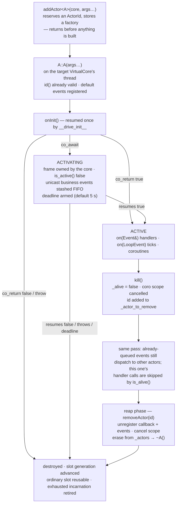

# Writing actors: identity, life, and death

> **Audience:** Adopter · **Status:** stable · **Verified-against:** qb 3.3.0 (C++20 default, C++23 supported) — d519f005

A `qb::Actor` is not an addressable object — it is an entry in one `VirtualCore`'s map, reached only by its `ActorId`. This page follows one actor from `addActor` through an `onInit()` that may suspend, through steady state, to a `kill()` that flags rather than destroys, and finally to a destructor that runs several steps later — plus what happens to a coroutine it spawned if the actor dies while that coroutine is parked.

**Prerequisites:** [The actor model](../2_core_concepts/actor_model.md) · [The event system](../2_core_concepts/event_system.md) — **See also:** [Inter-actor messaging](./messaging.md) · [The engine](./engine.md) · [Async in actors](../5_core_io_integration/async_in_actors.md) · [C++20 coroutines](../3_qb_io/coroutines.md) · [Core invariants](../7_reference/core_invariants.md)

## The smallest actor that works

```cpp
// src: derived from qb/tests/core/system/messaging/messaging-api.cpp (TestActorReceiver)
#include <qb/actor.h>
#include <qb/io.h>

struct WorkEvent : qb::Event {
    int value;
    explicit WorkEvent(int v) : value(v) {}
};

class MyWorker : public qb::Actor {
public:
    qb::io::async::task<bool> onInit() override {
        registerEvent<WorkEvent>(*this);      // subscribe
        registerEvent<qb::KillEvent>(*this);  // graceful shutdown
        co_return true;                       // the actor is ready
    }

    void on(WorkEvent const &ev) {
        qb::io::cout() << "got " << ev.value << '\n';
    }

    void on(qb::KillEvent const &) { kill(); }
};
```

Four things are already true of that class and worth stating before anything else:

- **It has an identity before it has a body.** Framework admission reserves the full instance ID before invoking the user allocator/constructor, and the base constructor consumes that reservation. `id()` is valid in your constructor body; nested admissions have their own reservations. Source: `src/qb/core/Actor.cpp` (`Actor::Actor`), `src/qb/core/VirtualCore.h` (`addReferencedActor`), `src/qb/core/VirtualCore.cpp` (`__generate_id__`).
- **It is not copyable.** `Actor` derives from `qb::nocopy` (`src/qb/core/Actor.h:326`).
- **It lives on exactly one thread for its whole life** and never migrates, which is why none of its members needs a lock.
- **`onInit()` is a coroutine.** The declaration returns `qb::io::async::task<bool>`, so `co_await` is legal from the actor's first moment of life (`src/qb/core/Actor.h:496-499`). The common case never suspends and pays nothing for the option.

## Identity, and why nothing needs a lock

`id()` returns a 64-bit instance identity: `[generation:32 | core:8 | slot:24]`. Its `index()` selects the owning core; `slot()` / `sid()` select a slot and return `qb::ActorSlotId` (`uint32_t`), while `generation()` distinguishes successive owners. Public `qb::CoreId` stays 16 bits, with real encoded cores 0..255. Ordinary slots are `1..0xFEFFFF`: 16,711,679 arithmetic positions per core before outstanding reservations, retired slots and resource limits. A released slot advances generation, and exhaustion retires it instead of wrapping.

Every service also has a nonzero-generation instance ID. Its process-stable `ServiceId` tag occupies `0xFF0000 | tag`, for tags `1..65534`; `getServiceId<Tag>(core)` gives the separate generation-zero logical address. Slot `0xFF0000` is invalid; `0xFFFFFF` with generation zero is broadcast. Exact comparisons include every bit, so an old instance ID or handle cannot identify a replacement within one engine run. The codec has no engine/node namespace and supplies no durable or process-wide identity guarantee.

Use the checked full-width `ActorId::from_raw` / `raw64()` codec. The former 32-bit import/conversion is removed, and this layout changes source compatibility and ABI: rebuild all consumers, modules and plugins consistently. This does not choose a release version or imply a performance gain. Source: `src/qb/core/ActorId.h` (`ActorId`, `BroadcastId`), `src/qb/core/VirtualCore.cpp` (`ActorIdPool::release`).

`is_actor_alive(id)` accepts either an exact instance or a logical service address on the current core. The latter queries the current service and remains phase-aware. `ActorHandle::get()` / `ready()` and `findActor<T>()` resolve exact instance IDs only; they never follow a replacement.

Because the actor never leaves its core, `VirtualCore::_handler` identifies its owning runtime on that thread, and the liveness flag remains a plain `bool`:

```cpp
    mutable bool _alive = true;
```
<!-- src: qb/src/qb/core/Actor.h:356 -->

Single-writer, single-reader, both always on the one owning thread — remote senders enqueue a `KillEvent`, they never flip the flag. No atomic, no fence, no lock (`src/qb/core/Actor.h:334-355`). `mutable` is what lets `kill()` be `const`, so a handler that received its event by const reference can still terminate its actor. The activation flag `_activated` has the identical contract (`src/qb/core/Actor.h:357-374`).

**External code must not read `_alive`.** It is not synchronised, and a cross-thread read is a data race. To test whether some other actor is still there, use a `qb::ActorHandle<T>` or `is_actor_alive(id)` — both re-query the owning core.

| Accessor | Returns | Notes |
|---|---|---|
| `id()` | `qb::ActorId` | exact instance identity within the engine run; valid from the constructor body onward |
| `getIndex()` | `qb::CoreId` | the `VirtualCore` hosting this actor |
| `getName()` | `std::string_view` | demangled class name on GCC/Clang, mangled elsewhere; the pointer is deliberately immortal (`src/qb/core/Actor.h:2658-2707`) |
| `getCoreSet()` | `const qb::CoreIdSet&` | every core the engine was started with |
| `getCoreStats()` | `qb::CoreStats` | a copy of the hosting core's cumulative counters — received, published to other cores, blocked, dropped, io, passes; the caller's core only ([the engine](./engine.md#counting-what-a-core-has-done)) |
| `time()` | `uint64_t` | nanoseconds since the epoch, **cached once per loop pass** |
| `now()` | `qb::wall_time` | the same cached instant as a `std::chrono` time point — prefer this (`src/qb/core/Actor.h:830`) |
| `is_alive()` | `bool` | `_alive` only; `true` until the reap |
| `is_active()` | `bool` | `_alive && _activated` — the phase oracle |
| `is_actor_alive(id)` | `bool` | same-core phase-aware query; exact instance or current logical service, no `dynamic_cast` |

`time()` does not move inside a handler. It is the `VirtualCore`'s per-pass timestamp, so `assert(t1 == time())` holds across any amount of work in one handler (`src/qb/core/Actor.h:804-822`). For a moving clock read `qb::unix_nanos(qb::wall_now())` from `<qb/system/time.h>`.

`is_actor_alive(id)` exists for bookkeeping that stores bare ids — a subscriber list, a routing table — and must drop entries whose actor is gone. It is **same-core by construction**: an actor map belongs to its own `VirtualCore` and is not synchronised, so `false` for a *remote* id is not evidence of anything. For cross-core liveness, ask (`co_await qb::ping(...)`) (`src/qb/core/Actor.h:1178-1201`).

## The life of an actor



### Construction happens on the worker, not where you asked for it

`Main::addActor` and `CoreInitializer::addActor` only *reserve* an id and store a factory — [the engine page](./engine.md#configuration-coreinitializer-and-what-addactor-returns) has that half. Your constructor runs later, on the target core's thread, and both `Actor` constructors assert it:

```cpp
Actor::Actor() noexcept
    : _id((assert(VirtualCore::_handler != nullptr
                  && "Actor must be constructed from within a VirtualCore worker thread "
```
<!-- src: qb/src/qb/core/Actor.cpp:667-672 -->

So construct actors only through `Main::addActor<T>(core, …)`, `Main::core(idx).addActor<T>(…)`, a `builder()`, or `addRefActor<T>()` from inside another actor on the same core. `new MyActor` on the main thread trips the assertion in a debug build and dereferences a null `_handler` in a release one.

Where the object's bytes come from is part of the same contract. `Actor` declares its own `operator new` / `operator delete` (`src/qb/core/Actor.h:563-584`), and they draw from the core thread's `qb::allocator::thread_arena` (`src/qb/system/allocator/thread_arena.h:94`): 16-byte size classes up to 1 KiB, each with a LIFO free list, filled by bump allocation from a 64 KiB first chunk and then from 2 MB `slab_cache` slabs — so a spawn-and-die burst recycles its own blocks while they are still in cache, with no lock, no atomic and no thread-local init guard on the path. It was measured into existence on qb-vs-others' `fib` (57 312 actor lifetimes per window, Huly QB-212), where the actor object's `malloc` / `free` had become the last heap traffic of an actor's lifetime and 27.8 % of the core: the lifetime went 185.3 -> 127.2 ns (-31 %) on Windows/MSVC and 129.2 -> 99.1 ns (-23 %) on WSL2 g++-14 (1c-spin, 12 interleaved launches each). An actor type larger than 1 KiB or with `alignas` above 16 falls through to the global allocator; a derived class that declares its own `operator new` / `operator delete` hides the base's, which is how a custom pool plugs in beside `qb::allocate_actor<T>` (the *construction* customization point). The block goes back on the same thread, in the reap phase below; a thread that exits while one of its blocks is still live keeps its chunks on a reachable orphan list rather than recycle them.

The default constructor also subscribes to five system events — `KillEvent`, `SignalEvent`, `UnregisterCallbackEvent`, `PingEvent`, `RequireEvent` (`src/qb/core/Actor.cpp:673`; `src/qb/core/VirtualCore.cpp:246-289`). The base constructors initialize these five dispatch pointers together; later typed registration still replaces the corresponding pointer. That is where the framework's own machinery comes from: `Main::stop()` reaches you through `SignalEvent`, `unregisterCallback()` through `UnregisterCallbackEvent`, and `co_await qb::ping/require` through the `PingEvent`/`RequireEvent` pair.

### `no_default_events` — and the one line you must not forget

To opt out of the five default handlers, pass the tag. Note what it no longer buys: since 3.2 a default event's subscription is a dispatch pointer in the actor itself (`Actor::_default_on`), found by the core's `DefaultEventResolver<E>` from the destination id, so there is no router insertion to skip — the tag is for an actor that must NOT react to one of them, not for a pool of short-lived actors.

```cpp
class ComputeTask : public qb::Actor {
public:
    ComputeTask() : qb::Actor(qb::no_default_events) {}

    qb::io::async::task<bool> onInit() override {
        registerEvent<InputEvent>(*this);
        registerEvent<qb::SignalEvent>(*this); // THE one: Main::stop() and SIGINT/SIGTERM arrive as this
        registerEvent<qb::KillEvent>(*this);   // only for a peer that kills you by pushing one
        co_return true;
    }

    void on(InputEvent const &ev) {
        push<ResultEvent>(ev.getSource(), compute(ev.data));
        kill();
    }

    // BOTH must be declared here. Declaring any `on` in a derived class HIDES every base
    // overload of that name, and the router dispatches through `Derived::on(...)` — so
    // `registerEvent<qb::SignalEvent>(*this)` above does not compile without this line.
    void on(qb::KillEvent const &) { kill(); }
    void on(qb::SignalEvent const &) { kill(); }
};
```
<!-- src: qb/src/qb/core/Actor.h:435-448; qb/src/qb/core/Actor.cpp:684-689 -->

The tag constructor's body is empty on purpose (`src/qb/core/Actor.cpp:687-688`). **The line you must not forget is `SignalEvent`, not `KillEvent`** — the distinction is not pedantry, it is the difference between a program that stops and one that does not. `Main::stop()` sends nothing: it bumps SIGINT's generation and the global one, and each `VirtualCore` then synthesises a `qb::SignalEvent` for the actors it owns (`src/qb/core/Main.cpp:901-909`, `src/qb/core/VirtualCore.cpp:1683-1688`). Nothing in the engine ever constructs a `qb::KillEvent`; that type is for a *peer* to kill you with. An actor holding only a `KillEvent` subscription therefore ignores `Main::stop()` and every signal, its core never empties, and `Main::join()` never returns — with no diagnostic. Register both if peers will also kill you directly. Pinned by `NoDefaultEvents.*` (`qb/tests/core/system/engine/no-default-events.cpp`), whose second case asserts the `KillEvent`-only actor really is unstoppable.

### `onInit()`: a coroutine from the first moment of life

`onInit()` runs once, after construction and id assignment, before any business event. Because it is a coroutine, setup that would otherwise need a state machine spread across callbacks reads as straight-line code:

```cpp
// src: derived from qb/tests/core/system/init/init-lifecycle.cpp (MultiSuspendInit)
// #include <qb/patterns.h> for qb::require; using namespace std::chrono_literals for 5ms/200ms
qb::io::async::task<bool> onInit() override {
    registerEvent<Tick>(*this);
    registerEvent<qb::KillEvent>(*this);

    co_await context().sleep(5ms);          // warm-up window
    auto peers = co_await qb::require<Peer>(context(), 200ms);  // task<std::vector<qb::ActorId>>
    if (peers.empty())
        co_return false;                    // give up: the actor is destroyed, never started

    _peer = peers.front();
    co_return true;                         // active from here
}
```

`co_return true` activates the actor; `co_return false` **or an uncaught exception** fails it. A failed init never replays its stashed inbound unicast business events; control broadcasts, `KillEvent` and replies to an ask inside `onInit()` may still be processed during activation (`src/qb/core/VirtualCore.cpp:343-382`, `:716-749`, `:877-899`). Both failure paths are pinned by `InitLifecycle.SyncOnInitReturnsFalseWithoutCoAwait`, `…SyncOnInitThrowsWithoutCoAwait`, `…AsyncInitFailureRemovesActor` and `…ExceptionAfterSuspensionFailsInit` (`qb/tests/core/system/init/init-lifecycle.cpp`).

Use `context()` rather than a bare `qb::io::async::sleep`. It returns a `qb::ScopedCoroContext` carrying this actor's cancellation scope, so a kill during init throws `cancelled_error` and unwinds the frame cleanly instead of leaving it parked (`src/qb/core/Actor.h:1548-1564`, `:2289-2293`).

`__drive_init__` resumes `onInit()` for the first time without binding a scheduler. A `sleep(0)`, a negative sleep or a callback completed inline that queues its continuation during that resume reaches `CoroutineScheduler::current()` or `schedule_via_current()`, whose cold path binds the core's listener scheduler, so the continuation lands on the scheduler the loop will drain (`src/qb/core/VirtualCore.cpp:722-730`; `src/qb/io/async/coroutine/scheduler.h:850-854`). The scheduler is allocated once per core, on that cold path (`src/qb/io/async/listener.h:1403-1411`); a core whose actors never suspend never creates one, and its loop pass asks no scheduler for work. A synchronous `co_return` still frees its frame immediately and skips the activation map (`src/qb/core/VirtualCore.cpp:732-748`).

### Activating: what is deferred, what is withheld, what is not

If `onInit()` *does* suspend, the actor enters the **Activating** phase. Its still-live frame is moved into the core's `_activating` map, `_activated` flips to `false`, and a deadline is armed (`src/qb/core/VirtualCore.cpp:751-765`).

```cpp
actor._activated = false;
const auto now   = static_cast<std::uint64_t>(qb::unix_nanos(qb::wall_now()));
Activation act;
act.init        = std::move(init);
act.deadline_ns = activation_deadline_ns ? now + activation_deadline_ns : 0; // 0 ⇒ no deadline
```
<!-- src: qb/src/qb/core/VirtualCore.cpp:759-763 -->

`qb::VirtualCore::activation_deadline_ns` defaults to **5 s** and is a public knob you set *before* `Main::start()`; `0` disables the bound, which also removes the mutual-init deadlock guard (`src/qb/core/VirtualCore.h:519-527`). When it expires the core cancels the actor's coroutine scope so the init unwinds, and the activation is finalised as a failure on a later pass. A late `co_return true` after cancellation does not activate it (`src/qb/core/VirtualCore.cpp:845-854`, `:866-899`). Both the mailbox and I/O-loop park are capped by the nearest live activation deadline (`src/qb/core/VirtualCore.cpp:769-788`, `:1107-1119`).

While Activating, a unicast **business** event addressed to this actor is byte-copied into a per-actor FIFO stash and replayed in order once it activates — deferred, not dropped. The stash is capped at 4096 events; overflowing it drops the event as a `stash_overflow` dead letter, disposes its payload and forces the activation to fail on the next pump rather than letting a wedged init exhaust the core's memory (`src/qb/core/VirtualCore.h:514`; `src/qb/core/VirtualCore.cpp:798-820`).

Three things bypass the gate entirely (`src/qb/core/VirtualCore.cpp:343-383`):

- **broadcasts**, so a system-wide notice still reaches an Activating actor;
- **any `KillEvent`**, so an Activating actor stays killable and its in-flight `onInit()` can be unwound;
- **the reply to a `qb::ask` this actor issued from inside its own `onInit()`** — stashing that would deadlock the init on its own reply. The gate recognises it without RTTI, because every correlated reply derives from `qb::CorrelatedEvent` as its first base, so `correlation_id` sits at a fixed offset (`src/qb/core/Event.h:857-869`).

The surfaces that observe the phase do **not** all behave the same, and that is deliberate:

| Surface | Consults | While the target is *Activating* |
|---|---|---|
| `VirtualCore::findActor<T>(id)` | `is_active()` | **withheld** — `nullptr` |
| `ActorHandle<T>::get()` / `ready()` / `operator bool` | `findActor` | **withheld** — `nullptr` / `false`; `operator->` / `operator*` require readiness and assert in debug (`Actor.h:2568-2582`) |
| `is_actor_alive(id)` | `is_active()` | **withheld** — `false` |
| `is_active()` | `_alive && _activated` | `false` |
| `is_alive()` | `_alive` only | `true` — it is not a phase check |
| `getService<T>()` | *nothing* | **handed out**, by design |
| inbound-event dispatch gate | `VirtualCore::_activating` membership | **deferred**, not withheld |
| `ActorHandle<T>::id()`, `push` / `send` / `broadcast` / `to()` | *nothing* | usable immediately |

<!-- src: qb/src/qb/core/Actor.h:882-917 -->

A `false` from any of the gated ones is therefore not, on its own, evidence that the actor is gone. Over a `co_await` in a peer's `onInit()` it may simply be early.

### Steady state: handlers

For every registered type, provide a public `on()`. Take the event by `const&` to read it; take it by non-const `&` when you intend to `reply()` or `forward()`, because both mutate it in place and consume it.

```cpp
void on(DataEvent const &ev) { process(ev.payload); }

void on(QueryEvent &ev) {              // non-const: reply() reuses the object
    ev.result = lookup(ev.key);
    reply(ev);                         // ev is consumed here
}
```

`ev.getSource()` is the sender; `ev.getDestination()` is the id it was routed to. Dispatch is by exact type: a handler for a base class is **not** called for a derived event, because the router keys on `type_id<E>()` of the type that was pushed.

> **The five built-in handlers are not `virtual`.** `Actor::on(KillEvent const&)`, `on(SignalEvent const&)`, `on(UnregisterCallbackEvent const&)`, `on(PingEvent const&)` and `on(RequireEvent&)` are plain members (`src/qb/core/Actor.h:622`, `:650`, `:661`, `:674`, `:683`) — the router dispatches through a per-handler-type trampoline, not a vtable, so it does not need them to be. Declaring your own therefore **hides** the base one by name; do not write `override`, which will not compile. If you replace `on(KillEvent const&)`, call `kill()` at the end of your body — the base version's whole job is that one call (`src/qb/core/Actor.cpp:713-716`). If you replace `on(SignalEvent const&)`, call `Actor::on(event)` explicitly for the terminal signals, or handle `SIGINT`/`SIGTERM` yourself.

```cpp
void on(qb::KillEvent const &) {              // no `override`
    push<ShutdownNotice>(_manager_id, id());  // last words
    kill();                                   // mandatory: nothing else marks the actor
}
```

`registerEvent<E>(*this)` is normally called from `onInit()`, but constructor-body registration works too (the id is already assigned) and so does registration at runtime from any handler. What `onInit()` uniquely offers is the failure path: `co_return false` aborts activation and prevents replay of stashed business events; control events and replies to its own initialization-time asks may still run while initialization is suspended. `unregisterEvent<E>(*this)` stops delivery of one type; `qb::Actor`'s removal from the router happens automatically at the reap (`src/qb/core/VirtualCore.h:1435-1451`; `src/qb/core/VirtualCore.cpp:291-294, src/qb/core/VirtualCore.cpp:1344-1346`).

### Steady state: sending

Every send primitive is a `const noexcept` member of `qb::Actor` and sets this actor as the source. [Inter-actor messaging](./messaging.md) owns all of them — their ordering, their lifetimes and the mechanism behind each; this is the map.

| Call | What it is for |
|---|---|
| `push<E>(dest, args…)` | the default: ordered per source → destination, any event type, returns `E&` so you can finish populating it |
| `to(dest)` → `EventBuilder` | several ordered pushes to one destination, chained |
| `getPipe(dest)` → `qb::Pipe` | the raw channel, plus `Pipe::allocated_push<E>(tail_bytes, …)` for an event with a trailing byte region |
| `send<E>(dest, args…)` | unordered; the drop path makes it a `qb::EventQOS0` primitive in practice |
| `broadcast<E>(args…)` | every actor on every core; `push<E>(qb::BroadcastId(core), …)` for one core, ordered |
| `reply(event)` / `forward(dest, event)` | reuse the event you are handling; the handler must take `E&` |

Three consequences you must know before writing the first `push`, each explained in full on that page:

- **The reference `push` returns lives until your handler returns** — across further pushes, but not across a `co_await` and never in a member. The pipe is segmented, so nothing already queued ever moves.
- **Every event payload must be trivially *relocatable*.** The runtime moves events with `memcpy` and never runs the source destructor, so a by-value `std::string` is invalid on every path. Use `qb::string<N>`, or box the data behind a `std::shared_ptr` / `std::unique_ptr`.
- **The whole send path is `noexcept`.** A throwing event constructor, or a `std::bad_alloc` growing the buffer, calls `std::terminate()`.

### Periodic work: `qb::ICallback`

Inherit `qb::ICallback` alongside `qb::Actor`, override `on(qb::LoopEvent const&)`, and call `registerCallback(*this)` — normally from `onInit()`.

```cpp
// src: derived from qb/src/qb/core/ICallback.h (the HeartbeatActor example)
class HeartbeatActor : public qb::Actor, public qb::ICallback {
    int _tick = 0;
public:
    qb::io::async::task<bool> onInit() override {
        registerEvent<qb::KillEvent>(*this);
        registerCallback(*this);
        co_return true;
    }

    void on(qb::LoopEvent const &loop) override {
        if (++_tick >= 10) {
            unregisterCallback();
            kill();
        }
    }

    void on(qb::KillEvent const &) { kill(); }
};
```

The tick fires once per `VirtualCore` pass, **after** the core has flushed its outbound pipes and dispatched that pass's inbound events — so anything the tick pushes leaves the core on the *next* pass ([the loop pass](./engine.md#the-loop-pass)). `qb::LoopEvent` carries `now` (identical to `time()` for that pass) and a monotonic `iteration` counter; it is delivered by a direct virtual call, not routed, so it is neither pushed nor addressed (`src/qb/core/ICallback.h:65-81`).

> **The tick runs on the `VirtualCore` thread, like everything else.** It must be fast and non-blocking: no mutex wait, no synchronous I/O, no `sleep` (`src/qb/core/ICallback.h:164-170`). Its rate follows the core's load and its `CoreInitializer::setLatency` setting (`src/qb/core/ICallback.h:141-143`).

Both `unregisterCallback()` and typed `unregisterCallback(*this)` queue an `UnregisterCallbackEvent` to the actor, so neither removes the callback synchronously. Its handler performs the removal when the event is delivered (`src/qb/core/Actor.cpp:736-737`, `:773-776`; `src/qb/core/VirtualCore.cpp:1432-1448`; `src/qb/core/VirtualCore.h:1429-1433`).

### `kill()` flags; the destructor runs later

```cpp
void
Actor::kill() const noexcept {
    _alive = false;
    __cancel_coro_scope__();
    VirtualCore::_handler->killActor(id());
}
```
<!-- src: qb/src/qb/core/Actor.cpp:820-833 -->

Three effects, none of which is destruction. The flag flips, the actor's coroutine cancellation scope is cancelled (a no-op if it never spawned a scoped coroutine), and the id joins `_actor_to_remove`. `killActor` is one `push_back` onto the kill queue — a plain vector, because `kill()` returns early on an already-dead actor and so enqueues an id at most once (`src/qb/core/VirtualCore.cpp:1427-1429`).

What follows, in order, on the same pass:

1. **The actor stops being called.** It is still in the router's handler map, so events addressed to it are still copied and routed — but the dispatch trampoline checks `handler.is_alive()` first, so no handler runs ([dispatch-time liveness](./messaging.md#is_alive-is-checked-at-dispatch-not-at-enqueue)).
2. **Its `ICallback` tick is skipped** if it was killed earlier in the same pass (`src/qb/core/VirtualCore.cpp:2212-2216`).
3. **The reap phase destroys it**: `removeActor(id)` unregisters the callback, unsubscribes every event type, cancels the coroutine scope again as a catch-all, moves the `unique_ptr` out of its registry slot, then resets it — which is where `~Actor()` finally runs (`src/qb/core/VirtualCore.cpp:1333-1408`) and where the sized `operator delete` hands the block back to its size class in the thread's arena (`src/qb/system/allocator/thread_arena.h:155-171`).
4. **The incarnation is released.** After the destructor, its slot advances generation; an ordinary slot becomes reusable and a service tag can admit a new service instance. Generation exhaustion retires the slot. `ServiceIndex` remains the stable tag, not the instance ID. Source: `src/qb/core/VirtualCore.cpp` (`removeActor`), `src/qb/core/detail/actor_id_pool.h` (`ActorIdPool::finish_retirement`).
5. **Its watchers are told.** Each actor that `watch()`ed it is sent one `qb::DownEvent{id, killed}`, from here, by `__on_actor_down__` — after the destructor, the id back in the pool ([death watch](#death-watch-learning-that-another-actor-is-gone); `src/qb/core/VirtualCore.cpp:1403-1406`).

`kill()` sets `is_alive()` to `false` immediately; the object remains allocated until step 3. Do not send events from `~Actor()`: the actor is mid-teardown and its instance is being retired (`src/qb/core/Actor.h:864-872`; `src/qb/core/Actor.cpp:821-832`).

There is exactly one case where destruction is *deferred past* the reap. If the actor is killed while its `onInit()` frame is still suspended, `removeActor` cancels the scope, records the id in `_dying_with_frame` and **returns without destroying anything** — the actor must outlive its own coroutine frame. Teardown completes on a later pass, once the frame reports `done()` (`src/qb/core/VirtualCore.cpp:1304-1341`, `:857-902`). Pinned by `InitLifecycle.KillDuringInitCancelsAndDestroysCleanly`.

## Death watch: learning that another actor is gone

`kill()` tells nobody, and neither does the destructor. Since 3.3 an actor can ask to be told: `watch(id)`, from any actor, of an actor on any core, and one `qb::DownEvent` arrives — `watched`, the id, and `reason`, a `qb::DownReason` (`src/qb/core/Actor.h:517-540`; `src/qb/core/DeathWatch.h:36-56`, `:79-96`):

| Reason | When |
|---|---|
| `killed` | `kill()`, a `KillEvent`, the engine's shutdown — after its destructor ran |
| `init_failed` | its `onInit()` returned `false`, or did not complete before its activation deadline |
| `init_threw` | its `onInit()` threw |
| `unknown` | no actor held the id when the watch reached its core: it never existed, or it was already gone |
| `core_stopped` | its core had stopped when the watch reached it — or ended on an exception, taking its actors with it |

```cpp
class Owner : public qb::Actor {
    qb::ActorId _worker;
public:
    explicit Owner(qb::ActorId worker) : _worker(worker) {}
    qb::io::async::task<bool> onInit() override {
        registerEvent<qb::DownEvent>(*this);   // or the answer is an `unhandled` dead letter
        watch(_worker);                        // on any core
        co_return true;
    }
    void on(qb::DownEvent const &e) {          // once, after the worker's destructor ran
        qb::io::cout() << e.watched << " is gone: " << qb::down_reason_name(e.reason) << "\n";
    }
};
```

What it guarantees, and what holds each guarantee up:

- **One answer per watch; target-down answers follow the destructor.** A watch is a record on the watcher's core, opened by `watch()` and closed once — by its answer, by `unwatch()`, or by the watcher's own removal. The watched actor's core answers from `removeActor`, whose `__on_actor_down__` runs after the destructor ran and the id was released (`src/qb/core/VirtualCore.cpp:1403-1406`, `:1954-1987`). Every answer travels as an internal `detail::WatchDown` carrying the watch's ticket, a number the watcher's core gave it, and becomes the `DownEvent` only where it closes the record holding that ticket (`src/qb/core/VirtualCore.cpp:1889-1908`): two answers to one watch deliver one.
- **`unwatch()` is final.** It closes the record (`__unwatch__`), so no `DownEvent` of that watch arrives afterwards, not even one already on its way (`src/qb/core/VirtualCore.cpp:1848-1860`).
- **Slots are reused; full instance IDs are not.** A replacement receives a different generation, so an old instance watch/event/handle does not identify it within the run. A logical service watch instead keeps the requested generation-zero address and is answered for the instance present when registration reaches its core. Tickets distinguish repeated watches of that address; `unwatch()` still closes an earlier watch, including an answer already in flight. Source: `src/qb/core/VirtualCore.cpp` (`__register_watch__`, `__on_actor_down__`, `__on_watch_down__`).
- **Every watch is answered, a core that stops included.** A watch of an actor on another core travels to that core as a request addressed to the core, not to the actor (`__watch__`), so an actor still in its `onInit()` cannot stash it and lose it with a failed init (`src/qb/core/VirtualCore.cpp:1816-1846`). A request that reaches a core after its last receive is answered by the watcher's own core: a core that stops tells the cores still running that watched one of its actors — each watcher core sets its bit in the watched core's set before its fence, and no other core hears of the stop, so a core that never watched takes in no notice and, on Windows, a stop allocates no mailbox ring for a pair of cores that never talked (Huly QB-203) — as the last thing its thread does — after its actors were destroyed and it was marked stopped (`src/qb/core/Main.cpp:641-655`, `src/qb/core/VirtualCore.cpp:1922-1946`). A store-load fence on each side guarantees that either the watcher sees the stop, or the stopping core sees the watch.
- **The watch dies with the watcher.** A watcher that dies first is never told, and its watches are withdrawn from their targets' cores, so a long-lived actor never collects dead watchers (`src/qb/core/VirtualCore.cpp:1954-1987`).
- **Nobody pays for what nobody uses.** No pass reads anything. Removing an actor costs a test of two empty tables on a core where nobody watches; the stop notice goes only to the cores that watched one of the stopping core's actors; and the death watch's own events are never dead letters (`src/qb/core/VirtualCore.cpp:1721-1722`).

Death watch reports *death*. An actor that is alive but stuck answers nothing — and its whole core with it — so that question is a health check, `co_await qb::ping(ctx, id, timeout)`. The two together, and `qb::Supervisor`'s watch mode, are in [Error handling](../6_guides/error_handling.md#supervision). Pinned by `qb/tests/core/system/engine/death-watch.cpp`; the tour is `examples/01-actors/13-death-watch.cpp`.

## Children: `addRefActor` and `ActorHandle<T>`

`addRefActor<T>(args...)` creates an actor on the **same** core and returns a `qb::ActorHandle<T>` (`RefActorHandle<T>` is a type alias of it; `addRefHandle<T>` is the same call marked `[[nodiscard]]` — `addRefActor` deliberately is not, because creating a self-managing child you only ever talk to by events is a first-class use) (`src/qb/core/Actor.h:1410-1429`). The child manages its own lifecycle; the parent does not own it.

```cpp
// src: derived from qb/src/qb/core/Actor.h:1401-1406 (addRefActor's own example)
auto helper = addRefActor<HelperActor>(cfg);   // qb::ActorHandle<HelperActor>
if (!helper.valid()) return;                    // terminal teardown refused creation
push<TaskEvent>(helper.id(), task_data);        // stashed if it is still Activating
if (helper.ready())                             // sync-init child: ready at once
    helper->doSomething();
```

The handle never dangles. Check `valid()` before using its id: terminal core teardown refuses `addRefActor` before running the child's constructor and returns an empty handle. A valid handle stores the `ActorId` and resolves the pointer **on demand** through `VirtualCore::findActor<T>()`; `get()` is read-only and never trusts or updates its reserved pointer cache. It returns `nullptr` while the child is Activating, after a failed init, or after destruction. Check `ready()` before `operator->` or `operator*`: both assert in debug when unresolved, and dereference is invalid in release (`src/qb/core/VirtualCore.h:1459-1473`, `:1128-1131`; `src/qb/core/Actor.h:2568-2581`).

| Member | Behaviour |
|---|---|
| `id()` | valid if creation succeeded, even mid-activation — safe to `push` to after `valid()` |
| `valid()` | the handle was constructed from a non-null actor; false when terminal teardown refused creation |
| `get()` / `operator bool` / `ready()` | the pointer, or `nullptr`/`false` unless the actor is **active** |
| `operator->` / `operator*` | `get()` with a debug `assert` that it resolved |
| `ready_async(ctx, timeout = 5s)` | `co_await`-able, event-driven: `true` only if the ID currently resolves to an active actor when the waiter resumes; `false` on timeout, init failure or an unresolved ID. A later actor never answers for it: the ID is one incarnation. It snapshots the ID before the lazy coroutine starts, so the handle may die while waiting (`src/qb/core/Actor.h:2486-2495`, `:2563-2567`) |

The handle stores the complete instance ID and re-resolves it on every access; a reused slot never makes an old handle resolve the replacement within the engine run. `ready_async()` captures that instance at the moment you call it, before the helper coroutine suspends. Moving, reassigning or destroying the handle before awaiting the returned task does not change what that task waits for. Source: `src/qb/core/Actor.h` (`ActorHandle::ready_async`, `ready_async_impl`), `src/qb/core/VirtualCore.h` (`ActorHandle::get`, `__actor_slot__`).

Two rules the type cannot enforce:

- **Only dereference from the owning core's thread.** `get()` reads the `thread_local` `VirtualCore::_handler`, which is null off any worker thread and points at the *wrong* core elsewhere, so it simply returns `nullptr` (`src/qb/core/VirtualCore.h:1459-1473`). There is no thread-identity check anywhere: what `operator->` and `operator*` carry is a generic non-null debug `assert` that also fires after the actor dies, and release builds carry nothing at all — so cross-thread misuse is a silent null dereference (`src/qb/core/Actor.h:2568-2582`).
- **Prefer `push(handle.id(), …)` over `handle->method()`.** A direct call bypasses the mailbox, the ordering guarantee and the one-event-at-a-time discipline the whole model rests on.

## Services: one per core, per tag

`qb::ServiceActor<Tag>` is a singleton per `VirtualCore` per `Tag`. The `Tag` must be a **complete** type — `struct MyTag {};` first, because `ServiceActor<struct MyTag>` only *declares* it and the index reaches `typeid(Tag)` (`src/qb/core/Actor.h:2426-2449`).

```cpp
// src: derived from qb/tests/core/system/actor/actor-add.cpp (TestServiceActor / CheckServiceActor)
struct LoggerTag {};

class LoggerService : public qb::ServiceActor<LoggerTag> {
public:
    qb::io::async::task<bool> onInit() override {
        registerEvent<qb::KillEvent>(*this);
        co_return true;
    }
    void on(qb::KillEvent const &) { kill(); }
    void log(std::string_view line) { /* … */ }
};

class Worker : public qb::Actor {
    LoggerService *_logger = nullptr;
public:
    qb::io::async::task<bool> onInit() override {
        _logger = getService<LoggerService>();   // same core only
        if (!_logger)
            co_return false;                     // no logger here: refuse to start
        registerEvent<qb::KillEvent>(*this);
        co_return true;
    }
    void on(qb::KillEvent const &) { kill(); }
};
```

`getServiceId<Tag>(core)` computes a generation-zero logical address without proving an instance exists there. `Actor::id()` and service admission return a nonzero-generation instance ID. A message to the logical address binds to the current service once on the receiving core, before activation/stashing; the handler sees that captured instance as `getDestination()`. A message already bound to an old instance cannot follow its replacement. `getService<T>()` is a separate same-core tag lookup. Source: `src/qb/core/VirtualCore.h` (`Actor::getServiceId`, `VirtualCore::getService`), `src/qb/core/VirtualCore.cpp` (`__resolve_destination__`, `__receive_events__`), `src/qb/core/Actor.cpp` (`Service::Service`).

**When a tag registers, and when it is refused.** A tag's 16-bit index is drawn once per process through `Actor::registerIndex<Tag>()`. Named tags register at static initialization; readers use the registry fallback if `ServiceIndex` is not initialized yet. The tag remains stable while each actual service incarnation has its own nonzero generation. First-time registration while a core lives remains refused: invalid address, failed admission before construction, CRIT and debug assert. Load an image introducing tags before `Main::start`; registration can succeed after every core is gone. Ordinary slots and service tags have separate banks, so tag registration before startup cannot shift a reserved ordinary ID. Source: `src/qb/core/VirtualCore.h` (`Actor::registerIndex`, `ServiceActor::ServiceIndex`), `src/qb/core/VirtualCore.cpp` (`__register_service__`), `src/qb/core/ActorId.h` (`service_address`, `service_instance`).

> **`getService<T>()` is deliberately not phase-gated, so a non-null pointer is not proof the service is usable.** It consults neither `is_active()` nor `is_alive()`. It hands the pointer back while the service's own async `onInit()` is still in flight, **and** after the service has been `kill()`ed but not yet reaped. That is exactly what lets a service look itself, or a peer service, up from inside its own `onInit()` — the common bootstrap pattern, and the reason the gate is absent rather than forgotten. The cost is on the caller: what you get back may be mid-init or dying. It matters most for the pattern the example above uses, caching the raw pointer as a member for the actor's lifetime. If you need an initialisation guarantee, *ask* the service — `push` an event, or `co_await qb::ask(...)` — instead of touching its state.
<!-- src: qb/src/qb/core/Actor.h:842-856; qb/src/qb/core/VirtualCore.h:1209-1231 -->

`actor-add.cpp` pins all three positions of that contract: `getService<TestServiceActor>()` is `nullptr` in the service's own constructor (it is not in `_actors` yet), is exactly `this` inside its `onInit()`, and is non-null to a peer on the same core (`qb/tests/core/system/actor/actor-add.cpp:91-125`).

A runtime `addRefActor<Service>()` with a tag already present returns an invalid handle before allocating or constructing a duplicate. A different tag remains admissible. Ordinary and service admission reserve an instance ID before user construction, including nested admission: exhaustion returns an invalid handle without constructing an actor with no identity. If construction fails after registering a handler, callback or watch, rollback removes those registrations and any pending self-kill, then releases the reservation. A retry uses a new generation. A synchronous runtime `onInit()` failure cancels the actor scope before the temporary actor is destroyed (`src/qb/core/VirtualCore.cpp:1217-1229`). Source: `src/qb/core/VirtualCore.h` (`VirtualCore::addRefActor`), `src/qb/core/VirtualCore.cpp` (`__rollback_failed_admission__`, `ActorIdPool::release`), `tests/core/system/actor/actor-add.cpp` (failed construction, nested admission and exhaustion witnesses).

Rollback does not retract events already queued by a constructor. An event addressed to the failed instance cannot reach its replacement. An event explicitly addressed to the generation-zero logical service may intentionally select the current service when received. Publish after admission when construction can fail and that behavior is unwanted. Source: `src/qb/core/VirtualCore.cpp` (`__receive_events__`, `__resolve_destination__`, `__rollback_failed_admission__`).

## Coroutines, and what happens when the actor dies first

An actor drives a coroutine on its own core's loop with `spawn` (recommended) or `spawn_detached`. Both return immediately, and both are safe **only** under one rule.

### The rule is a lifetime rule

A coroutine's frame outlives the statement that created it. It does **not** outlive the actor — the actor may be destroyed while the coroutine is parked, and nothing in either `spawn` waits for it. So:

- **Capture everything you need by value before the first `co_await`.** Never capture `this` or a reference to a member.
- **After a suspension, reach the actor system only through the context.** `ctx.push<E>(...)` (to the spawning actor), `ctx.push_to<E>(dest, ...)`, `ctx.broadcast<E>(...)`, `ctx.id()`, `ctx.time()` — all safe, because the context holds the `ActorId` **by value**, never a pointer (`src/qb/core/Actor.h:1713-1770`).
- **Keep them short.** The longer the coroutine runs, the wider the window in which its actor can vanish.

```cpp
// Safe: copy out, await, answer through the context.
void on(RequestEvent &ev) {
    std::string key    = ev.key;         // copied BEFORE spawning
    qb::ActorId sender = ev.getSource();

    spawn([key, sender](qb::ScopedCoroContext ctx) -> qb::io::async::task<void> {
        auto reply = co_await fetch(key);              // the actor may die here
        ctx.push_to<ResultEvent>(sender, reply);       // safe: id captured by value
    });
}
```

```cpp
// Dangerous — identical for spawn and spawn_detached.
spawn([this](qb::ScopedCoroContext ctx) -> qb::io::async::task<void> {
    co_await ctx.sleep(100ms);   // the actor may die while suspended
    this->_member = value;       // undefined behaviour: the actor may be gone
});
```

The machinery that makes the *frame* safe is worth knowing, because it is what the rule leans on. `spawn` does not hand your lambda to the scheduler; it hands it to a wrapper coroutine that takes `func` and `ctx` **by value**, so a temporary lambda's closure lives inside the frame rather than in the dead caller's stack (`src/qb/core/VirtualCore.h:1641-1675`). The active-coroutine census is a reference-counted cell (`detail::coro_census`) rather than a plain member precisely so the RAII guard can decrement it after the actor is gone — the last orphaned frame's handle frees it. Neither count is atomic: the actor, its frames and its destruction all live on the owning core's thread (`src/qb/core/Actor.h:1645-1672`).

### Killed while parked

The actor side has a cancellation step and one omission. `kill()` cancels the actor's coroutine scope, and `removeActor` cancels it again as a catch-all, so *every* destruction path — kill, failed init, engine shutdown — signals an existing scope; a scope-free actor needs no cancellation lookup (`src/qb/core/Actor.cpp:828-831`; `src/qb/core/VirtualCore.cpp:1333-1355`).

**The omission is that nothing waits.** `removeActor` looks at `has_active_coroutines()`, logs what it sees, and destroys the actor anyway: a `VERBOSE` line when the actor had a scope — those coroutines were just cancelled and will unwind on the next pass — and a `WARN` when it did not, because those are unbounded (`src/qb/core/VirtualCore.cpp:1356-1377`). `has_active_coroutines()` and `active_coroutine_count()` are there so you can look before deciding to `kill()` (`src/qb/core/Actor.h:1570-1572`, `:1613-1616`).

Whether the signal actually reaches the coroutine is a property of the awaiter it is parked on, and [C++20 coroutines](../3_qb_io/coroutines.md#safe-integration-with-qbactor) owns that distinction with the full inventory. In one line: an awaiter registered on the scope token — through `on_cancel` for everything `ScopedCoroContext` offers, through an embedded `cancel_hook` for `qb::ask` — wakes on the next pass and throws `cancelled_error`; anything else is listening to nothing and simply finishes on its own schedule. `spawn`'s wrapper swallows that `cancelled_error`, because a scoped coroutine being torn down is expected rather than an error (`src/qb/core/VirtualCore.h:1662-1675`); `spawn_detached`'s does the same, though for a different reason — its coroutine never joined the scope, so a `cancelled_error` there can only come from a token the caller manages themselves, which is their control flow rather than a failure (`src/qb/core/VirtualCore.h:1641-1653`). **Every other exception is reported.** Both wrappers end in a `catch (...)` that names the actor, the API and the `what()` on `std::cerr` — through `qb::io::cerr`, since `QB_LOG_CRIT` compiles to nothing unless the build asked for logging. Until 3.0 they did not: a spawned body has no continuation and no `task<>` owner, so its `exception_ptr` sat in a promise the scheduler then destroyed, and the throw vanished without a trace at any log level. Reporting changes nothing else — the frame still unwinds, RAII still runs, and the engine keeps going (`qb/tests/core/system/coroutine/coroutine-escaped-exception.cpp`).

Either way the coroutine frame can survive its actor safely while the same core is running: it owns the closure, context and census cell; the scoped form also holds the cancellation token. A detached task does **not** keep the core alive; if the last actor dies, the loop exits before a pending timer or continuation is guaranteed to run. Keep a same-core actor alive until a completion event when that work must finish. An event pushed to an actor already gone is disposed, rather than delivered into freed memory. <!-- src: qb/src/qb/core/VirtualCore.cpp:1064-1066; qb/tests/core/system/coroutine/coroutine-detached.cpp:878-938 -->

`Actor::context()` gives you the same `ScopedCoroContext` a `spawn` body receives, wherever you hold the actor — most usefully inside `onInit()`, which is what makes a `co_await` during init cancellable (`src/qb/core/Actor.h:2409-2413`). The scope itself is allocated lazily on first use, so an actor that never spawns a scoped coroutine pays nothing (`src/qb/core/Actor.h:1674-1683`).

## Pitfalls

- **Constructing an actor off a worker thread.** Every `Actor` constructor asserts `VirtualCore::_handler != nullptr`. Use `addActor` or `addRefActor`.
- **`qb::no_default_events` without re-registering `qb::SignalEvent`.** The actor ignores `Main::stop()` and every signal, and the engine never terminates. `KillEvent` is *not* the one that fixes this — the engine never sends it.
- **Capturing `this` into a coroutine.** The scope bounds the coroutine's *lifetime*; it does not legalise member access after a `co_await`. Copy by value, answer through `ctx`.
- **Assuming `kill()` destroys.** It flags. The destructor runs at the reap, later in the same pass — or later still if an `onInit()` frame is suspended.
- **Sending events from `~Actor()`.** The actor is being torn down and its instance is being retired.
- **Trusting a non-null `getService<T>()`.** It is not phase-gated: the service may be mid-`onInit()` or already killed. Ask it, do not read it.
- **Calling `operator->` on a handle you have not checked.** `get()` returns `nullptr` while Activating, after a failed init, after death, and from the wrong thread; `operator->` asserts in debug and dereferencing without readiness is invalid (`Actor.h:2568-2573`). Check `ready()` first, or `co_await ready_async(context())`.
- **Treating `time()` as a live clock.** It is cached per loop pass. Use `qb::unix_nanos(qb::wall_now())` for a fresh reading.
- **Blocking in a handler or an `on(qb::LoopEvent const&)` tick.** One thread serves every actor on the core, and nothing diagnoses it — see [Async in actors](../5_core_io_integration/async_in_actors.md).
- **Using a received event after `reply()` or `forward()`.** Both consume it, and both need `void on(E&)`.

## See also

- [Inter-actor messaging](./messaging.md) — the send API in full, and the path an event takes to reach the handler.
- [The engine](./engine.md) — where construction, the activation pump, the reap and the shutdown drain actually happen.
- [Async in actors](../5_core_io_integration/async_in_actors.md) — timers, deferred work, and the annotated `co_await` versus `run_sync` call chains.
- [C++20 coroutines](../3_qb_io/coroutines.md) — the awaitables a spawned coroutine can wait on, and which of them are cancellation-aware.
- [Actor patterns](./patterns.md) and [the patterns library](./patterns_library.md) — supervision, discovery, request/response and the rest, built on this surface.
- [Core invariants](../7_reference/core_invariants.md) — the same lifecycle rules in reference form.
