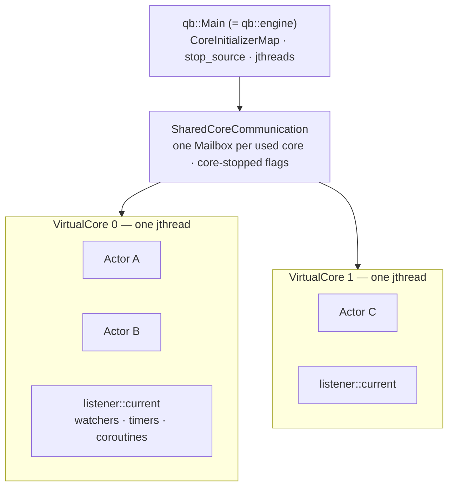
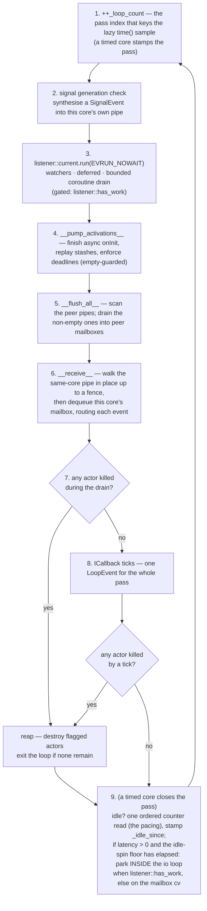
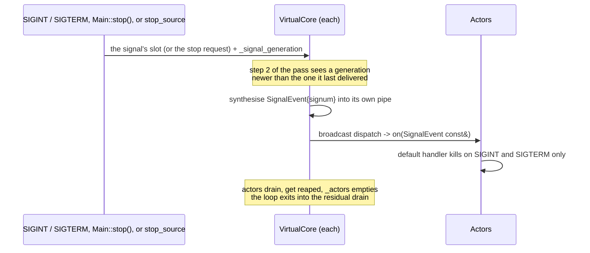

# The engine: `qb::Main` and `VirtualCore`

> **Audience:** Adopter · **Status:** stable · **Verified-against:** qb 3.3.0 (C++20 default, C++23 supported) — d519f005

`qb::Main` is a configuration object that becomes N threads, each of them a `qb::VirtualCore` that owns a disjoint set of actors, drives one `qb::io::async::listener` loop, and runs the same eight-step pass forever. This page owns that pass, the startup barrier, the backpressure policy, and the shutdown drain.

**Prerequisites:** [Writing actors](./actor.md) · [Inter-actor messaging](./messaging.md) — **See also:** [The async runtime](../3_qb_io/async_system.md) · [The pipe](../0_foundations/buffers.md) · [Core invariants](../7_reference/core_invariants.md) · [Concurrency primitives](../0_foundations/concurrency_primitives.md)

## Two objects, and only one of them is yours

- **`qb::Main`** (alias `qb::engine`) — you construct one, register actors against logical core indices, tune each core, then `start()` and `join()`.
- **`qb::VirtualCore`** — you never name it. `Main` builds one per used core inside its own `qb::jthread`, and it owns its actors, their id pool, their event router, its outbound pipes and its inbound mailbox — `_actors`, `_ids`, `_router`, `_pipes`, `_mail_box` — all without synchronisation, because exactly one thread ever touches them (`src/qb/core/VirtualCore.h:369-401`).



Between them sits **`SharedCoreCommunication`**, which `Main` owns and no application code names. It holds the `CoreSet`, one `Mailbox` per used core, and one atomic "has stopped" flag per core (`src/qb/core/Main.h:726-734`). A `Mailbox` is a `qb::lockfree::mpsc::block_ringbuffer<EventBucket, MaxRingEvents>` (`src/qb/system/lockfree/mpsc.h`) plus the condition variable used by the latency path. The matching send side lives inside each `VirtualCore`: one `qb::VirtualPipe` per destination core, plus one for itself. [Inter-actor messaging](./messaging.md#the-address-is-the-route) narrates a single event through both.

A *core index* is a logical `qb::CoreId`, not a CPU. The valid range is `0 … qb::MaxCores - 1` (256); `core(index)` with a larger index throws `std::range_error`, and the `qb::NoAffinity` sentinel is `CoreId` max, deliberately above `MaxCores`, so it can never be mistaken for one (`src/qb/core/Main.cpp:946-947`; `src/qb/core/Main.h:116`).

`qb::Main()` registers **no** cores. A core comes into existence the first time you call `core(index)` or `addActor(index, …)` for it; there is no default population from hardware concurrency (`src/qb/core/Main.cpp:935-949`).

## Configuration: `CoreInitializer`, and what `addActor` returns

`Main::core(index)` returns a `qb::CoreInitializer&` — the configuration for one logical core: its affinity set, its idle latency, and the list of actor factories to instantiate when the worker starts. The first call for an index registers the core; later calls return the same object.

```cpp
// src: derived from qb/tests/core/system/actor/actor-add.cpp (ShouldRetrieveValidOrderedActorIdList)
auto builder = engine.core(0).builder()
                   .addActor<LoggerService>()
                   .addActor<Worker>(cfg);
if (!builder)                                   // == builder.valid()
    return 1;                                   // some addActor failed to reserve an id
const std::vector<qb::ActorId> ids = builder.idList();   // creation order, NotFound for a failure
```

`CoreInitializer::builder()` returns an `ActorBuilder` whose `addActor` chains; `idList()` gives the created ids in creation order as a `qb::Main::ActorIdList` (a `std::vector<qb::ActorId>`), and `valid()` — also reachable through `explicit operator bool` — reports whether every add on that builder reserved an id (`src/qb/core/Main.h:141-208`; `src/qb/core/Main.cpp:139-154`).

**`addActor` does not construct the actor.** It reserves an `ActorId`, stores a `TActorFactory` holding your decayed constructor arguments, and returns the id immediately (`src/qb/core/Main.h:1211-1243`). The object is built much later, on the worker thread, when `start()` calls `factory->create()` (`src/qb/core/Main.cpp:727-731`). Two consequences you can see from the call site:

- **String literals become `std::string`** and every other argument is decayed and stored by value, because the factory has to outlive the call. Anything matching the `reference_wrapper_type` concept is preserved as-is (`src/qb/core/Actor.h:2745-2779`, `:2804-2813`).
- **A valid id reserves an incarnation; it does not prove the actor will exist.** Reservation can fail for a duplicate/refused service or exhausted slot/incarnation capacity. An `onInit()` that later fails is reported through `hasError()`, without changing the value already returned. Service admission returns an instance ID, not the logical address from `getServiceId<Tag>()`.

The initializer owns an incarnation pool with separate ordinary-slot and service-tag banks. Every `addActor` reserves a full generation/core/slot ID before storing its factory. Startup moves that pool into `VirtualCore` before creating any factory and binds each factory's reserved ID while its user allocation hook runs. A nested dynamic child therefore cannot consume a later factory's promised ID; allocation order no longer supplies the identity guarantee. A failed or abandoned reservation advances its generation on release, and a slot is retired rather than wrapped at generation exhaustion. A child constructed during a factory can start `onInit()` immediately; the later startup sweep snapshots IDs, re-resolves each actor, and skips one already started, so it does not run `onInit()` twice (`src/qb/core/Main.cpp:707-737`; `src/qb/core/VirtualCore.cpp:674-718`).

Ordinary slots `1..0xFEFFFF` provide 16,711,679 arithmetic positions per core; outstanding reservations, retired slots and resource limits reduce what is available. Service tags `1..65534` live in the separate `0xFFxxxx` band and do not consume that ordinary pool. A registered tag remains process-stable while its service instance changes generation. First registration while any core is alive remains refused (CRIT, debug assert), so load an image introducing tags before `start()`. Registration before startup no longer shifts ordinary promises.

`CoreInitializer::clear()` releases pending reservations and drops their factories. At startup the pool moves to the core; at terminal teardown it moves back only after actors, coroutine frames and pipe payloads are cleaned up, preserving generation metadata without a second live metadata copy. Source: `src/qb/core/Main.h` (`CoreInitializer::addActor`), `src/qb/core/Main.cpp` (`CoreInitializer::clear`, `Main::start_thread`), `src/qb/core/Actor.h` (`IActorFactory::reserved_id`, `TActorFactory`), `src/qb/core/VirtualCore.cpp` (`__install_id_pool__`, `__predicted_ids_hold__`, `VirtualCore::~VirtualCore`, `ActorIdPool::release`), `src/qb/core/detail/actor_id_pool.h` (`ActorIdPool`).

Dynamic admission and startup factories keep a guard owning the exact reserved identity across user
allocation and construction. The private append path compares that full ID with the constructed actor's
ID; a mismatch still takes the checked pool path. Publication reacquires the reserved metadata row
by slot after user init. Retirement similarly detaches the actor before its destructor and reacquires
the metadata afterwards, so nested creation cannot invalidate a retained row pointer. Ordinary free
links store the next complete incarnation; generation exhaustion still retires the slot.
<!-- src: src/qb/core/VirtualCore.cpp:1250-1284,1400-1411; src/qb/core/detail/actor_id_pool.h:58-80,128-157 -->

Identity safety is scoped to one engine run; the codec has no engine/node epoch and gives no process-wide uniqueness. Preserving internal generation metadata does not make normal restart after `join()` a public contract. A successfully started `Main` keeps `_is_running` set after joining: `core()` still rejects reconfiguration and `start()` returns immediately. Source: `src/qb/core/Main.cpp` (`Main::start`, `Main::join`, `Main::core`).

Everything on `CoreInitializer` is **pre-start only**. Once the engine is running, `core(index)` throws:

```cpp
if (_is_running)
    throw std::runtime_error("Cannot access to CoreInitializers while engine is running");
```
<!-- src: qb/src/qb/core/Main.cpp:937-938 -->

To create an actor after startup, do it from inside a running actor with `addRefActor<T>()` (or `addRefHandle<T>()`, the same call marked `[[nodiscard]]`), which lands on the *same* core — see [Writing actors](./actor.md#children-addrefactor-and-actorhandlet).

## Latency: what a core does when it has nothing to do

`setLatency` is the one knob that changes how a core behaves when idle, and it works through the mailbox rather than through the loop.

```cpp
void
wait() noexcept {
    if (_latency <= qb::duration::zero())
        return;
    _parked.store(Park::Cv, std::memory_order_relaxed);
    seq_cst_fence();
    if (!has_data()) {
        std::unique_lock lk(_mtx);
        _cv.wait_for(lk, _latency, [this] { return has_data(); });
    }
    _parked.store(Park::None, std::memory_order_relaxed);
}
```
<!-- src: qb/src/qb/core/Main.h:558-568 -->

| `setLatency(...)` | `Mailbox::wait()` | Cost |
|---|---|---|
| `qb::duration::zero()` (the default) | returns immediately — the core stays on the lock-free poll | lowest latency, one CPU fully occupied |
| `> 0` | parks for up to that span, once the core has been idle for its **idle-spin floor** (`setIdleSpin`, 50 µs by default) — inside its event loop when it owns active qb-io watchers (`ev_run(EVRUN_ONCE)` capped at `latency`), on a `std::condition_variable` when it owns none | lower CPU at idle; a core parked in its loop still answers io and io timers at poll latency, a core parked on its mailbox wakes only for a producer's `notify()` or the timeout |

`qb::duration` is `std::chrono::nanoseconds`, so pass a chrono value — `std::chrono::nanoseconds(500'000)`, `std::chrono::microseconds(500)`, `qb::duration::zero()` — never a bare integer ([the time vocabulary](../0_foundations/time.md)). Calling `setLatency` more than once on a core is safe; the last value wins.

A producer that enqueues into a mailbox calls `notify()` afterwards (`src/qb/core/Main.cpp:336`; the budget-exhausted flush at `src/qb/core/VirtualCore.cpp:2157`). The two halves are a Dekker handshake, not a bare signal: `wait()` publishes a `_parked` flag, fences, re-checks the rings and only then sleeps — with `has_data()` as the predicate — while `notify()` fences, reads the flag, and takes the mutex before `notify_one()` when the consumer has announced a park (`src/qb/core/Main.h:558-568`; `src/qb/core/Main.h:667-701`). That is what makes a wake-up impossible to lose: the 3.0 form (`wait_for` with no predicate, `notify_all` outside the lock) slept the whole latency whenever an enqueue landed between the consumer's empty drain and its registration on the condition variable — measured on a two-core ping-pong, 246–293 lost wakeups per 300 000 messages on Linux and up to 2849 on Windows, where MSVC's `wait_for` rounds to the 15.6 ms scheduler tick. At zero latency `wait()` returns at once and `notify()` is only its fence — kept on purpose: on x86 a `seq_cst` fence drains the producer's store buffer, so the event just enqueued becomes visible to the spinning consumer now rather than whenever the buffer flushes. Measured on the same two-core ping-pong (interleaved A/B on a quiet host, p50 of 7 runs), the spinning cell was *slower* than the parking one without it on Windows — 296–309 ns per round-trip against 256–272 — and lands at 259–263 ns with it; on Linux the p50 is a wash (204–219 → 205–208) and the worst run falls from 295 to 215 ns, while bulk single-producer throughput is unchanged; the fence is paid once per cross-core event, after the bucket copy that already dominates. The latency and the idle-spin floor are fixed at mailbox construction from the `CoreInitializer` and read back with `getLatency()` / `getIdleSpin()` (`src/qb/core/Main.cpp:177`; `src/qb/core/Main.h:720-722`; `src/qb/core/Main.h:720-722`).

A core does not park the moment it finds nothing to do. It keeps polling for an **idle-spin floor** — a span of TIME, `CoreInitializer::setIdleSpin()`, 50 µs by default — measured from the first pass that found nothing, and parks only once that floor has elapsed:

```cpp
if (likely(active) || !_self_pipe.empty()) {
    _idle_since = 0;
} else {
    const std::uint64_t t = __pace__();
    if (_idle_since == 0) {
        _idle_since = t;
    } else if (t - _idle_since >= _idle_spin_ticks) {
        // A pending request deadline bounds the park (Huly QB-189): the loop holds no
        // timer for it any more, so neither park may outlast it -- the cap is the smaller
        // of `latency` and the time to the earliest deadline, on a clock reading made here.
        auto cap = _mail_box.getLatency();
        if (unlikely(!_activating.empty()))
            cap = __activation_park_cap__(cap);
        if (_deadlines.armed()) {
            const auto now  = static_cast<std::uint64_t>(qb::mono_now().time_since_epoch().count());
            const auto left = detail::deadlines_next_in(_deadlines, now);
            if (left < static_cast<std::uint64_t>(cap.count()))
                cap = qb::duration{static_cast<qb::duration::rep>(left)};
        }
        if (loop.has_work()) {
            if (_mail_box.wait(loop, cap))
                _idle_since = 0;
        } else {
            _mail_box.wait(cap);
        }
    }
}
```
<!-- src: qb/src/qb/core/VirtualCore.cpp:1106-1132; qb/src/qb/core/VirtualCore.cpp:769-788 -->

A pass is idle when it moved no event — received, I/O or a flush attempt — **and** left nothing in the core's own pipe: an actor's tick callback may push to itself, which counts as no activity, and parking over that would delay a local event by up to `latency`. A pass knows it moved something from what its phases returned — the io turn's count, the flush's result, the receive's (Huly QB-257); until 3.3 it summed the cumulative counters `Actor::getCoreStats()` reads ([Counting](#counting-what-a-core-has-done)) and compared the sum with the one it had read at the end of the previous pass, a value kept live across the loop that MSVC's register allocator could not spare. The first idle pass stamps `_idle_since`; a wait that times out keeps the stamp, so an idle core parks again on the next pass rather than re-spinning a whole floor between two timeouts; the stamp is a reading of the CPU counter, taken ORDERED (`lfence; rdtsc`, the instructions the Linux vDSO gives `clock_gettime`, inline on both compilers — an internal helper of `qb/system/time.h`) on idle passes only — in **every** latency mode, a latency-0 core included: that ordered read, one per idle pass (the floor between two of them, `kIdlePollFloorNs` in `VirtualCore.cpp`, is 0), is what paces a spinning core's idle poll of the peer rings (without it the cross-core spin cells measured +25 % — the loop-clock pass of the qb-vs-others audit, `CHANGELOG.md` `[3.2.0]`; until 3.3 the read was the park policy's clock read and the cadence whatever the pass's content added to it, Huly QB-251) — the clock is read only to cap a park (against both request and activation deadlines), and the park itself only when the core can park at all (`src/qb/core/VirtualCore.h:556-569`; `src/qb/core/VirtualCore.cpp:1106-1132`). Until 3.0 this was an integer **spin credit** refilled from the previous pass's event count, which parked a one-event-per-pass workload after two or three empty passes — every hop of a request/response paid an OS park and wake (axis A of the qb-vs-others audit). A floor in time is indifferent to how many events a pass carries: a ping-pong whose hops take a few microseconds never reaches it, and a genuinely idle core still yields its CPU after 50 µs. `setIdleSpin(0)` parks on the first idle pass; a larger floor keeps a burst-then-quiet core polling longer (`src/qb/core/Main.h:336`; `src/qb/core/Main.h:422`).

> **Where a core parks decides what wakes it.** A core that owns active qb-io watchers — a listening socket, a session, a timer, a `qb::io::async::callback` — parks *inside* its event loop (`Mailbox::wait(listener &)` → `listener::run_once_for()`, `src/qb/io/async/listener.h`): `ev_run(EVRUN_ONCE)` blocks in the backend poll under a one-shot cap timer armed at `latency`, so a readable socket or an expiring io timer wakes it at poll latency and `latency` only bounds the park. A producer ends that park through the loop's `ev_async` — the mailbox's `notify()` reads the published park state (`Park::Loop` / `Park::Cv`) under its mutex and either sends the async or signals the condition variable; the async watcher is `unref()`-ed so it never counts as work, and it is armed on the first loop park, so a spinning or actor-only core never creates the wake pipe. Until 3.2 every park was the condition variable and a parked core consulted no io deadline: a socket that became readable waited for the timeout (measured p50 0.9–1.2 ms at 100 µs latency and 15.6 ms at 10 ms, against 19 µs while polling; 24–31 µs with the loop park), and a timer armed on such a core fired at the park timeout. A core with no io work keeps the condition-variable park. `tests/core/system/engine/core-park-policy.cpp` pins where a core parks and that its cap holds; `core-park-wake.cpp` pins each wake path.

> **`Main::setLatency` is a blanket overwrite, not a default.** It loops every registered core and calls `setLatency` on each, last write wins (`src/qb/core/Main.cpp:802-805`); `Main::setIdleSpin` does the same for the floor (`src/qb/core/Main.cpp:808-811`). Pairing either with per-core tuning clobbers whatever you set before it. Use one or the other, or call the global one first.

## Affinity is a request, and on macOS it is a different request

`setAffinity(CoreIdSet)` asks the OS to run the worker only on the listed CPUs. `qb::NoAffinity` is `std::numeric_limits<CoreId>::max()`, deliberately above `qb::MaxCores`; ids at or above that bound are filtered out before any OS call is made, so `CoreIdSet{qb::NoAffinity}` is the explicit, well-defined way to say "no pinning" and is exactly equivalent to an empty set (`src/qb/core/Main.h:116`; `src/qb/core/Main.cpp:600-602`). `qb::CoreIdBitSet` applies the same filter at insertion, so an out-of-range id never even reaches the set (`src/qb/core/ActorId.h:127-135`).

**The default follows the inherited mask (since 3.3, Huly QB-1081).** A core never given a set is pinned to the CPU at its position in the mask its thread inherits — on Linux the mask of the thread that called `start()` (a `taskset`, a cgroup cpuset), on Windows the process's (`start /affinity`, a job object) — so core 0 takes the first CPU the process may run on and core 1 the second, and a core past the mask's end is not pinned. An explicit set keeps the CPUs of that mask and leaves the others out, logged; with none inside, nothing is pinned: a deployment's restriction is never widened by the program it restricts. The rule is `qb::detail::place_thread` (`src/qb/system/cpu.h:279`), applied to each core on its own thread by `place_core` (`src/qb/core/Main.cpp:597`). Through 3.2 core `i` was pinned to CPU `i` regardless: out of a `taskset` on Linux, an `EINVAL` warning in a cpuset, a refused `SetThreadAffinityMask` on Windows. `tests/core/system/core/core-affinity.cpp` reads every placement back from the OS.

It is best-effort in the ordinary sense — a refused pin logs a warning and **never** fails core init (`src/qb/core/VirtualCore.cpp:661-662`). It is also best-effort in a sharper sense that a successful return will not tell you:

- **macOS has no `pthread_setaffinity_np`, and no mask.** qb calls `thread_policy_set(THREAD_AFFINITY_POLICY)` instead (`src/qb/io/cpu.cpp:574-604`). On **Apple Silicon** that flavour is not implemented: every call answers `KERN_NOT_SUPPORTED`, and qb deliberately takes that code as *success* — otherwise every core of every run would warn. Nothing is pinned, silently — and since Huly QB-1111 nothing is asked either: once `CPU::ThreadPinningSupported()` has probed that answer, the pin and the capture of `start(false)` return without a Mach call (every core of every engine paid one before). With no mask to read, a default core asks for its own index, as before 3.3.
- Where macOS does implement it (Intel), the header calls the policy experimental and a scheduler **hint**: threads sharing an affinity *tag* are placed to share an L2 cache. qb passes the CPU number as that tag, so `setAffinity(3)` means "group me with other tag-3 threads", not "pin me to CPU 3".
- qb honours only the **first** real id in the set there, so a multi-core `CoreIdSet` narrows to its lowest member.
- A Windows **GNU** build applies no affinity at all — the code path is `#warning`-ed out (`src/qb/io/cpu.cpp:616`).

Do not infer placement from a call that returned. Ask `qb::CPU::ThreadPinningSupported()` (`src/qb/system/cpu.h:197`), which is a runtime probe and is therefore also right for an x86_64 binary under Rosetta 2. The full account is on `qb::NoAffinity` (`src/qb/core/Main.h:85-108`).

**More cores at latency 0 than CPUs is a configuration `start()` names (Huly QB-1082).** A spinning core never parks and never yields its CPU, so when they outnumber the CPUs the process can run at once they preempt one another and an event between two of them waits for the receiver's next time slice — on the eight-core chain of Huly QB-1080, 320 ns a hop with a CPU per core, 0.89 ms with one CPU short. `start()` counts its cores at latency 0 against `qb::detail::usable_cpus()` (`src/qb/system/cpu.h:248`) — `hardware_concurrency()` lowered to the inherited mask and, on Linux, to the tightest cgroup v2 `cpu.max` quota on the process's path — and warns on stderr and in the log when they outnumber it (`src/qb/core/Main.cpp:618`). It changes nothing else: the check runs once, before any core exists, and no core parks or slows for it. The remedy is a latency on the cores that can wait, or fewer cores.

## Startup: the barrier, and what "started" means

```cpp
engine.start();   // async = true (default): on success, returns after the startup barrier
engine.join();    // block until every worker has terminated
return engine.hasError() ? 1 : 0;
```

`start(true)` spawns one `qb::jthread` per registered core and then waits until the shared counter reaches the core count — 1024 spins, then 256 `yield()`s, then a 50 µs `sleep_for` per poll, because the calling thread is one more competitor for a CPU while the last core initialises (`hardware_concurrency()` ignores affinity masks and cgroup quotas, so an engine can have more cores than CPUs); `start(false)` promotes the **calling thread** to the last worker, so `start()` blocks until that core stops; call `join()` afterward if other cores must also finish (`src/qb/core/Main.cpp:856-880`, `:882-887`). That thread's affinity, which its core pinned, is put back when `start(false)` returns, after a failed init as after a run (Huly QB-1083). Both modes install the signal handlers before the first core is launched, after reading the process's signal counts, which each core then takes as already delivered (`src/qb/core/Main.cpp:837-848`): until 3.3 the asynchronous start installed them right after the barrier and the synchronous one just before the calling thread was consumed, so a signal raised by an actor's `onInit()` or first passes met the process's previous disposition (Huly QB-1070), and every start zeroed the counts under any engine already running (Huly QB-364).

Each worker, in `Main::start_thread`, does this in order (`src/qb/core/Main.cpp:639-754, src/qb/core/Main.cpp:698-732, src/qb/core/VirtualCore.cpp:672-704`):

1. Construct the `VirtualCore` on its own stack, take the signal counts `start()` read as the signals it has delivered (Huly QB-364), wire the engine's `qb::stop_token`, and publish `VirtualCore::_handler = &core` — the `thread_local` every `Actor` member forwards through.
2. Arm guards that withdraw the core's io loop from its mailbox, destroy the core and its actors while `_handler` still points at it, then clear the TLS context and publish `stopped`. The ordering holds even when a callback throws: an actor destructor retains its core context, a late death watch cannot report `core_stopped` before that destructor finishes, and peers can end their residual drain (`src/qb/core/Main.cpp:645-690`).
3. Move the initializer's incarnation pool into the core, verify its reserved factory IDs, then run `__init__(cpus)` — pin the core where `place_core` put it in the mask its thread inherited (Huly QB-1081).
4. Refuse a registered core with **zero** actor factories: `Error::NoActor` (`src/qb/core/Main.cpp:704-706`).
5. Bind each factory's reserved instance ID with a scoped restore/rollback guard, then call `factory->create()` and `appendActor(...)` — construction only, no init.
6. `__init__actors__()` snapshots services by tag, then ordinary actors by slot, and starts their `onInit()` coroutines through first suspension or return, skipping an actor whose `onInit()` already started (a child a factory created), so none runs twice.
7. `__wait__all__cores__ready` — `fetch_add(1)` on the shared counter, then poll until it reaches the core count — 1024 spins, then 256 `yield()`s, then a 50 µs `sleep_for` per poll, so a core that arrives after every CPU is already taken by a waiting peer still gets a slice to arrive on, and the waiters' polls leave the counter alone between quanta (under TSan the pure spin was a hang, not a delay — `MainLifecycle.StopMultiCoreGracefulNoError` past 600 s on a 24-vCPU host — and the yield alone left the same tests anywhere between 0.1 s and 30 s, because with one CPU per waiter `yield()` returns at once and the polls' acquire loads kept starving the last core's every atomic op under TSan's atomics lock; with the sleep they take 100 ms, every run).
8. `__workflow__()`.

That single counter carries two things at once, which is why the error codes start at `1 << 9`:

```cpp
static_assert(static_cast<uint64_t>(qb::MaxCores) < static_cast<uint64_t>(BadInit),
              "startup-barrier sentinel space (Error::BadInit) must exceed "
              "MaxCores so a clean ready-count is never mistaken for an error");
```
<!-- src: qb/src/qb/core/VirtualCore.h:144-146 -->

A value below `BadInit` is a clean ready-count; anything at or above it is a failure. A failing core **stores** its error code over the counter, which both trips `hasError()` and releases every other core's barrier — so one bad core aborts the whole start rather than leaving the rest spinning (`src/qb/core/Main.cpp:793-799`, `:880-883`).

### The four error codes, and which path raises which

They are the `qb::VirtualCore::Error` flags:

```cpp
enum Error : uint64_t {
    BadInit         = (1u << 9u),
    NoActor         = (1u << 10u),
    BadActorInit    = (1u << 11u),
    ExceptionThrown = (1u << 12u)
};
```
<!-- src: qb/src/qb/core/VirtualCore.h:131-136 -->

| Code | Raised when |
|---|---|
| `BadInit` | `VirtualCore::__init__` returned false, or `start()` was called with no core registered at all (`src/qb/core/Main.cpp:826-830`) |
| `NoActor` | a core was registered with `core(n)` but given no actor |
| `BadActorInit` | an actor's `onInit()` resolved to `false` — **including the case where it threw** |
| `ExceptionThrown` | an exception escaped pre-loop startup, such as from an actor **constructor**; a handler exception in `__workflow__` uses a distinct internal runtime marker |

The `onInit()`-throws case is worth stating exactly, because it is easy to guess wrong. `__drive_init__` is `noexcept` and catches the exception itself, logs it, and reports `InitOutcome::ReadyFalse` (`src/qb/core/VirtualCore.cpp:734-746`). It therefore lands on `BadActorInit`, identically to a clean `co_return false`. An actor constructor that throws during `create()` can reach the pre-loop `ExceptionThrown` catch; a handler that throws inside `__workflow__` sets the runtime marker instead.

Only the boolean is public. `hasError()` reads the barrier counter and compares it against `BadInit`; the individual code is visible only in the log (`src/qb/core/Main.cpp:901-904`). **`join()` returning does not mean success** — always check.

On a failure before the workers enter `__workflow__`, `start()` joins them before it clears the running flag and returns. This keeps their initializers and shared mailboxes alive through teardown, and makes a later `core()` call, another `start()`, or scope exit safe without a separate join. A worker that throws after passing the startup barrier sets a separate internal error marker: `hasError()` still reports it, but `start()` leaves any live peers for the caller to stop (`src/qb/core/Main.cpp:527-533`, `:889-898`). The system tests hold a failed actor's destructor at a latch and make a post-barrier throw race a live peer (`qb/tests/core/system/engine/main-lifecycle.cpp`).

## The loop pass

One iteration of the core's loop, in the order it happens — `__workflow__` runs it as `__workflow_loop__`, one of two instantiations chosen once at thread start: a core with pass timing runs the other ([Counting](#counting-what-a-core-has-done)) (`src/qb/core/VirtualCore.cpp:973-1164`):



Six things read off that ordering, and each is a question people actually ask:

- **`Actor::time()` is constant for a whole pass, and sampled on demand.** It forwards to `VirtualCore::time()`, which reads `qb::unix_nanos(qb::wall_now())` on the FIRST call of a pass — keyed on `_loop_count` — and returns that sample to every later call in the same pass (`src/qb/core/VirtualCore.cpp:1650-1657`; `src/qb/core/VirtualCore.h:580-582`). Every actor on the core sees the same value in the same pass, and so does `qb::LoopEvent::now`; a pass in which nobody asks reads no clock at all — through 3.1.0 every pass paid one read at step 1, asked or not, and until the 3.2 loop-clock pass the `LoopEvent` of step 8 still asked on every pass, callbacks or none. For a moving clock read `qb::wall_now()` directly; `Actor::now()` is the same cached instant as a `qb::wall_time`.
- **A `qb::ICallback` tick happens *after* the flush**, so events a tick pushes wait for the *next* pass to leave the core. Events pushed from an ordinary handler in step 6 also miss step 5, for the same reason. One `qb::LoopEvent` is built for the whole pass and handed to every registered callback by a direct virtual call — it is not a routed event and has no source or destination (`src/qb/core/VirtualCore.cpp:2211-2215`; `src/qb/core/ICallback.h:65-81`) — and it is built only when at least one callback is registered: a core with none skips step 8 entirely (`src/qb/core/VirtualCore.cpp:1071`), which is what keeps a callback-free pass clock-free.
- **`listener::run` comes before the actor dispatch, not around it.** That is the whole mechanism behind the `run_sync` rule: an actor handler runs at step 6, after `run()` has returned, so the scheduler's re-entrancy guard is not armed and blocking there freezes the rest of the pass. [The async runtime](../3_qb_io/async_system.md#run_sync-and-run_for-block-the-calling-thread) owns that rule; [Async in actors](../5_core_io_integration/async_in_actors.md) narrates the two call chains side by side.
- **Step 3 is gated on the loop's own liveness.** `listener::has_work()` — a referenced active watcher, a pending event, an outstanding `defer()`, a ready coroutine or a completed spawned frame the scheduler still has to free (an `ask` reply resumes its frame inline, so a coroutine can finish outside a `run()` turn), the first two read inline off the loop's own counters through `ev_active_count_addr()` / `ev_pending_count_addr()` rather than through two calls into libqev per pass (`src/qb/io/async/listener.h:1294-1297`; `src/qb/core/VirtualCore.cpp:1034-1038`). A pure-actor core with no live qb-io object skips the loop entirely. The gate used to be `has_coro_scheduler() || size() || has_deferred()`, and its first term is true for the rest of a core's life once any actor has spawned a coroutine — a `NOWAIT` libev pass on every tick with nothing to poll for. And a core that owns a socket does not poll it on every pass either: the listener polls the backend while the loop is hot (the previous poll reported a ready fd) and otherwise once per `CoreInitializer::setIoPollInterval` (1 µs by default), the passes in between running `ev_run(EVRUN_NOWAIT | EVRUN_NOPOLL)` — timers and pending events as usual, no syscall — since the poll was the whole of what an io pass cost over a plain one (124 vs 12 ns on WSL2, 292 vs 16 on MSVC) and on a quiet socket it returned nothing on nearly all of them. And a pass with nothing for the loop to do does not run it at all: the listener reads the loop's counts inline — a pending event, a wake left by another thread's `ev_async_send`, a poll the cadence is due to make, a timer or periodic deadline within reach of an estimate it keeps on the CPU's counter — and enters `ev_run` only for one of them, handing it the clock reading that found the timer due (`ev_now_set`) so the pass reads the clock once; a busy core with a far timer 36.6 → 26.3 ns per pass, a quiet socket between two polls 48.0 → 27.5, against 12.2 for a plain pass (WSL2 g++-14). The corollary for a raw timer: `event::timer::start()` refreshes the loop's clock before arming, because that clock now stands still between the passes that run the loop.
- **Step 9 parks where a wake can reach it.** Past the idle-spin floor a `latency > 0` core with io work — `listener::has_work()` again — parks INSIDE its io loop: `Mailbox::wait(listener &, cap)` publishes `Park::Loop` and hands the cap — `latency`, or the time to the core's earliest request deadline when a timed `ask` is pending, whichever is smaller (`src/qb/core/VirtualCore.cpp:1116-1124`) — to `listener::run_once_for` (`src/qb/core/Main.h:609-624`) — one `ev_run(EVRUN_ONCE)` capped by a one-shot timer (`src/qb/io/async/listener.h:1377`) — so a socket that becomes readable ends the park at poll latency, and a producer on another core ends it through the loop's async watcher (`listener::wake()`, `src/qb/io/async/listener.h:1352`) — the one libev entry point safe against a concurrent `ev_run`. Io delivered by that park clears `_idle_since`, so the reply is met at polling latency (`src/qb/core/VirtualCore.cpp:1112-1131`). A core with no io work keeps the condition-variable park. Before 3.2 every park was the cv, which a readable socket could not end: measured p50 0.9–1.2 ms at `latency` 100 µs and 15.6 ms at 10 ms, against 24–31 µs with the loop park (qb-vs-others, axis N).
- **The loop ends when the last actor is reaped**, not on a flag: `if (__reap__()) break;`, the reap answering `_actor_count == 0` (`src/qb/core/VirtualCore.cpp:1074-1075`, `:2248`). An engine whose actors never call `kill()` runs forever, by design.

### Reaping is a drain, not a sweep

`kill()` only flags. The reap at step 7/8 destroys the flagged actors — and destroying one runs arbitrary user code, which may `kill()` another and re-enter `killActor()`. Iterating the queue being mutated would be a use-after-free (a growth reallocation of the vector moves every entry), so the loop swaps into a scratch buffer and repeats until a pass adds nothing:

```cpp
while (!_actor_to_remove.empty()) {
    _actor_remove_batch.clear();
    _actor_remove_batch.swap(_actor_to_remove);
    for (auto const actor : _actor_remove_batch)
        removeActor(actor);
}
```
<!-- src: qb/src/qb/core/VirtualCore.cpp:2241-2246 -->

It terminates because only user code refills the queue and each actor can be removed at most once — after an id leaves `_actors`, `removeActor` destroys nothing. Pinned by `KillDuringReap.ActorKilledFromAnotherDestructorIsStillReaped` (`qb/tests/core/system/lifecycle/kill-during-reap.cpp`). A callback whose actor was killed earlier **in the same pass** is skipped rather than ticked one last time, because the tick loop consults `_actor_to_remove` before every call (`src/qb/core/VirtualCore.cpp:2221-2225`).

## Backpressure: why the flush always terminates

Cores can fill each other's mailboxes. If core A and core B both hold full outbound pipes for each other *and* their inbound mailboxes are full, neither can progress without first reading its own mailbox — so an unbounded retry inside `try_send` would deadlock. The invariant that replaces it is: **every pass of `__flush_all__` terminates in bounded time.**

A failed `try_send` falls into one of four cases, tested in this order (`src/qb/core/VirtualCore.cpp:514-651`):

| Case | Test | Action |
|---|---|---|
| Malformed | `bucket_size == 0` | cannot be stepped over — log `LOG_CRIT` and **discard the rest of that pipe** |
| Permanently undeliverable | `bucket_size > kMaxDeliverableBuckets` | log `LOG_CRIT`, **dispose** the event (its destructor runs) and skip it — an `oversize` dead letter |
| Best-effort | `state.bits.qos == 0` | drop it **without** disposing — this is the drop path the `EventQOS0` `static_assert` protects; counted in `events_dropped` |
| Guaranteed | otherwise | a partial flush at once when the peer is stalled and this core has inbound work of its own; otherwise a bounded backoff, then a partial flush; every failed attempt is counted in `sends_blocked` |

The retries are for a peer that is draining, or a core with nothing else to do. Two things together make the flush take the partial flush at once instead (`src/qb/core/VirtualCore.cpp:2123-2134`): the peer is STALLED — its consumer index, as this core's producer ring last saw it, unmoved over `kFlushStallRefusals = 2` refusals in a row (`src/qb/core/VirtualCore.cpp:496-503`): a peer held in one long handler, or itself blocked on this core's ring — and this core has inbound work waiting: a peer's ring into it holds events, its self pipe holds the last pass's same-core pushes, or its io loop has something to deliver (`__has_inbound_work__`). That work may be what the peer is waiting on, and it is throughput the retries would burn. The shape that found it is `savina/barber` at two cores (Huly QB-979): the factory's core drains nothing during the reference's one-handler production, its ring from the barber's core fills after a few hundred customers, and the barber's core then spent every pass in the retries — up to 64 pauses and 448 yields — with its own customers waiting. The stall test is what keeps `savina/nqueens`' master fed: it drains its ring every pass and relays what the workers send it, and a worker that ran its own kernels instead of waiting out the budget hoarded the children the master was about to relay, so the search fell into its slower schedule more often. Ticks are not inbound work, on purpose: a ticking producer that floods a slower peer keeps the throttle the retries give it. The whole refused-event branch -- the count, the drop, the stall test, the retries and the two partial flushes -- lives out of line in `__refused__` (`src/qb/core/VirtualCore.cpp:2075-2159`), the cold half kept out of the hot one. What no form of the rule buys is the compiler's schedule of `__flush_pipes__`'s run-gathering loop as it was before the rule: g++ and MSVC redo that loop whenever the function changes, however cold the change, and `savina/big` at two cores -- a cell none of the rule's code runs in -- reads ~1.5 % slower for it on g++ (a census of forty interleaved launches; the same with the branch inline or out of line, worse with the loop in a function of its own); binary size, member layout and alignment were excluded by their own controls, and Windows is level (qb-vs-others `docs/TUNING.md` §21.8).

The backoff is monotonic and its two thresholds are compile-time constants — `kFlushSpinAttempts = 64` and `kFlushYieldAttempts = 512`, `static_assert`ed in that order (`src/qb/core/VirtualCore.cpp:486-488`). After the first `try_send` fails, the retry loop runs a budget of 512 further attempts (`src/qb/core/VirtualCore.cpp:2137-2149`):

- attempts `1 … 63` — `qb::spin_loop_pause()` between tries, a CPU hint with no scheduler involvement;
- attempts `64 … 512` — `std::this_thread::yield()`, giving the peer's consumer a slot;
- budget exhausted — **partial flush**: `notify()` the destination's mailbox, `pipe.consume_front(cur - seg.data())` so the unsent tail stays queued in order at the head of its segment, and return to the workflow, the peer's `_peer_seen_read` snapshot refreshed so what it consumed during the budget is no stall evidence (`src/qb/core/VirtualCore.cpp:2151-2158`; the walk consumes at `src/qb/core/VirtualCore.cpp:642`).

The caller then runs `__receive__`, which frees room in *this* core's mailbox for its peers, so the next pass makes progress. That is what closes the cycle: no cross-core deadlock, no starvation, and no event silently reordered — the tail keeps its place in the FIFO.

Separating "permanently undeliverable" from "backpressured" is what makes the whole thing terminate. An oversized event can never be enqueued however much the consumer drains, so retrying it would hold the FIFO pipe hostage behind it, the sender would spin in the shutdown drain forever, and `Main::join()` would never return — [the size ceiling](./messaging.md#the-size-ceiling-and-what-happens-past-it) has the numbers.

## Counting: what a core has done

Every core counts what it does, and an actor reads its own core's counts with `getCoreStats()`, which returns a copy of a `qb::CoreStats` (`src/qb/core/CoreStats.h:52-89`). They are the counts the park policy has always kept, made cumulative in 3.3 instead of cleared at the end of every pass (Huly QB-162): the pass pays nothing new, and the snapshot is paid by the actor that asks.

| field | counts | where in the pass |
|---|---|---|
| `loop_passes` | passes of the loop — what `LoopEvent::iteration` carries | step 1 |
| `events_received`, `buckets_received` | every event the core took in, from its mailbox or from its own pipe, whether an actor handled it or not | step 6 |
| `events_sent`, `buckets_sent` | every event published into ANOTHER core's mailbox: by the flush, or straight into the peer's ring by a `send`, `reply` or `forward` | step 5, and the direct path |
| `sends_blocked` | each publish attempt that met a full mailbox — one per failed attempt of the backoff, and one for a `send`, `reply` or `forward` whose direct publication was refused, the event then waiting for the flush (Huly QB-356) | step 5's slow path, and the direct path |
| `events_dropped` | `EventQOS0` events dropped on a full mailbox | step 5's best-effort row |
| `dead_letters`, `dead_letters_by_reason` | events that reached no actor, by `qb::DeadLetterReason` — each one also logged and handed to the core's `DeadLetterHandler` ([dead letters](../6_guides/error_handling.md#dead-letters-what-reached-no-actor)) | step 6, the activation pump, step 5's oversize row, the shutdown drain |
| `io_events` | qb-io callbacks the loop ran since the core started, a park's included — the listener's `total_events_processed()`, less what that loop had run before: under `start(false)` it is the calling thread's loop, which outlives the engine (Huly QB-357) | steps 3 and 9 |
| `pass_time` | how long the passes take, the park excluded: a `qb::TimingStats` — count, total, last, max and `recent_max`, the longest of the last one to two seconds. Only on a core `CoreInitializer::setPassTiming()` set; zero otherwise | from step 1 to the start of step 9 |

Three properties are pinned by `qb/tests/core/system/engine/core-stats.cpp`, and they are the ones to build on. Counts conserve: a QoS-0 burst into a full mailbox is exactly published plus dropped, and the peer receives exactly what was published. Same-core traffic is received, never sent. A counter moves after the event it counts was handled, so inside the handler of the k-th arrival the core reads k − 1 received. Two of these were false until 3.3: a direct cross-core `reply` was counted nowhere — every reply of a two-core ping-pong was invisible — and a dropped QoS-0 event was counted as sent.

**Pass timing is the one measurement a core takes only when asked** (Huly QB-165). A handler that blocks — a synchronous call, a long loop — shows nowhere but in everyone's latency; `pass_time` shows it as the longest pass, and `recent_max` keeps it visible for a second or two after it happened, which is the window a monitor polling once a second needs. It costs two monotonic clock reads a pass (an idle pass adds the ordered counter read that paces it, as on an untimed core). An untimed core — every core's default — pays nothing for the option: `__workflow__` picks one of two instantiations of the loop at thread start, and the untimed one reads no clock it did not read before. The compilers do lay it out anew — g++ stops inlining the listener's `run()` and the mailbox waits into it, MSVC allocates its registers differently — and it measured level with the loop before it on both hosts: the Savina cells, the pass, ask and push probes, and a core pumping a quiet socket or a far timer every pass. Pinned by `qb/tests/core/system/engine/pass-timing.cpp`: a 40 ms stall in a handler is the longest and the recent-worst pass, the park is not a pass, an untimed core reads zero.

The counters are plain integers written by the core's own thread, so `getCoreStats()` reads the caller's core and no other. A view across cores is asked for, the way any cross-core question is: one responder actor per core answering with its snapshot, gathered with `qb::ask_all`. Nothing is shared, nothing is atomic, and nothing is paid between two collections.

### Exposing them: `qb::metrics`

The responder per core ships (Huly QB-154). `qb::metrics::Registry` is a service actor -- one per core, added like any other (`engine.addActor<qb::metrics::Registry>(core)`) -- that answers a scrape with its core's snapshot: the core's own counters, as the `qb_core_*` families with a `core` label (`qb::metrics::describe`), and every source the actors of that core added with `add_source()` -- a module client's `stats()`, an HTTP server's request counts. A scrape runs from a coroutine of an actor whose core has a registry: `co_await qb::metrics::scrape(*this, getCoreSet(), timeout)`. That registry collects its own core at once and asks the others (one `qb::ask` each, all at the same time), so it receives the answers and the scraping actor registers nothing; a core that does not answer in time -- no registry there, or a handler holding it past `timeout` -- is reported `qb_scrape_core_up{core="N"} 0` instead of failing the scrape, which is why it is not built on `qb::ask_all` (a single silent target fails that one). `qb::metrics::write_text()` renders the result in the Prometheus text format 0.0.4. The rule above still holds: a counter is read on its own core, by its own thread, only when a scrape asks, and nothing is paid between two scrapes (`src/qb/core/metrics.h:254`; `src/qb/core/metrics_registry.h:178`, `:201`).

```cpp
#include <qb/core/metrics_registry.h>
#include <qb/main.h>

int main() {
    qb::Main engine;
    for (qb::CoreId core : {0, 1})
        engine.addActor<qb::metrics::Registry>(core);   // every core a scrape asks
    // ... the application's actors; one of them, on core 0 or 1:
    //   _source = getService<qb::metrics::Registry>()->add_source(
    //       [this](qb::metrics::snapshot &s) { s.counter("app_jobs_total", "Jobs done.").add({}, _jobs); });
    //   ...and, from a coroutine:
    //   auto snap = co_await qb::metrics::scrape(*this, getCoreSet(), std::chrono::milliseconds(500));
    //   std::string text = qb::metrics::write_text(snap);
    engine.start();
    engine.join();
}
```

Pinned by `qb/tests/core/unit/metrics/metrics-text.cpp` (the exposition byte for byte, the merge) and `qb/tests/core/system/engine/metrics-scrape.cpp` (two cores through one registry, a core without one reported down, a throwing source contained).

### Autonomous listeners and module adapters

The model also describes an autonomous `qb::io::async::listener`, without an actor registry:

```cpp
qb::metrics::snapshot snapshot;
auto &loop = qb::io::async::listener::current;
qb::metrics::describe_dispatch(snapshot, loop.dispatch_timing(), loop.nb_invoked_event(),
                               {{"listener", "main"}});
```
<!-- src: qb/src/qb/core/metrics.h:283; qb/src/qb/io/async/listener.h:1480 -->

`qb_io_last_run_events` is a gauge of the last `run`, not a cumulative total or a rate.
When the supplied timing has observations, the adapter adds dispatch count/time counters
and last/max/recent-max duration gauges, all durations in seconds. Watcher dispatch excludes
deferred callbacks and coroutine resumes outside it. Timing remains opt-in through
`set_dispatch_timing`; the adapter does not read a clock or install instrumentation.
Reading `dispatch_timing()` itself obtains the current time for its recent-maximum window.
Link `qb::core` for the value model even when the application has no actors. Distinct
listeners need distinct labels, particularly for last/max gauges.

PostgreSQL and Redis offer explicit snapshot overloads in `<qbm/pgsql/metrics.h>` and
`<qbm/redis/metrics.h>`. Read client snapshots on their owner core in a synchronous
registry source. Declare the returned handle after client members, so it unregisters first.
Do not retain a raw pointer beyond the owner's lifetime or send a live client across cores.
The runnable `07-applications/04-observability` example in qb-examples combines these
adapters, HTTP metrics and two registries, with a private listener and a Prometheus/Grafana stack.

## Shutdown

### Three triggers, one path



`Main::start()` calls `Main::install_default_signals()` before it launches a single core, which installs handlers for **both** `SIGINT` and `SIGTERM` through `sigaction`, so Ctrl-C and the signal a container runtime or service manager sends both unwind every actor through the ordinary `kill()` path (`src/qb/core/Main.cpp:995-1013`). You do not need to register either yourself. `sigaction` rather than `std::signal` is deliberate: under the historical System V semantics `std::signal` resets the disposition after the first delivery, so a second Ctrl-C would terminate the process instead of shutting it down again (`src/qb/core/Main.cpp:952-970`).

The handler itself does the minimum a signal handler may: bump the generation of that signal's own slot, then the global generation with release ordering. Every slot and the global generation are `std::atomic<unsigned int>`, `static_assert`ed lock-free (`src/qb/core/Main.cpp:522-546`).

The generations are what make the mechanism repeatable, and complete. Each signal number has its own slot (`NSIG` when defined, 65 otherwise; `src/qb/core/Main.h:883-888`), and a pass reads only the global generation: when it has moved, the core scans the slots and synthesises one `SignalEvent` per signal raised since its last scan, in ascending signum order. Two *different* signals raised between two passes are therefore both delivered — until 3.2.1 a single slot held only the latest signum, so a registered `SIGHUP` landing after a `SIGTERM` or a `Main::stop()` hid it and the engine kept running (Huly QB-65) — while repeats of the *same* signal between two passes coalesce into one event, as POSIX standard signals do. The per-pass check is one relaxed load and a compare (`src/qb/core/VirtualCore.cpp:1012-1013`; the scan, `:1690-1722`). A generation already scanned costs nothing on later passes.

**When the engine starts.** `start()` reads the slots and the global generation, then installs its handlers, then launches its cores, and each core takes that reading as the signals it has already delivered (Huly QB-1070, QB-364). A signal raised while the engine starts -- an actor's `onInit()` runs before the start barrier, its first passes right after it, both inside `start()` -- is therefore the first pass's to deliver, and a `SIGTERM` then shuts the engine down: until 3.3 the handlers came after the barrier, and such a signal met the disposition the process had before the engine, by default its end -- Windows' console `SIGBREAK` included, before the bridge was in place. The counts are process-wide and never reset: until 3.3 `start()` zeroed them for its fresh cores, and a second engine starting while one ran erased a signal the running cores had not scanned yet and, once the counts moved again, replayed one they had delivered. Every running engine now delivers each signal raised after its own `start()` once; `Main::stop()`, being static, stops them all.

`Main::stop()` is the same path with a synthetic `SIGINT`, and is safe from any thread including a signal handler (`src/qb/core/Main.cpp:906-915`). The C++20 `qb::stop_source` is the third: `~Main` requests it and then advances the same global generation, so each worker's next scan finds its `stop_token` requested and synthesises a virtual `SIGINT` once — the pass itself never polls the token — a signal-free shutdown that works identically on platforms with no POSIX signals (`src/qb/core/Main.cpp:553-567`; `src/qb/core/VirtualCore.cpp:1704`, `:1704-1708`).

### Terminal versus delivered

`registerSignal(signum)` routes a signal through the engine so that every core synthesises a `qb::SignalEvent` carrying it. It does **not** make that signal terminal:

```cpp
if (event.signum == SIGINT || event.signum == SIGTERM)
    kill();
```
<!-- src: qb/src/qb/core/Actor.cpp:724-725 -->

A `SIGHUP` or `SIGUSR1` is delivered and ignored by the default handler — those are the config-reload and stats-dump cases. To act on one, declare your own `on(qb::SignalEvent const&)` and inspect `event.signum`; call `kill()` there if that signal should stop the actor. `unregisterSignal` restores the OS default, `ignoreSignal` sets `SIG_IGN` (the usual reason being `SIGPIPE` on a network server) (`src/qb/core/Main.cpp:1015-1028`).

### The residual drain, and the flag it turns on

Leaving `__workflow__` is not the end. Cores exit independently — there is no shutdown barrier — so a peer can stop draining its mailbox while this core still holds guaranteed events for it, and the hot-loop invariant ("partial-bail, then the peer's `__receive__` frees room") no longer holds. An unbounded `while (__flush_all__())` would spin forever.

```cpp
for (;;) {
    __receive__();
    if (!__flush_all__())
        break; // every outbound pipe drained — clean finish
    if (!__dispose_residual_to_stopped_cores__())
        break; // nothing left targets a still-live core — done
}
_engine.mark_core_stopped(_resolved_index);
```
<!-- src: qb/src/qb/core/VirtualCore.cpp:1152-1161 -->

Each pass keeps receiving (so live peers can still deliver *to* us) and keeps flushing. A pipe is abandoned only once its destination has published its "stopped" flag — it has left its own workflow and will never drain its mailbox again, so that residue can never arrive. Those events are disposed through the disposer registry rather than merely dropped, because nobody else will ever free a non-trivial payload for them, and each is reported as a `peer_stopped` dead letter (`src/qb/core/VirtualCore.cpp:1178-1219`). A pipe to a **live but backpressured** peer is retried, never dropped.

The stopped flag is published *after* the final receive and flush, which is exactly the right order: from that instant this core no longer drains its mailbox, so peers must stop sending to it (`src/qb/core/Main.h:728-734`).

One window remains open by construction: a peer's last cross-core flush can land in a mailbox *after* that core's final `__receive__` but *before* it publishes the flag. Nobody will drain it. `Main::join()` closes it — after every worker has joined, and therefore single-threaded, it sweeps every mailbox and disposes what is left (`src/qb/core/Main.cpp:917-933`). That sweep must copy events out of the ring rather than walk it in place, so it calls the scratch-buffer overload `consume_all(func, scratch, chunk)` and not the in-place `consume_all(func)`: a saturated ring wraps, and the in-place walk would hand the functor two disjoint segments, tearing any multi-bucket event straddling the wrap (`src/qb/core/Main.cpp:476-513`).

### RAII is the backstop

`~Main` calls `_stop_source.request_stop()`, advances the signal generation so every core scans, and then `join()`; the workers are `qb::jthread`s — an alias for `std::jthread` where the standard library provides it, and qb's own fallback otherwise — so even a `Main` you neither stopped nor joined shuts down when it goes out of scope, because each `jthread` destructor requests a stop and joins (`src/qb/core/Main.cpp:553-567`; `src/qb/utility/compat.h:52-66`). Explicit `stop()`/`join()` are for controlling *when*. The engine's `stop_source` is private to `Main`; the signal-free path a Windows service or an embedded host wants is `Main::stop()`, safe from any thread.

## A complete engine, start to finish

```cpp
// src: derived from examples/07-applications/01-taskmanager/src/main.cpp
#include <chrono>
#include <vector>
#include <qb/io.h>
#include <qb/main.h>

int
main() {
    qb::Main engine;

    // Core 0: the accept loop. Zero latency = never park, lowest accept latency.
    engine.core(0).setLatency(qb::duration::zero());

    // Workers on cores 1..3. Set the latency inside the same loop that adds the
    // actor, so core(n) is only ever called for a core that will receive one —
    // a registered core with zero actors fails startup with Error::NoActor.
    std::vector<qb::ActorId> worker_ids;
    for (std::uint32_t i = 0; i < 3; ++i) {
        const qb::CoreId core = static_cast<qb::CoreId>(1 + i);
        engine.core(core).setLatency(std::chrono::nanoseconds(500'000)); // 500 us
        const auto id = engine.addActor<Worker>(core, /* ctor args… */);
        if (!id.is_valid()) {
            qb::io::cerr() << "failed to reserve a Worker on core " << core << '\n';
            return 1;
        }
        worker_ids.push_back(id);
    }

    engine.addActor<Listener>(0, worker_ids);
    qb::Main::ignoreSignal(SIGPIPE);   // usual for a network server

    engine.start();                    // async: on success, returns after the startup barrier
    engine.join();                     // Ctrl-C, SIGTERM or Main::stop() ends it

    return engine.hasError() ? 1 : 0;  // join() returns on failure too
}
```

## Memory: what an engine holds before its first event

Before its first event an engine holds memory in proportion to its core count, plus a page per pair of cores on POSIX: per core, a 64 KiB receive buffer, its `VirtualCore` and io loop, and one 8-byte mailbox slot per core of the engine; per pair, the 64 KiB mailbox ring that carries one core's events to another, constructed without its slot array (since 3.3, Huly QB-203) — on POSIX in `start()`, its lock and index lines a page, on Windows by the first event of the pair. A core's outbound pipe allocates nothing before its first push. A 64-core engine at rest grows the process by 22 MiB on Linux, a 128-core one by about 80 MiB by the arithmetic, where through 3.2 it held 1 GiB of rings that `start()` had written — every mailbox kept a private inbound ring from every core, used or not, every byte written; on Windows a 128-core engine at rest holds about 8 MiB. POSIX builds every ring because a consumer that skips empty slots polls its live rings harder — a chain of eight cores passing one event ran 9 % slower with rings constructed by their first events — and a kernel whose transparent huge pages are `always` may back each header page with a 2 MiB page, and so a mailbox nearly whole, as in 3.2. What traffic adds stays: the pages of a ring per pair of cores that has talked, at most `N × (N − 1)` on a full mesh, and a core's pipe pool at the high water of its busiest burst, in 2 MB slabs kept until the core stops and then cached for the next engine (`slab_cache::trim()` returns them). The per-structure figures, and why the buffers never come back, are on [the pipe](../0_foundations/buffers.md#memory-it-grows-and-it-does-not-come-back). A full mesh is still quadratic — worth knowing before you configure a 64-core engine inside a container memory limit.

## Pitfalls

- **Configuring after `start()`.** `core(index)` throws `std::runtime_error`. Create runtime actors from inside an actor with `addRefActor<T>()`.
- **Registering a core you never populate.** `core(n)` with no actor fails startup with `Error::NoActor`, logged as `Started with 0 Actor`.
- **Pairing `Main::setLatency` with per-core `setLatency`.** The global form overwrites every core, last write wins.
- **Believing `setAffinity` pinned anything.** It is a request; on Apple Silicon it succeeds and pins nothing. Branch on `qb::CPU::ThreadPinningSupported()`, not on the call returning.
- **Passing a bare integer to `setLatency`.** It takes a `qb::duration`. Write `std::chrono::microseconds(500)` or `qb::duration::zero()`.
- **Ignoring `hasError()`.** `join()` returns on failure just as it does on success.
- **Expecting `registerSignal(SIGHUP)` to stop the engine.** Only `SIGINT` and `SIGTERM` are terminal in the default handler; everything else is delivered for you to act on.
- **Blocking anywhere on the pass.** A handler, an `on(qb::LoopEvent const&)` tick and an I/O callback all run on the one thread that serves every actor on the core. There is no diagnostic — the only symptom is latency. Chunk the work, hand it to a coroutine with `spawn`, defer it with `qb::io::async::callback`, or move it to a dedicated actor on its own core.
- **Treating a logical core index as a CPU.** `qb::MaxCores` (256) bounds the index space, not your machine.

## See also

- [Writing actors](./actor.md) — what runs inside step 6 of the pass, and the lifecycle the reap completes.
- [Inter-actor messaging](./messaging.md) — what steps 5 and 6 are moving, and the ceiling the flush enforces.
- [The async runtime](../3_qb_io/async_system.md) — the loop turn inside step 3, and the `run_sync` rule.
- [The pipe](../0_foundations/buffers.md) — the buffers this page sizes.
- [Concurrency primitives](../0_foundations/concurrency_primitives.md) — the MPSC ring behind the mailbox.
- [Core invariants](../7_reference/core_invariants.md) — the same guarantees in reference form.
